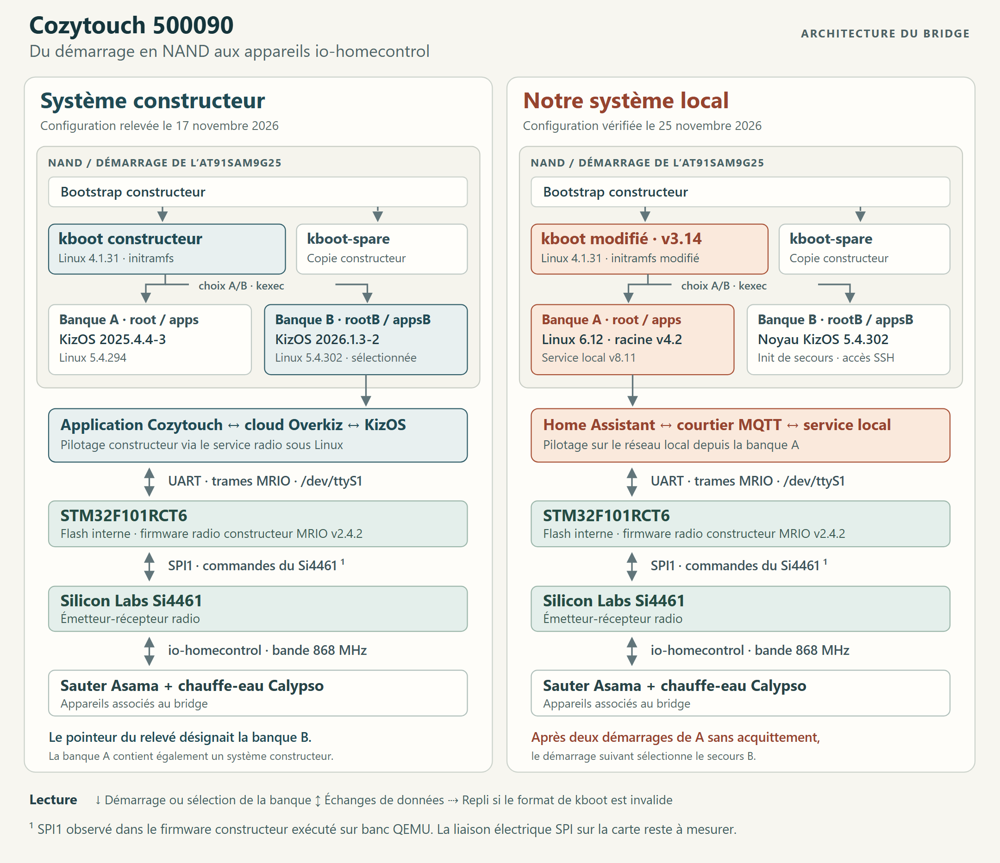

# Cozytouch local — projet indépendant

Ce projet montre comment Home Assistant peut lire et piloter deux appareils déjà associés à un bridge Atlantic 500090 (Overkiz Kizbox Mini) : un chauffe-eau Calypso et un sèche-serviettes Sauter Asama. Le service tourne sur le bridge et échange avec Home Assistant via MQTT sur le réseau local. [Lire l’article sur le pilotage et la récupération du bridge](guide/pilotage-et-recuperation.md)

## Du système constructeur au pilotage local

Le schéma se lit de haut en bas. Le processeur AT91SAM9G25 démarre depuis la mémoire NAND et sélectionne une banque Linux. Plus bas, on suit le trajet d’une commande entre Linux, le contrôleur radio et les appareils.

[Agrandir le schéma (PNG)](guide/illustrations/architecture-cozytouch.png) · [Ouvrir la source modifiable (SVG)](guide/illustrations/architecture-cozytouch.svg)

- **Démarrage.** Le chargeur kboot v3.14 conserve le noyau constructeur Linux 4.1.31. Après deux démarrages de A sans confirmation de santé, il sélectionne le secours B au démarrage suivant.
- **Banque A.** Linux 6.12 exécute le service local v8.11 sur la racine v4.2. Les essais ont confirmé le lancement des séchages de 30, 60 et 120 minutes par relecture radio et observation sur le sèche-serviettes. [Pilotage et mesures](guide/07-home-assistant.md)
- **Banque B.** Le secours utilise le noyau constructeur 5.4.302 et ouvre un accès SSH. Il a réécrit puis relu la racine A avant son redémarrage. La racine était saine au début de cet essai. [Trois essais de récupération](guide/10-secours-du-bridge.md)
- **Radio.** Linux dialogue par UART avec le STM32F101RCT6, qui conserve le firmware constructeur MRIO v2.4.2. Le STM32 pilote le Si4461 par SPI1. Le Si4461 communique avec les appareils en io-homecontrol sur la bande 868 MHz. L’usage de SPI1 a été observé avec le firmware d’origine sous QEMU. La mesure électrique sur la carte reste à faire. [Identification des composants](RECHERCHE-REVERSE-2026-11-17.md)

## Chronologie

- **6 avril 2026** · Première enquête documentaire. [Analyse historique](COZYTOUCH_ANALYSIS.md), en anglais
- **17 novembre 2026** · Acquisition et analyse NAND, analyse MRIO, lectures locales et essai de Linux en RAM. [Synthèse NAND](analyse-2026-11-17/SYNTHESE.md) · [Service local](analyse-2026-11-17/service-local/RESULTAT.md) · [Linux en RAM](analyse-2026-11-17/buildroot-ram/RESULTAT.md)
- **18 novembre 2026** · Préparation de la banque A et qualification sur banc QEMU. [Persistance banque A](analyse-2026-11-18/persistance-banque-a/RESULTAT.md) · [Sources et construction phase2](analyse-2026-11-18/persistance-banque-a/phase2/REPRODUIRE.md)
- **19 novembre 2026** · Essai de démarrage en banque A, diagnostic du démarrage radio, puis démarrage v4 autonome après débranchement. Premier essai dans le résultat local de démarrage en banque A · [Résultat v4](analyse-2026-11-19/ecriture-v4/PROCEDURE.md)
- **20 novembre 2026** · Mises à jour LAN pour attendre un courtier MQTT tardif, puis publier des mesures radio supplémentaires. [Premier déploiement](analyse-2026-11-20/maj-lan-1/PROCEDURE.md) · [Deuxième déploiement](analyse-2026-11-20/maj-lan-2/PROCEDURE.md) · [v3](analyse-2026-11-20/maj-lan-3/RAPPORT.md) · [v4](analyse-2026-11-20/maj-lan-4/RAPPORT.md) · [v5](analyse-2026-11-20/maj-lan-5/RAPPORT.md) · [v6](analyse-2026-11-20/maj-lan-6/RAPPORT.md)
- **23 et 25 novembre 2026** · Confirmation des trois durées de séchage et du redémarrage de A après sa réécriture depuis B. [Résultats et limites](guide/pilotage-et-recuperation.md)

## Suite

Les relevés laissent ouvertes l’échelle du V40, la comparaison simultanée de l’index PAC et l’interprétation du registre de consommation IC3. La [fiche Home Assistant](guide/07-home-assistant.md) détaille les mesures et leurs limites. [Périmètre de publication](PUBLICATION.md)

Le projet est indépendant et sans affiliation avec Atlantic, Overkiz ou Somfy. Le contenu est fourni sans garantie. Toute intervention se fait à vos risques.

[Guide](guide/README.md) · [Périmètre et marqueurs](PUBLICATION.md)

## Licence

- **Code** (Lua, Python, scripts shell, PowerShell et Tcl, sources C et assembleur, paquets `.ctapp`, fichiers Buildroot du projet) : [MIT](LICENSE).
- **Documentation** (fichiers Markdown) : [CC BY 4.0](LICENSE-DOCS.md).
- **Exceptions.** Les fichiers DTS et DTSI dérivés du noyau Linux restent sous GPL-2.0-or-later. Les fichiers `.config` de Linux, Buildroot et BusyBox sont des configurations de ces projets. Les courts extraits de firmwares Atlantic, Overkiz ou MRIO, cités à titre d’analyse, restent la propriété de leurs auteurs.
