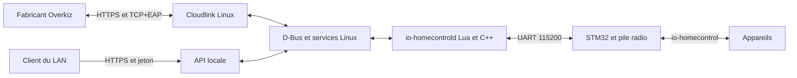

# Cozytouch — contenu de la NAND et accès locaux

Analyse du 17 novembre 2026, sur la sauvegarde du bridge Atlantic. **Le firmware est largement lisible et contient déjà SSH, une API locale et un mode développeur. La piste la plus prometteuse consiste à activer ces fonctions tout en conservant la pile radio et les appairages.** La procédure d'accès initial, la persistance et le fonctionnement sans cloud restent à tester sur le matériel.

Aucun firmware exécuté pendant cette analyse, aucune modification du bridge, aucun appel au fabricant et aucun ordre envoyé aux appareils. Les clés, certificats privés, jetons et identifiants individuels restent dans les artefacts privés. Les originaux de la sauvegarde ne sont pas modifiés.

## Architecture retrouvée



Chemins établis par le code et la configuration sauvegardés. Les ports ouverts, le trafic actuel et l'autonomie sans cloud ne sont pas mesurés. Le dernier lien radio n'a pas fait l'objet d'une capture. Rendu Mermaid non vérifié.

## Contenu et qualité de l'extraction

- 13 volumes : `dtb`, `dtb-spare`, `kboot`, `kboot-spare`, `security`, `security-spare`, `persistent`, `root`, `appsB`, `rootB`, `persistent-spare`, `data`, `apps`.
- Système Linux ARM, applications LuaJIT et bibliothèques natives. Organisation A/B ; le fichier de sélection sauvegardé désigne `ubi0:rootB`, associé à `appsB`.
- Banque B : **KizOS 2026.1.3-2**, noyau **5.4.302**. Banque A : KizOS 2025.4.4-3, noyau 5.4.294. Le choix sauvegardé ne remplace pas une observation du système actuellement exécuté.
- Extraction de référence : **2 597 fichiers réguliers et 918 liens symboliques**, avec archives POSIX et métadonnées conservées. Les liens ne sont pas tous matérialisés sous Windows.
- Moria a fourni une seconde extraction indépendante, déclarée partielle, et Mithril un inventaire de composants. Leurs compteurs ne sont pas directement comparables : le contrôle complémentaire retrouve les 2 574 chemins réguliers des six archives UBIFS corrigées dans Moria. Aucun verdict CVE n'a été produit.

**14 erreurs d'un bit** rendaient certains nœuds UBIFS invalides. Les copies dérivées sont corrigées ; les originaux restent intacts. Chaque correction est corroborée par le CRC UBIFS et par les parités BCH enregistrées dans l'OOB. Une localisation indépendante par syndrome BCH retrouve les 14 mêmes bits. Huit corrections rétablissent aussi le CRC du bloc UBI statique. L'agent a vérifié 1 123 secteurs supplémentaires ; ce contrôle BCH n'est pas exhaustif sur toute la NAND.

La vérification principale recalcule les deux SHA-256 des acquisitions, les différences exactes des volumes corrigés, les CRC et les 14 parités BCH. Elle contrôle aussi les offsets et empreintes des **4 052 occurrences de modules imbriqués**. Voir verification-principale.json (non publié) et [rapport d'extraction](extraction/RAPPORT-EXTRACTION-SYSTEME.md).

## Hub et appareils : résultat prioritaire

Le chemin Linux vers la carte radio est explicite : services et délégation D-Bus → `io-homecontrold` → code Lua/C++ → `FrameRouter` → `DaughterBoardConnection` → `/dev/io` → STM32.

L'interface série est configurée à **115200 bauds, 8 bits, sans parité**. Le format est :

```text
02 | header | command | longueur BE16 | payload | CRC8(payload) | 03
```

La longueur vaut `taille(payload) + 1`. Le CRC est CRC-8/SMBUS : polynôme `0x07`, initialisation 0, XOR final 0, aucune réflexion. Le parseur entrant refuse une longueur supérieure à 128. L'ordre des octets et les paramètres CRC ont été recoupés avec la décompilation native, pas déduits de l'architecture ARM.

Les tables de commandes décrivent la découverte, les informations d'actionneurs, les ordres de mouvement, les lectures et événements de capteurs, la révision et la gestion de pile. Elles contiennent les structures des réponses, adresses sur 24 bits, RSSI et autres champs. **Cette API série n'est pas le protocole radio complet sur les ondes.** La cryptographie et les échanges RF n'ont pas été intégralement reconstruits.

Le stockage IO contient deux entrées d'actionneurs, une entrée maître et une entrée de pile. Ces données et leurs informations d'appairage doivent être préservées. Le rapprochement des profils et des champs d'information avec les règles du firmware établit les deux familles suivantes :

| Appareil mémorisé | Famille sélectionnée dans le catalogue |
|---|---|
| Chauffage, profil 52/1, fabricant 12, sous-type 4 | **Sèche-serviettes Atlantic IC3** |
| Eau chaude, profil 51/0, fabricant 12, sous-type 9 | **Production d'eau chaude Atlantic V2 / CETHI V4** |

Pour le chauffe-eau, le catalogue déclare les lectures du mode, de la consigne, de la température intermédiaire, des durées boost/absence, des erreurs et consommations ; ainsi que `setDHWMode`, `setTargetTemperature`, `setBoostModeDuration` et `setAwayModeDuration`. Pour le sèche-serviettes, les profils thermostat et les états de température, occupation et consommation sont établis ; sa table de commandes exacte n'est pas encore résolue. La référence commerciale et l'acceptation actuelle des commandes restent inconnues.

Le script de rapprochement lit les tables Lua comme des données, sans exécution. Il a été relu et relancé lors de la vérification principale. Pour l'eau chaude, la règle précise 9 est sélectionnée avant la règle générique 1, conformément au premier `return` dans la boucle du firmware. Aucune adresse, clé ou valeur opaque n'est exposée. Voir PROFILS-DEUX-APPAREILS.md (non publié).

Autre résultat utile : **les images de mise à jour du STM32 sont présentes dans la NAND**, version MRIO v1 2.4.2 dans `appsB`, 2.4.1 dans `apps`. Ce sont des fichiers livrés par le fabricant, pas une lecture de la flash du STM32 ni une preuve de sa version installée.

Preuves, commandes, pseudocode et projet Ghidra : RADIO-ET-REA.md (non publié).

## Accès accessibles depuis le LAN : capacités livrées

| Fonction | Ce que contient l'image | Ce qui reste inconnu |
|---|---|---|
| SSH, TCP 22 | Dropbear 2020.81 ; authentification par clé, mots de passe désactivés | Écoute actuelle et accès initial |
| Activation SSH | Script conditionné par `/persistent/factory/enable-dropbear`, absent de la sauvegarde ; outils d'activation et gestion des clés livrés | Méthode matérielle retenue pour obtenir le premier accès |
| HTTPS 443 | lighttpd, API locale, certificat client obligatoire, scope `local` | Service effectivement lancé et client autorisé |
| HTTPS 8443 | Mode `developerMode`, scope `devmode`, authentification Bearer dans l'application | Activation actuelle, persistance et disponibilité sur ce modèle Atlantic |
| mDNS | `_kizbox._tcp` et `_kizboxdev._tcp` prévus | Annonces réellement diffusées |
| Telnet | Aucun serveur identifié ; présence d'un client BusyBox | Absence totale à l'exécution non démontrée |
| D-Bus | Interfaces locales de services, délégation et création de jetons | État réel ; aucune raison de les exposer sans protection sur le réseau |

Dans `rootB`, les clés SSH autorisées sont référencées sous `/persistent/factory/authorized_keys`. Un fichier existe déjà ; il ne contient pas pour autant une clé privée dont nous disposerions. Un mot de passe root verrouillé n'empêche pas le chemin SSH par clé prévu par ces scripts.

Le module interne `developerMode` demande les services `local` et `webserver` et leur transmet le port 8443. Les scripts, certificats web et clé correspondante sont présents. L'activation est donc prévue dans le logiciel livré. Aucun fichier drapeau simple pour ce mode, bouton public Atlantic ou méthode D-Bus d'activation arbitraire n'est établi. La couche de persistance `modules` reste à localiser précisément ; un message d'administration cloud peut réécrire sa liste. Voir ACTIVATION-NATIVE.md (non publié).

### API locale et jetons

Le préfixe est `/enduser-mobile-web/1/enduserAPI`. **29 routes littérales** ont été cataloguées, sans compter toutes les routes construites dynamiquement : API-LOCALE-ROUTES.md (non publié).

Les chemins utiles comprennent :

- `GET /setup` et `/setup/devices` : configuration et liste d'appareils.
- `GET /setup/devices/:deviceURL/states` : états.
- `POST /events/register`, puis `/events/:listenerId/fetch` : événements.
- `POST /exec/apply` : demandes d'exécution, avec actions et commandes.
- `GET /exec/current` et `/history` : suivi d'exécution et historique.

Les contrôles de scope restent applicables. Les lectures d'état, événements et exécutions étudiés acceptent `devmode`. Le rafraîchissement explicite `/setup/devices/states/refresh` est réservé au scope `local` dans le code étudié ; il ne faut pas lui attribuer les mêmes droits.

Le serveur contrôle `Authorization: Bearer …` avec le scope injecté par lighttpd. La méthode locale de création est déjà livrée :

```text
service   com.overkiz.utilities.local
objet     /com/overkiz/utilities/local/tokensService
interface com.overkiz.utilities.local.tokensService
méthode   createWithRandomKey(label:string, scope:string, duration:int32)
retour    token:string
```

Un accès administrateur local permettrait d'étudier ce chemin pour créer un jeton `devmode`. Aucun jeton n'a été créé. **Il n'est pas nécessaire de remplacer le contrôle d'autorisation par un retour toujours vrai**, contrairement à certaines anciennes pistes de rétro-ingénierie. L'exécution réelle et les prérequis de démarrage restent à valider.

Preuves de ce chemin : modules `enduserAPI.lua`, `tokens.lua`, `tokensServiceServer.lua`, `TokenScopes.lua`, indexés dans `lua/embedded-index.json`. Une affectation omise par LJD dans `authorizationHandler` a été vérifiée dans `lua/enduserAPI-appsB.asm`.

## Hub et fabricant

La connexion sauvegardée utilise **TCP+EAP**, avec amorçage HTTPS et certificat client. Aucun rôle MQTT n'est établi pour cette liaison.

| Usage | Destination configurée |
|---|---|
| Descripteur | HTTPS `ha-upgrade-overkiz-2048.overkiz.com/si.xconf` |
| Amorce | `ha110-overkiz-2048.overkiz.com:443/connection-listener/cl` |
| Canal persistant | Même hôte, TCP+EAP port **803** |
| Canal nommé bypass | Même hôte, port **18888**, HMAC-SHA1 et anti-rejeu |
| Journaux | HTTPS `/connection-listener/log` |
| Mises à jour | HTTPS `/images/at91-kizboxmini/` |

Cloudlink sérialise des objets JSON et échange avec les services via D-Bus, avec topics, durée de vie et urgence. Certificats, clé client et CA sont présents. Cela ne démontre pas leur acceptation actuelle ni le chiffrement intégral des canaux 803/18888. Aucun trafic n'a été capturé et aucun serveur n'a été interrogé.

Le fabricant peut déclencher des mises à jour des volumes inactifs puis changer la sélection de démarrage. Une personnalisation pourrait donc être remplacée. Voir [rapport Moria/Mithril et cloud](mori/RAPPORT.md).

## Peut-on modifier facilement ?

| Objectif | Évaluation actuelle |
|---|---|
| Lire et comprendre les fichiers | Oui, très largement ; quelques sorties de décompilation restent incomplètes |
| Obtenir un shell SSH | Fonction livrée, activation et clé à préparer ; accès initial non résolu par cette seule analyse |
| Utiliser une API LAN | Piste forte : composants, mode développeur et génération de jetons déjà présents |
| Commander les appareils sans réécrire la radio | Piste prioritaire : conserver STM32, pile native et appairages, utiliser les services Linux existants |
| Modifier/reconstruire root/apps | Plausible, mais procédure de reconstruction et démarrage à tester ; ne pas réinjecter une extraction comme image brute |
| Remplacer toute la pile radio | Travail nettement plus important ; protocole RF et cryptographie non intégralement reconstruits |
| Supprimer immédiatement toute dépendance cloud | Non démontré ; démarrage, persistance, états et pilotage sans Internet restent à tester |

Les scripts de cette variante déclarent `have_trusted=false`, `have_encryption=false`, `have_authentication=false`. Ils ne prouvent pas l'état des fusibles ni l'absence de toute vérification dans chaque étage de démarrage. Le téléchargement vérifie un MD5 via une connexion TLS avec certificat client ; le MD5 n'est pas une signature autonome. Aucun firmware modifié n'a été construit ou flashé.

**Suite proposée, non exécutée :** obtenir un accès administrateur réversible, vérifier l'état des services, démarrer l'API native avec un jeton dédié, puis tester d'abord la lecture des appareils et événements. Mesurer ensuite l'autonomie sans cloud avant toute modification durable. Préserver les volumes de données, les informations de sécurité et les deux banques de secours.

## Travail délégué et vérification

Trois agents ont travaillé séparément : extraction et intégrité ; REA et pile radio ; Moria/Mithril, cloud et activation interne. Les publications historiques leur ont été fournies comme hypothèses, puis confrontées à cette image. La coordination principale a décompilé le corpus Lua, reconstruit l'API, relu les conclusions et vérifié les empreintes, offsets et corrections.

- LuaJIT autonome : 851 bytecodes distincts, 831 décompilations réussies.
- Modules imbriqués, union des deux corpus : **3 944 distincts, 3 864 décompilations réussies**. Ces chiffres ne doivent pas être additionnés au premier sans dédoublonnage entre catégories.
- 61 désassemblages supplémentaires ont réussi pour des échecs de décompilation du premier corpus. Le dossier reste exploitable pour poursuivre sur les échecs.
- REA : inventaires ELF et huit enregistrements de preuve. Son adaptateur Ghidra Windows ne prend pas en charge ELF ARM ; Ghidra autonome a réalisé les décompilations ARM ciblées. Provenances distinctes conservées.
- Moria 0.3.0 et Mithril 0.4.0 réellement construits et exécutés sur le HP. Un diagnostic erroné de clé RSA sur des paramètres Diffie-Hellman a été écarté. Aucune base CVE chargée.

Une décompilation réussie n'est pas le code source original et ne garantit pas sa recompilation ni une sémantique parfaite. Les propriétés importantes ont été recoupées avec bytecode, configuration ou code natif. Les archives POSIX restent la référence pour liens, droits et fichiers non matérialisés sous Windows.

## Sources et reprise

- Missions et sources publiques fournies aux agents (non publié).
- [Lafois, Cozytouch, partie 5](https://www.lafois.com/2020/12/20/rooting-the-cozytouch-aka-kizbox-mini-part-5/) : précédent pour LuaJIT, D-Bus et API locale ; version ancienne distincte.
- [Maasland, Connexoon](https://blog.unauthorizedaccess.nl/2021/04/07/no-clouds-just-sunshine.html) : appareil voisin et piste 8443 ; pas une preuve pour ce bridge.
- [Moria](https://github.com/nmatt0/moria), [Mithril](https://github.com/nmatt0/mithril), [LJD](https://github.com/Aussiemon/ljd).

Les rapports des trois pistes contiennent les versions, scripts, hashes, résultats et limites. Le dossier entier est privé ; conserver l'image d'origine, ses OOB, les archives, les corrections dérivées, les outils et les preuves. Aucune suppression ni publication n'est proposée.

> Les empreintes historiques des fichiers expurgés se rapportent aux originaux privés.
