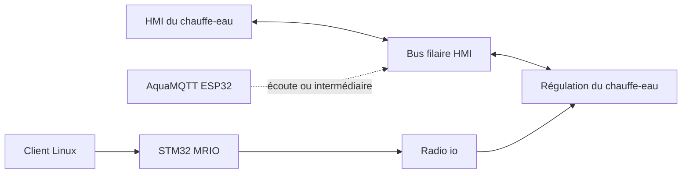

# AquaMQTT, nouvelles données et difficulté des cinq voies

Analyse du 17 novembre 2026. Sources locales et code public uniquement. Aucun accès au bridge ou au chauffe-eau, aucune émission, aucun branchement, aucune modification de réglage. Les essais matériels éventuels relèvent du coordinateur.

**AquaMQTT aide à identifier des données intéressantes, mais ne fournit pas la traduction de ses commandes filaires en commandes radio io-homecontrol.** Trois sondes supplémentaires ont une définition native READ précise : air entrant, évaporateur bas et évaporateur haut. Leur prise en charge par le Calypso CETHI V4 de <PERSONNE> reste inconnue. Aucune nouvelle commande RF prête à transmettre n'est établie par cette comparaison.

Le Calypso 250 L 286041/CV4 est l'identité historique corroborée par le PKM et une nomenclature Atlantic. Sa plaque et son bus actuel ne sont pas vérifiés. La liste AquaMQTT mentionne notamment Calypso VR et Calypso Split Inverter 270 L ; elle ne prouve pas la compatibilité du 286041/CV4.

## Deux protocoles distincts

Les liens HMI/régulation décrivent l'architecture AquaMQTT publiée, pas un branchement vérifié chez <PERSONNE>. Le chemin MRIO a déjà produit des lectures natives sur cette installation, selon les preuves du coordinateur. Le lien interne radio/régulation est fonctionnel dans le schéma ; son transport électrique exact n'est pas identifié ici. Source Mermaid modifiable, rendu non vérifié.

Le bus publié utilise une liaison série monofilaire semi-duplex, généralement 9600 bauds, avec variantes du format série et de la somme de contrôle. Les identifiants 193/194/67/74 sont des **types de messages filaires**, pas des indices de registre RF. Le code épinglé distingue LEGACY, NEXT et ODYSSEE. Les valeurs ci-dessous décrivent **LEGACY seulement**.

Dans les tables et le code AquaMQTT, `mData[0]` est la longueur. L'identifiant du message précède ce tableau. « 193[3:5] » signifie les octets d'indice 3 et 4 du tableau de ce message. Une sonde en dixièmes et little-endian sur le bus ne prouve pas le même ordre d'octets en RF.

## Matrice des fonctions utiles

| Fonction AquaMQTT | Format LEGACY publié/implémenté | Correspondance native ou RF voisine | Écart et nouveauté réelle |
|---|---|---|---|
| Température eau | 193[1:3], entier LE /10 | `0x0c001701` SondeEauChaude1, READ dans CETHI604 ; Calypso public RF0017 utilise i16BE/10 | Déjà connue, pas une nouvelle commande. La conversion RF ne vient pas du bus. |
| Air entrant | 193[3:5], LE /10 | `0x0c001a01` =201333249 SondeAirEntrant, définition READ | Candidate nouvelle donnée ; absente du bloc604, enregistrement natif et réponse de l'appareil non prouvés. |
| Évaporateur bas | 193[5:7], LE /10 | `0x0c001b01` =201333505 SondeEvaporateurBas, READ | Même limite. Aucune sonde ne doit être assimilée à la température ambiante du logement. |
| Évaporateur haut | 193[7:9], LE /10 | `0x0c001c01` =201333761 SondeEvaporateurHaut, READ | Même limite. Il s'agit d'un candidat nommé, pas d'un indice obtenu par balayage. |
| Température refoulement compresseur | Aucun champ LEGACY principal identifié ; le getter d'erreur annonce un attribut mais retourne0 | `0x0c001d01` =201334017 SondeRefoulementCompresseur, READ hors604 | Définition native supplémentaire, **pas** une donnée LEGACY démontrée par AquaMQTT. Non retenue pour un test issu de cette comparaison. |
| Activité appoint/PAC/ventilo/dégivrage | 193[17], masques01/02/08/20 ; chaudière04 | RF voisin Calypso0021 ; absent604 | Nouvelle visibilité possible. Aucun alias entre193[17] et RF0021 démontré. |
| Vitesse ventilateur | 193[18:20], u16LE /10 dans le code | Aucun paramètre RF exact qualifié | Unité physique non établie ; la documentation évoque des rpm avec réserve. Ne pas publier comme rpm. |
| Puissance PAC et appoint | 67[1:3] et[3:5], u16LE ; total[7:9] | `0x0c003401` PowerHeatPump et `0x0c003301` PowerHeatElec, READ dans604 | États natifs déjà disponibles ; égalité des unités et de la sémantique à vérifier. Pas de nouvelle commande. |
| Durées PAC/appoint/ensemble | 67[11:15], [15:19], [19:23], u32LE | `0x0c000301` DureeFonctionnementPacEtElec, READ dans604 | Concept déjà natif. Le découpage/échelle native ne sont pas déduits du bus. |
| Énergie cumulée | 67[23:31], u64LE, Wh dans la documentation | Calypso RF voisin0004, u32BE ; absent604 ; NrjFan002b présent mais autre nom | Différence de largeur et d'objet. Ne pas substituer NrjFan à l'énergie totale. Pas d'alias RF prouvé. |
| Eau produite | 67[9:11], u16LE, litres selon documentation | QuantiteEauChaude0001 et V40ConsumEst0031 sont dans604 | Ni production cumulée, stock disponible et estimation V40 consommée ne sont interchangeables. |
| Défaut courant | 193[23], 255 converti en0 par AquaMQTT | `0x0c000201` Erreurs, READ dans604 | Capacité native déjà connue. Conversion des codes natifs non établie par AquaMQTT. |
| Historique des erreurs et contexte | Réponse74 : identifiant[1], code[2], sondes[4:12], date[29:31], heure[31:33] | Aucun paramètre radio d'historique précis identifié | Potentiellement nouveau en filaire ; pas de commande RF déduite. La documentation et le code divergent sur les indices de requête ; code HMI[28]/[29]. |
| Capacité, marque, version | 193[33:35] u16LE, [35] ASCII marque, [28] lettre version | Capacité0008, marque0007 et NumeroSoft0040 dans604 | Déjà connus comme fonctions ; lettre du contrôleur HMI et chaîne logicielle radio peuvent différer. |
| Mode, consigne, boost, absence | Champs HMI194, dont cible[1:3] et mode[3] | Mode0006, principal65537, durées0000/0005 ; RF voisin FP15/FP16 | Fonctions déjà connues. Les bits HMI ne remplacent pas les mots FP16 radio. Aucun nouvel ordre de chauffe proposé. |
| Anti-légionellose, extraction, installation, PV | Champs HMI194 et états193, y compris[20]/[21]/[22]/[36] | AntiLegionnelle000c, Extraction0013, Installation0010 et SmartGrid0012 dans604 | Noms proches, parité non prouvée. Les commandes de configuration constructeur ne deviennent pas des essais READ. |

« Dans604 » désigne le composant exact CETHI V4 de `offline-next/radio-memory/cethi-component-604.txt`. Une absence dans ce catalogue ne prouve pas un refus RF. Une définition READ ailleurs dans le logiciel ne prouve pas l'enregistrement de ce paramètre pour l'appareil présent.

## Ce qui peut être préparé comme lecture

Le fichier `candidats-read.json` conserve trois candidats nommés001a/001b/001c avec leur preuve Lua. Il n'active aucune transmission et ne contient aucun identifiant d'appareil, clé ou requête exécutable. **L'étape de qualification manquante est la route native enregistrée et la structure de réponse, avant tout nouvel essai.**

Le natif inspecté contient deux encodeurs différents : `Atlantic::Parameter::Generic::create` et `GenericV2::create`. Ils traitent différemment l'accès et l'indice. `ParameterManager::getParameter` exige un identifiant enregistré. Aucun lien exact entre001a/001b/001c et un de ces objets n'est prouvé dans l'export existant. Le terme `AtlanticQueryFP` n'a pas été retrouvé dans les exports C ciblés, les rapports ni les bibliothèques natives extraites examinées par recherche de chaîne. Cette absence ne suffit pas à démontrer qu'aucune route de ce type existe ailleurs.

Pour une future qualification : rechercher l'enregistrement de chacun des trois identifiants exacts ; établir son encodage et son décodage ; réutiliser le client natif READ qui termine correctement, une requête à la fois ; vérifier terminaison, absence d'erreur et mise à jour d'état. Le coordinateur décide et documente toute étape matérielle autorisée. Aucun balayage des registres, numéros d'erreur ou codes de service n'est préparé.

L'écoute filaire AquaMQTT peut lire les trames spontanées193/67 et celles de l'HMI sans modifier les données. L'historique74 n'est émis que lorsqu'une requête HMI le demande. Son observation passive dépend donc de l'activité réelle de l'HMI. Dans le code épinglé, les setters `HMI_ERROR_NO_REQUESTED` et `HMI_ERROR_ID_REQUESTED` sont encore des TODO ; le mode écoute ne fabrique aucune requête d'historique.

## Difficulté relative des cinq solutions

La difficulté logicielle et l'intervention matérielle doivent être séparées. Les niveaux portent sur cette installation et ses preuves actuelles ; ils ne sont pas des délais.

| Solution | Difficulté relative | Travail principal et incertitude | Portée |
|---|---|---|---|
| Service Linux autonome + STM32/MRIO conservé | **La plus favorable pour les deux appareils** ; développement modéré | Construire le service, sa reprise et les lectures/écritures utiles ; conserver la gestion native radio et les clés. Les lectures du coordinateur étayent déjà cette chaîne. L'autonomie durable et le redémarrage restent à démontrer. | ASAMA + Calypso ; matériel bridge conservé |
| ESPHome host sur Linux + adaptateur MRIO | **Supérieure au service natif** pour réemploi du bridge | Même protocole MRIO à intégrer, plus plateformeESPHome host, compilation ARMv5, libc et interfaces disponibles. Home IO Control ne parle pas MRIO. | Potentiellement les deux ; portage non validé |
| Remplacer l'OS Linux du bridge | **La plus élevée pour réemployer la carte entière** | Démarrage, noyau, pilotes, NAND/ECC/UBI, contraintes ARMv5, services et reprise des appairages ; restauration matérielle non testée. Ne résout pas à lui seul les codecs d'appareil. | Potentiellement les deux ; dépendance matérielle forte |
| ESP32 + radio supportée + Home IO Control | **Projet existant, intégration substantielle** | Firmware et radio supportés existent ; matériel à choisir, clés et identité à qualifier, profil ASAMA distinct à compléter, CETHI250L exact à vérifier. Évite le portage de l'OS du bridge. | Potentiellement les deux, sans bridge ; pas encore démontré ici |
| AquaMQTT filaire | **Logiciel prêt pour appareils supportés ; intervention matérielle importante ici** | Identifier connecteur, niveaux et protocole du286041/CV4 ; commencer par écoute. Le passage en intermédiaire ajoute l'intégrité des échanges HMI. Compatibilité exacte inconnue. | **Calypso seulement** ; aucune solution ASAMA dans AquaMQTT |

Ordre utile pour le projet commun : service natif/MRIO d'abord ; ESPHome host seulement si son intégration justifie le portage ; ESP32/radio comme voie de remplacement indépendante ; OS complet en dernier. AquaMQTT est une branche parallèle ciblée sur le chauffe-eau, particulièrement intéressante pour les diagnostics supplémentaires. Il n'existe pas de rang unique honnête entre son intervention filaire et le développement radio ESP32.

## Sources épinglées et limites

- AquaMQTT : commit [`814fd16e45a5f9190c2f0c0c69188f7773d8181b`](https://github.com/tspopp/AquaMQTT/tree/814fd16e45a5f9190c2f0c0c69188f7773d8181b). [Protocole LEGACY](https://github.com/tspopp/AquaMQTT/blob/814fd16e45a5f9190c2f0c0c69188f7773d8181b/PROTOCOL.md), [appareils testés](https://github.com/tspopp/AquaMQTT/blob/814fd16e45a5f9190c2f0c0c69188f7773d8181b/DEVICES.md).
- Sources C++ : [MainStatusMessage](https://github.com/tspopp/AquaMQTT/blob/814fd16e45a5f9190c2f0c0c69188f7773d8181b/AquaMQTT/lib/AtlanticSerialProtocol/src/message/legacy/MainStatusMessage.cpp), [MainEnergyMessage](https://github.com/tspopp/AquaMQTT/blob/814fd16e45a5f9190c2f0c0c69188f7773d8181b/AquaMQTT/lib/AtlanticSerialProtocol/src/message/legacy/MainEnergyMessage.cpp), [HMIMessage](https://github.com/tspopp/AquaMQTT/blob/814fd16e45a5f9190c2f0c0c69188f7773d8181b/AquaMQTT/lib/AtlanticSerialProtocol/src/message/legacy/HMIMessage.cpp), [ErrorMessage](https://github.com/tspopp/AquaMQTT/blob/814fd16e45a5f9190c2f0c0c69188f7773d8181b/AquaMQTT/lib/AtlanticSerialProtocol/src/message/legacy/ErrorMessage.cpp).
- [Modes écoute/intermédiaire](https://github.com/tspopp/AquaMQTT/blob/814fd16e45a5f9190c2f0c0c69188f7773d8181b/AquaMQTT/include/config/Modes.h), [ListenerTask](https://github.com/tspopp/AquaMQTT/blob/814fd16e45a5f9190c2f0c0c69188f7773d8181b/AquaMQTT/src/task/ListenerTask.cpp).
- Home IO Control : [`09445153ef18f23f1dd80595c5e082ccd034efc6`, proto_dhw.h](https://github.com/laberning/home_io_control/blob/09445153ef18f23f1dd80595c5e082ccd034efc6/components/home_io_control/proto_dhw.h). Limites ASAMA/CETHI et plateformes détaillées dans `../../continuation-radio/esphome/RESULTAT.md`.
- Références natives locales : `../../offline-next/radio-memory/cethi-parameter-modules.json`, `../../offline-next/radio-memory/cethi-component-604.txt`, `../../live-interface/offline-stm32/atlantic-private.c`, `../../live-interface/offline-stm32/LECTURES-APPAREILS.md`. Les fichiers exacts de chaque candidat sont dans le JSON.

Écarts source à conserver : la documentation LEGACY place le drapeau anti-chauffe-à-sec désactivé en193[36]bit4, inversé ; le C++ lit directementbit5 pour `CAPABILITY_HAS_ANTI_DRY_HEATING`. La prose de la requête d'erreur indique27/28 alors que sa table et son code indiquent28/29. Les sources ne sont donc pas interchangeables sans capture du modèle exact. Aucun octet incertain n'est proposé comme ordre.

Quinze fichiers C++ publics, l'arbre Git épinglé et les documents déjà présents sont conservés ou référencés. `source-receipts.json` et `MANIFEST-SHA256.json` permettent la reprise et le contrôle. Aucun secret ni lien d'achat n'est inclus.

> Les empreintes historiques des fichiers expurgés se rapportent aux originaux privés.
