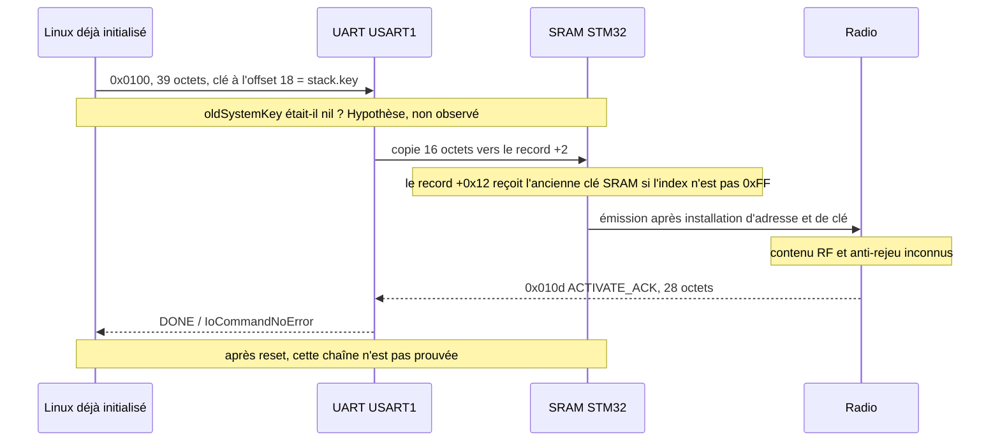

Je limite la lecture à ce dossier, en lecture seule, et je commence par en dresser l’inventaire avant toute analyse du dialogue de clés.Les rapports de capture et le schéma de formes sont lus. J’examine maintenant les chemins de clés dans le Lua, le Thumb et le C focalisé.Je suis Grok 4.7, lancé dans cette session Cursor CLI. Lecture limitée aux 18 fichiers de ce dossier. Aucun binaire n’a été décompilé de nouveau, la radio n’a pas été observée, le corps C++ de `getCurrentSystemKey` n’est pas dans le corpus, et la persistance dans les actionneurs n’est pas établie.

## Verdict

**Reprise à chaud.** Avec un STM32 et un daemon déjà initialisés, les deux lectures observées sont un `0x0100` de 39 octets dont les 16 octets à l’offset 18 égalent l’enregistrement `stack1.key`, puis un `0x010d` de 28 octets, CRC valides, terminés par `DONE` / `IoCommandNoError` pour les libellés `cethi` et `ic3`. Cette égalité vaut pour cette commande, dans cette session conservée. Elle ne dit pas que toute opération UART emporte `stack.key`.

**Démarrage à froid.** Il n’est pas démontré. Aucune séquence sans WAN, aucun reset, aucun autre client et aucune réassociation ne figurent dans les captures. Les clés runtime sont en SRAM. Le dump Flash ne les établit pas. Un client autonome qui ne ferait que rejouer ces deux trames après un reset du STM32 n’a pas de preuve de succès.

Les profils IC3 52/1 et CETHI 51/0 sont ceux annoncés par `MISSION.txt`. Ils ne sont pas recoupés par les sources de ce dossier. Le paramètre D-Bus `65537` est, lui, dans la capture.

## Table des clés

| Nom | Où c’est résolu | Taille | Statut |
|---|---|---|---|
| `stack.key` | Enregistrement Linux `stack` record 1, base64 | 16 octets, différent de `stack.oldKey` et des deux `actuator.key` | Forme vérifiée. Égalité UART observée sur les deux `0x0100` |
| `stack.oldKey` | Même enregistrement | 16 octets, ≠ `stack.key` | Forme seule. Aucune trame de ce dossier ne le transporte |
| `actuator.key` | Deux enregistrements `actuator` | 16 octets chacun, ≠ `stack.key` | Le cadre `_getGeneralInformationBaseFrame` ne lit pas ce champ. L’inégalité des captures est cohérente, limitée à ces deux lectures |
| `node.oldSystemKey` | Champ optionnel de nœud, base64 | Chaîne optionnelle | Le bytecode l’utilise s’il est vrai. `createNode` le calcule par une comparaison dont le second opérande, `slot10`, n’est pas identifiable dans le Lua décompilé |
| `stackMaster.key` | `getStackMaster().key` | Celui du maître de pile | Repli du cadre général si `oldSystemKey` est faux. Le commentaire du désassembleur qui l’affiche aux deux écritures suivantes est excessif |
| `ioSystemKey` | Champ de trame, 16 octets | Emplacement, pas une clé propre | Discover : retour C++. Cadre actionneur : `oldSystemKey` ou `stackMaster.key`. Trame 1W : retour d’un upvalue appelé avec `16` |
| Clé effective C++ | `CommandManager.getCurrentSystemKey` délègue à `cppCommandManager` | Inconnue | Corps absent. Utilisée telle quelle par `startDiscover`, et seulement comparée à `stackMaster.key` par `changeKey` et `createNode` |
| SRAM `+2` / `+0x12` | Records de `0x22` octets, base `0x20005e8c` | 16 + 16, octet d’état en `+1` | Vérifié statiquement. Ce ne sont pas les noms Linux. `+2` est la clé que le code radio relit via `FUN_0800aaa4` |
| 16 octets Flash de `FUN_0802b860` | Copie au démarrage selon des sentinelles | 16 octets | Présence vérifiée. Nature inconnue : rien n’identifie ces octets comme `stack.key` |
| Enregistrement `master` | Schéma Linux | Aucun champ clé | Vérifié : `key_field_shapes` vide |

## Séquence, incertitudes comprises

## 1. Cartographie

Le cadre commun des commandes actionneur est `_getGeneralInformationBaseFrame` (`CommandTracker.asm.txt` 1784-1955). Le bytecode fait ceci : si `slot1.oldSystemKey` est vrai, il le conserve ; sinon il charge `getStackMaster().key`. Les deux branches suivantes, maître ou autre nœud, écrivent ce même registre dans `ioSystemKey`. Le commentaire « `ioSystemKey = getStackMaster.key` » aux lignes 1878 et 1955 décrit le dernier chargement, pas le registre quand le saut a été pris.

`ACTIVATE_STATUS_REQUEST` passe par ce cadre, puis remplace l’identifiant par `ACTUATOR_MANAGEMENT__MOVEMENT_ORDER` (lignes 1030-1042). Les deux lectures observées sont donc des `0x0100` construits comme des informations générales. Leur clé égale `stack.key`. Cela colle au repli « `oldSystemKey` absent ». Cela collerait aussi si `oldSystemKey` contenait déjà les mêmes octets. Le schéma ne compare pas `node.oldSystemKey` à `stack.key`.

Trois autres choix sont résolus, et ils divergent :

- `startDiscover` (`CommandTracker.asm.txt` 291-319) met dans `ioSystemKey` le retour direct de `getCurrentSystemKey(stackMaster)`, sans comparaison.
- `changeKey` (`TransportNode.lua` 65-74) ne transmet qu’un booléen : vrai quand la clé C++ diffère de `stackMaster.key`. La clé écrite est l’argument base64 reçu, pas ce retour.
- `_send1W` (`CommandTracker.asm.txt` 1458-1462) appelle un upvalue avec l’entier 16 et range le résultat dans `ioSystemKey`. Ce n’est pas `stack.key`.

`createNode` (`AbstractDiscoverActuatorUseCase.lua` 183) veut `oldSystemKey = getCurrentSystemKey(maître) ~= maître.key and slot10 or nil`. `slot10` n’est assigné nulle part dans la fonction visible. Les registres `slot3`, `slot5`, `slot6` et `slot7` sont dans le même état. La décompilation est incomplète. On sait seulement que les auteurs prévoyaient un écart entre la clé C++ et `stack.key`. On ne sait pas quel octet est alors archivé.

`transfertKey` (`CommandTracker.asm.txt` 364-370) envoie le sous-commande `PAIRED` = 6 (`GeneralInformationSubCommand.lua` 34) dans le même cadre. Le transfert n’est pas un second champ de 16 octets.

## 2. Sérialisation et registre r1

Pour `0x0100` et `0x0101`, l’addition des champs de `FrameDefinition.lua` 219-333, en gardant la seconde affectation `name` (la première à `nil` est un artefact), donne : adresse source 3, cible 3, protocole 1, type 2, backbone 3, fabricant 1, multi-info 1, horodatage ignoré 2, info 1, canaux 1, clé 16 à l’offset 18, sous-commande à l’offset 34. Le firmware copie la clé depuis `param_1 + 0x12` et la sous-commande depuis `param_1 + 0x22` (`stm32-focused.c` 1388 et 1444). Les deux captures confirment l’offset 18 et 39 octets. Le champ `IGNORE` de 2 octets est donc bien émis. Un codec qui le sauterait décalerait la clé à 16.

Le handler `0x0100` remappe ensuite l’octet 34 : 0 reste 0, 1 (`ACTIVATE_STATUS_REQUEST`) devient 3, 2 devient 1, toute autre valeur abandonne (`stm32-focused.c` 1451-1463). L’énumération Lua ne définit que 0 et 1. Envoyer 3 sur l’UART n’est pas l’opcode interne 3.

`0x0200` copie 16 octets depuis l’offset 6 (`stm32-focused.c` 1872), conforme au schéma Lua 525-568. Le discover Lua vise l’adresse cible 59 (`CommandTracker.asm.txt` 315). Ailleurs, le schéma teste l’adresse 63 (`FrameDefinition.lua` 522). Ces deux constantes restent distinctes.

L’offset 24 annoncé pour `0x0300`/`0x0301`/`0x0302` vient du `memcpy` à `param_1 + 0x18` (`stm32-focused.c` 1822). Aucune définition Lua correspondante n’est dans `FrameDefinition.lua`. L’offset firmware est vérifié ; le schéma hôte de ces trois commandes est absent de ce dossier.

Les prototypes Ghidra perdent `r1`. `FUN_0800d084` avec `r2 != 0` charge l’octet de session, puis appelle `0x0801cd14` sans réécrire `r1` (`stm32-key-path-thumb.txt` 15-16). `FUN_0801cd14` charge un index à `+0x12` et appelle `0x0800a9cc` en laissant `r1` intact (lignes 29-33). `FUN_0800a9cc` copie 16 octets depuis ce `r1` vers `base + index * 0x22 + 2` (`stm32-focused.c` 771). Le C décompilé appelle `FUN_0800a9cc()` sans argument (`stm32-focused.c` 1258). Le chemin `r2 == 0` fait la même chose vers `+0x12` via `FUN_0800aab8`. Après le premier appel, le Thumb force `r1 = 0x2a` avant `FUN_0800e1e0` : 42 n’est pas la clé, et `FUN_0800e1e0` n’est pas dans le C fourni.

`FUN_08021ec0` et `FUN_08021f24` appellent `FUN_08021d98()` sans argument visible, alors que le callee lit `param_1`. Le pointeur de trame était déjà dans `r0`. Même classe d’omission pour `FUN_0800d0c0` et `FUN_0800414c`, typés `void` alors que `FUN_08022c7c` consomme leur retour : 3 octets d’adresse ou 16 octets de clé (`stm32-focused.c` 1992-2009). `FUN_0801ccf8` retourne explicitement le pointeur `+2`, ou 0 si l’octet d’indirection vaut `0xFF`.

Chaîne SRAM, bases littérales seulement : index maître à `+0x438`, record de session `0x20005eec` au pas `0x40`, octet `+0x20`, table `0x200028bc` au pas `0x18`, puis record clé `0x20005e8c` au pas `0x22`. L’état `+1` passe de 1 à 2 lors de l’écriture en `+2`, et de 2 à 3 lors de l’écriture en `+0x12`. L’ordre d’appel écrit d’abord `+0x12`, puis `+2`. Depuis l’état 1, la première écriture ne fait donc pas avancer l’état. La copie a lieu quand même. L’octet d’état n’est pas un verrou.

Le trameur est vérifié dans `FUN_08023274` et `FUN_08023354` : `STX=0x02`, longueur 16 bits gros-boutiste égale à la charge utile plus un, CRC-8 sur la charge utile seule, `ETX=0x03`. Le polynôme `0x07` est celui de la matrice, pas recalculé depuis la table. Le validateur est appelé depuis `0x08022f54`, fonction absente du C focalisé : le lien « toute commande passe par ce contrôle » est donc un cran au-delà des corps fournis. Plafond STM32 : charge utile 762 octets. Le plafond Lua 128 est dans la matrice, pas retrouvé dans les sources de ce dossier. Aucun identifiant de transaction n’est contrôlé dans le handler `0x0100`.

## 3. Persistance et initialisation

`FUN_08003aa0` appelle `FUN_0802b860`, qui programme 16 octets en Flash selon des sentinelles de 4 octets, puis les recopie (`stm32-focused.c` 168 et 2843-2874). Le vocabulaire de cette fonction ne nomme pas une clé système. Ensuite le firmware émet, dans cet ordre d’appels, `0x0403`, `0x0517` sur 16 octets, puis `0x050e` sur 1 octet (`stm32-focused.c` 214-232). `FUN_08021d2c` peut différer l’émission. L’ordre sur le fil reste inobservé. `FUN_08003280` ajoute d’autres notifications `0x0401`. Ce n’est pas un script de démarrage complet.

`0x0502` sait écrire ou relire l’adresse maître et la clé de 16 octets (`stm32-focused.c` 1984-2010). Zéro signifie écriture, toute autre valeur de l’octet d’accès signifie lecture. Aucune capture ne montre cet échange. `0x0503` n’accepte que les octets 2 et 3.

Au reset, la SRAM `0x20005e8c` et `0x200028bc` ne conserve pas les clés. `FUN_0800a8d8` et `FUN_0800a960` les remettent à zéro dans des chemins précis, pas à chaque boot de façon visible ici. Qui pose l’octet `0xFF` après un reset n’est pas établi : le BSS à zéro ne vaut pas `0xFF`, et le test d’abandon en dépend. Séparer donc une reprise à chaud, session et index déjà alloués, d’un démarrage à froid, où l’hôte doit fournir adresse et clé par `0x0502` ou par le prochain `0x0100`, dans un ordre encore non prouvé.

## 4. Authentification

La clé des 16 octets sur l’UART est la clé que le STM32 installe pour la suite radio. La clé d’appairage, au sens du sous-commande `PAIRED`, est une demande : le cas 6 du handler `0x0101` prépare un contexte et appelle `FUN_0800d028` (`stm32-focused.c` 1561-1575). `FETCH_KEY` = 9 appelle `FUN_0800d034`. Le schéma d’acquittement `LISTENER__KEY_TRANSFERT_ACK` (`0x040d`) existe. Son producteur direct est `0x08021704`. Le déroulement n’est pas dans les deux lectures.

Côté 1W, `FrameDefinition.lua` 161-180 place un numéro de séquence sur 2 octets et un MAC sur 6 octets. `FUN_08009d10` remplit un tampon de 6 octets. `FUN_0801a62c` étend 3 octets d’adresse sur 16. `FUN_0801a7e8` charge deux blocs de 16 octets et enchaîne dix tours de fonctions de tour absentes du C focalisé. `FUN_0801a844` n’en recopie au plus que 6. `FUN_08022a5c` compare ces 6 octets et, en cas d’écart, incrémente un octet puis recommence une fois. La forme est compatible avec un bloc de 16 octets et un MAC tronqué à 6. L’algorithme exact et la règle d’acceptation d’un rejeu restent inconnus. Le handler `0x0100` montré n’effectue aucun contrôle de séquence avant d’installer la clé.

Pour les lectures déjà observées, le STM32 suffit : l’hôte transporte la clé en clair sur l’UART, et le calcul du MAC reste dans le firmware. Cela cesse d’être vrai si le client veut vérifier lui-même un MAC, régénérer une session 2W, ou interpréter un refus radio. La machine d’état 2W est listée comme inconnue par la matrice.

## 5. Risques pour un client autonome

Le blocage réellement lié aux clés est plus étroit que la session. Pour un `0x0100` de demande d’état, la clé à placer est celle du cadre : `oldSystemKey` du nœud s’il est présent, sinon `stackMaster.key`. Les deux captures correspondent au second terme. Découvrir, changer de clé, envoyer une trame 1W ou lire un actionneur par un autre chemin ne réutilisent pas cette règle. Prendre `actuator.key` ou `stack.oldKey` contredirait à la fois le schéma et ces captures.

Le blocage principal est l’initialisation. Les lectures ont réussi parce que l’index maître, l’adresse et la session radio existaient déjà. Un `0x010d` n’est pas produit par `FUN_08021ec0` ; son producteur direct est `0x08021704`. Corréler deux `0x0100` simultanés est impossible avec les octets de trame seuls. La commande reste classée active : elle réécrit la clé SRAM et arme une émission, même quand Linux l’appelle `READ`.

Hors ligne, aujourd’hui, on peut coder et tester le codec `0x0100` avec l’horodatage de 2 octets, la clé à 18, la sous-commande à 34, le CRC sur la charge utile, et le choix Lua `oldSystemKey` ou `stack.key`. On peut aussi tester le remappage 1 vers 3. On ne peut pas comparer les octets aux archives : elles n’exportent ni clé, ni adresse, ni charge utile. On ne peut pas valider un reset, un `0x0502`, un discover, une trame 1W ni un rejeu.

Observations futures minimales, sans modification d’appareil et sans reset provoqué : l’ordre réel des premières notifications après un démarrage déjà survenu ; la présence ou l’absence d’un `0x0502` avant le premier `0x010d` ; une trame dont le nœud a un `oldSystemKey` non vide, pour voir quels 16 octets partent ; une trame `0x0200`, pour comparer sa clé à `stack.key`. Le corps C++ reste le trou qui empêche de figer la politique générale.