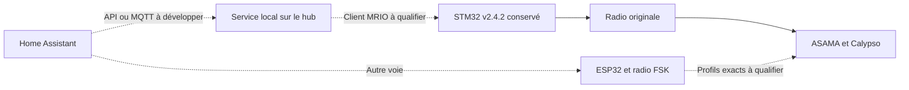

# Cozytouch : radio réelle, ESPHome et remplacement du système

État vérifié le **17 novembre 2026, 20 h 54 CET**. Trois analyses déléguées ont été relues et recoupées avec deux nouvelles lectures d'état sur le hub. **La voie la mieux étayée consiste à conserver le STM32 et sa radio, puis à développer un service local sur le processeur Linux.** Un ESP32 et une radio indépendante restent une seconde voie. Aucun de ces remplacements n'est encore déployé.

## Résultats qui changent la décision

| Sujet | Résultat vérifié | Limite ou travail restant |
|---|---|---|
| Dump STM32 réel | Deux images de 256 Kio identiques. Bootloader et application v2.4.2 identiques au code distribué ; seulement 48 octets personnalisés diffèrent. | La Flash ne contient pas la SRAM courante ni les firmwares des appareils. |
| Frontière Linux–STM32 | 24 commandes UART et 52 callbacks recensés. Le STM32 gère la radio et l'authentification ; Linux fournit notamment le contexte des requêtes. | Initialisation d'un client autonome, délais, corrélation et événements à implémenter. |
| Preuve dynamique | Deux READ CETHI/IC3 terminent DONE/IoCommandNoError. Quatre trames à CRC valide ; la clé transmise dans les deux demandes correspond au stockage Linux sauvegardé. | Ce résultat porte sur ces lectures avec le système natif. Ni client indépendant ni WAN isolé testés. |
| ESPHome direct | Home IO Control fournit SX1276, SX1262 et LR1121, avec des profils Atlantic voisins. | Compatibilité ASAMA IC3 et Calypso CV4 exacte non démontrée. |
| Firmware appareils | Modèle historique du chauffe-eau précisé : Calypso 250 L, 286041 ; nomenclature Atlantic CV4 retrouvée. | Aucun firmware OEM exact acquis pour ASAMA ou Calypso dans les sources examinées. |
| Autre Linux sur le hub | Le noyau officiel possède les descriptions Kizbox Mini base/SAM9G25 correspondant au DTB sauvegardé. | Image complète, démarrage et watchdog non testés. Aucun flash effectué. |

## Architectures possibles

Les pointillés indiquent les intégrations proposées. Le chemin natif STM32–radio–appareils est opérationnel. Source modifiable conservée ; rendu Mermaid non vérifié.

**ESPHome host est une application Linux**, avec accès UART par chemin Unix. Il ne remplace pas seul l'OS du hub. Son portage ARMv5 soft-float et un composant MRIO restent à qualifier. Un service Lua ou C/C++ exposant MQTT peut remplir la même fonction. Remplacer le firmware du STM32 ferait perdre la pile radio déjà fonctionnelle et constitue un chantier distinct.

## Profils ESPHome : différences concrètes

L'ASAMA utilise le profil **IC3 52/1**. Le module natif nomme `0x0138` pour la consigne confort, tandis que le codec public Adelis emploie `0x0103`. La lecture ambiante `0x0115` de ce codec n'est pas déclarée dans le bloc IC3 examiné. Le chauffe-eau utilise **CETHI V4 51/0** ; certains registres du Calypso public 200 L ne figurent pas dans son module natif. Une absence du catalogue n'établit pas un rejet radio, et un numéro commun ne garantit ni unités ni compatibilité d'écriture.

L'audit reproductible couvre **27 registres et 15 rapprochements numériques**. Le prototype de profils hors ligne (non publié) limite les futures premières étapes à des READ identifiés ; toutes ses I/O sont désactivées. Ce n'est pas un firmware à téléverser.

## Recherche des firmwares appareils

Le repère **Atlantic Calypso connecté VS 250 L, 286041** provient du PKM historique et d'une nomenclature constructeur. Celle-ci cite les cartes CV4 029765 et 029761 ; la révision matérielle de l'appareil n'a pas été inspectée. Aucun fichier OEM exact ASAMA/Calypso n'a été trouvé dans la recherche publique bornée.

[AquaMQTT](https://github.com/tspopp/AquaMQTT/tree/814fd16e45a5f9190c2f0c0c69188f7773d8181b) ouvre une piste filaire entre l'afficheur et la régulation de chauffe-eau Atlantic. Son logiciel tourne sur un adaptateur ESP32. Des modèles voisins sont documentés, mais pas une compatibilité explicite 286041/CV4 ni un mécanisme de lecture de Flash. Le bootloader du STM32 du hub ne fournit pas, par extension, un lecteur mémoire des appareils radio.

## Vérification et reprise

- [Analyse STM32 et contrat UART](stm-real/RESULTAT.md) : 10 contrôles reproductibles passés ; 24 commandes, 52 callbacks, 70 fonctions sélectionnées. REA Windows refuse le raw ARM ; les exports Ghidra ont été réutilisés après comparaison exacte du code avec le dump réel. Aucune nouvelle décompilation REA n'est revendiquée.
- [Compatibilité ESPHome](esphome/RESULTAT.md) : audit relancé par le coordinateur, sources Home IO Control épinglées au commit `09445153ef18f23f1dd80595c5e082ccd034efc6`.
- [Recherche firmware et AquaMQTT](firmwares/RESULTAT.md) : nomenclature et sources conservées. Les manifestes des deux études publiques totalisent **54 fichiers**, tous revérifiés par SHA-256.
- [Remplacement Linux et contre-épreuve live](hub-linux/RESULTAT.md) : quatre trames validées, deux résultats DONE, contrôle différé sans motif d'erreur radio. Les captures contenant des secrets restent privées.

Une correction de métadonnées remet **IC3 52/1** et **CETHI 51/0** dans le décodage de la collecte précédente, sans modifier ses captures ni son archive. Les requêtes historiques avaient ciblé les bons appareils ; les erreurs concernaient les étiquettes de profil.

La prochaine preuve utile est un codec et une machine d'états hors ligne, puis une lecture avec un client autonome en RAM et un seul propriétaire de l'UART. L'essai WAN isolé reste distinct. La tâche Inbox « lecture d'état locale sans cloud » reste ouverte. Conserver SSH en RAM : **ne pas redémarrer Linux**. Aucun réglage de chauffe, association, effacement, déprotection ou programmation de Flash effectué pendant cette étude.

> Les empreintes historiques des fichiers expurgés se rapportent aux originaux privés.
