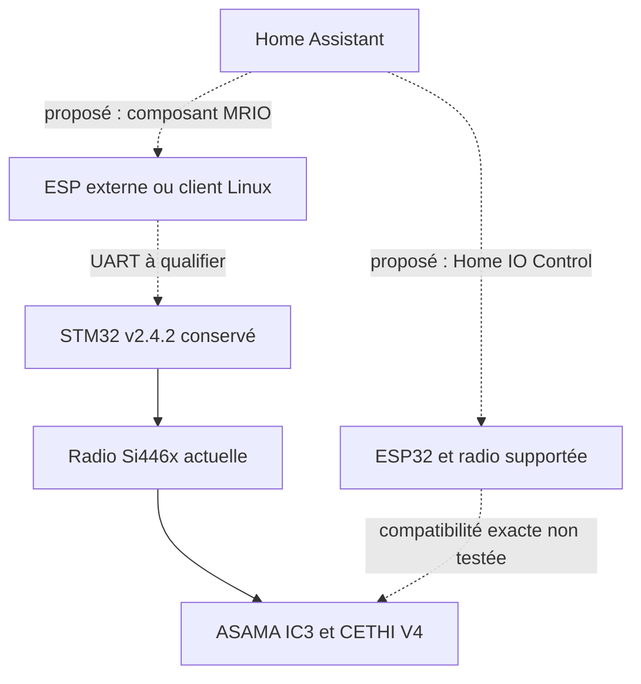

# ESPHome direct et réemploi de la radio Cozytouch

Étude du 17 novembre 2026. Analyse locale et consultation de sources publiques uniquement. Aucun accès SSH, branchement, émission radio, appairage, flashage ou achat par cet agent.

**ESPHome est une voie crédible pour remplacer entièrement le bridge, mais aucun projet consulté ne démontre encore le pilotage exact du Sauter ASAMA IC3 et du chauffe-eau CETHI V4 de cette installation.** Home IO Control est le candidat le plus avancé pour leurs fonctions. Réutiliser le STM32 avec son firmware fabricant constitue une seconde architecture, qui nécessite un adaptateur UART propre à MRIO. Le composant Home IO Control actuel ne fournit pas cet adaptateur.

## Appareils et versions retenus

| Élément | État établi et limite |
|---|---|
| Sèche-serviettes | Catalogue IC3, fabricant 12, type/sous-type **52/1 = 0x34/1**. Le cache d'identification donne **Sauter ASAMA**. Les lectures d'identification ont fini DONE ; la fraîcheur physique du cache n'est pas établie. |
| Chauffe-eau | Composant **CETHI V4**, type/sous-type **51/0 = 0x33/0**. Capacité en cache **250 L**. Le PKM déclare un **Atlantic Calypso250L, réf.286041**, acheté en février2022. Une nomenclature Atlantic associe cette référence au Calypso Connecté VS250L et à une régulation CV4. L'identité physique, la révision et la variante RF ne sont pas relues. **E722804 reste historique**, aucune nouvelle chaîne de version récupérée. |
| STM32 du bridge | Le coordinateur dispose désormais d'un dump réel de 256 Kio, identique sur deux lectures. Code bootloader/application v2.4.2 identique à la référence ; 48 octets personnalisés supplémentaires. Ces octets ne sont pas reproduits ni interprétés ici. |

Sources locales : [identification des appareils](../../offline-next/radio-memory/RESULTAT-IDENTIFICATION.md), lectures natives (non publié), état et sauvegarde STM32 (non publié). Le STM32 sauvegardé appartient au bridge, pas aux appareils radio.

Le rapprochement commercial du chauffe-eau vient de la [recherche firmware et nomenclature](../firmwares/RESULTAT.md), qui cite la fiche PKM `Références/Maison - équipements` et la nomenclature fabricant1454A du12mars2018. C'est une corroboration documentaire ; elle ne valide pas automatiquement le codec public du Calypso200L.

## Projet public réellement étudié

Home IO Control a été revérifié via GitHub au commit [`09445153ef18f23f1dd80595c5e082ccd034efc6`](https://github.com/laberning/home_io_control/commit/09445153ef18f23f1dd80595c5e082ccd034efc6), du **17 novembre 2026 à 17:41:44 UTC**. Il est six commits après `f10feccf6e59aeb3348658df6356a17973aa36eb`, utilisé dans l'étude précédente. La dernière évolution exprime les préambules en millisecondes ; une recette épinglée plus tôt ne doit pas être mélangée silencieusement au code actuel.

Les sources exactes sont conservées sous `sources/home_io_control/`, avec leur licence MIT. primary-receipt.json (non publié) consigne les versions et le périmètre. Les pages HTML générées peuvent précéder le Markdown du commit : cette étude privilégie les fichiers épinglés.

Le projet rapporte le fonctionnement d'Adelis 2 Digit sur SX1276 et d'Adelis 2 M sur SX1262, avec modes, température cible, boost et séchage. Il rapporte aussi ces fonctions sur un **Calypso Connecté de 200 L**, avec lectures d'énergie et d'activité PAC/appoint. Ce sont des appareils voisins. La recherche GitHub des issues contenant ASAMA ou CETHI n'a donné aucun résultat ; leur absence dans cette recherche ne prouve pas une incompatibilité. [Adelis au commit étudié](https://github.com/laberning/home_io_control/blob/09445153ef18f23f1dd80595c5e082ccd034efc6/docs/devices/atlantic-adelis.md), [Calypso au même commit](https://github.com/laberning/home_io_control/blob/09445153ef18f23f1dd80595c5e082ccd034efc6/docs/devices/atlantic-calypso.md).

## Compatibilité exacte : progrès et différences

Le nouvel audit statique reproductible (non publié) compare les registres des codecs publics aux identifiants des profils locaux et à leurs modules Atlantic. Il a analysé **27 lignes de registres publics et trouvé 15 correspondances numériques**. Ce nombre n'est pas un taux de compatibilité : il inclut aussi des registres de radiateur non utilisés par le profil Adelis. Les résultats complets avec lignes sources sont dans compatibilite-registres.json (non publié).

Le manifeste de prototype hors ligne (non publié) fixe les familles, une liste de lectures candidates issues des profils exacts, les limites et les exclusions. Il contient une valeur de test non secrète `D2 00 →21°C` pour la consigne IC3. Ce fichier n'est pas un YAML ESPHome et ne peut pas être téléversé comme firmware. Tous les accès matériels, transmissions, appairages et écritures y sont désactivés.

| Appareil / fonction | Preuve native exacte | Implémentation publique | Conclusion pour cet appareil |
|---|---|---|---|
| ASAMA : mode | `0x0c013601`, `ModeSsvPiece` | `0x0136`, modes off / manuel / PROG | Concordance forte ; valeurs et écritures pas encore validées avec Home IO Control sur ASAMA. |
| ASAMA : consigne effective | `0x0c013701`, READ ; cache après lecture native = 21 °C | `0x0137`, lecture en dixièmes, little-endian | Concordance d'indice et d'encodage ; candidat prioritaire pour une future lecture minimale. |
| ASAMA : consigne confort | **`0x0c013801`, `TemperatureConsigneConfortSsv`, READ** | **`0x0103`** lu/écrit sur Adelis | Différence précise, pas un alias démontré. La table native d'écriture IC3 reste non résolue. Ne pas remplacer 0103 par 0138 sans preuve d'écriture. |
| ASAMA : dérogation | `0x0c011d01`, `ValeurConsigneDerogee` | `0x011d` écrit en période éco ; retour au confort traité séparément | Registre commun. La logique de période et l'écriture ASAMA restent à vérifier. |
| ASAMA : boost / séchage | `0x0c013e01`, `EtatTemporaireSsv` ; durées/configurations 013a–013d dans le profil | `0x013e`, marche/arrêt des deux fonctions ; pas d'entité pour le temps restant | Pilotage voisin déjà implémenté, réglages de durée et parité complète non établis. |
| ASAMA : taux de marche | `0x0c012601`, `TauxDeMarche` | `0x0126` lu pour heating/idle | Correspondance statique ; aucun test direct de ce registre par ESPHome sur ASAMA. |
| ASAMA : température ambiante | **0x0115 absent du bloc IC3 examiné** | Le poll Adelis lit **0x0115** | La température ambiante n'est pas acquise par simple concordance de famille. Ne pas présenter la consigne effective comme température ambiante. |
| ASAMA : identité | 0118 marque / 0119 modèle présents ; cache Sauter / ASAMA | Lecture de modèle 0119 pour reconnaître les variantes | Signature utile à un futur profil ASAMA distinct. Le nom ne doit pas être assimilé à Adelis. |
| CETHI V4 : mode | `0x0c000601`, `Mode` | `0x0006`, auto / manuel ECO actif / inactif, lecture et écriture | Concordance forte ; options exactes à vérifier. |
| CETHI V4 : sonde d'eau | `0x0c001701`, `SondeEauChaude1`, READ | `0x0017`, première valeur i16 big-endian / 10 | Indice commun. Relier la sonde et sa conversion au profil exact avant de publier une valeur. |
| CETHI V4 : cible | Paramètre principal et convertisseurs natifs ; cache 62 °C | Paramètre principal normalisé **20–62 °C**, paliers du Calypso | Bornes/paliers du modèle 250 L à établir ; ne pas importer les paliers 50/54/62 du Calypso 200 L. |
| CETHI V4 : boost et absence | Registres `0x0000`, `0x0005`, et paramètres fonctionnels | Durée + **FP16** ; état issu de FP16 et capacités FP15 | Fonction réellement implémentée, mais aucune preuve exacte CETHI V4. Une durée seule n'est pas un ordre complet. |
| CETHI V4 : énergie / activité PAC | **0004 et 0021 absents du composant604 examiné** ; autres états énergie/puissance existent | Calypso poll : **0004** Wh u32BE ; **0021** octets d'activité | Les capteurs Calypso ne sont pas automatiquement transposables. Les autres états natifs peuvent suivre un autre chemin. |
| Deux appareils : programmes et fonctions avancées | Programmes IC3 ; anti-légionellose, smart grid et autres objets CETHI | Couverture publique partielle | Aucun remplacement intégral de toutes les fonctions établi. |

La correspondance numérique est une preuve de structure. Les modules locaux cités déclarent souvent seulement READ. Cela ne prouve ni l'absence d'un setter partagé, ni son équivalence avec l'écriture du codec public. L'absence d'un registre dans le catalogue ne prouve pas que l'appareil refuserait une lecture RF de ce registre.

Repères publics : [`proto_heating.cpp:73–113`](https://github.com/laberning/home_io_control/blob/09445153ef18f23f1dd80595c5e082ccd034efc6/components/home_io_control/proto_heating.cpp#L73-L113), [profil Adelis et sa liste de lectures](https://github.com/laberning/home_io_control/blob/09445153ef18f23f1dd80595c5e082ccd034efc6/components/home_io_control/proto_heating_profiles.cpp#L121-L189), [registres et échelle DHW](https://github.com/laberning/home_io_control/blob/09445153ef18f23f1dd80595c5e082ccd034efc6/components/home_io_control/proto_dhw.h#L46-L113). Repères natifs : `lua/embedded/9bc057c2a3ff/TemperatureConsigneConfortSsv.lua:1`, `4131e96d2890/TemperatureConsigneEffectiveSsv.lua:1`, `55b5650b21c8/SondeEauChaude1.lua:1`, puis leurs liaisons au catalogue dans l'audit JSON.

## Radios, clés et appairage

| Projet / chemin | Radio ou interface réellement disponible | Portée établie |
|---|---|---|
| Home IO Control | **SX1276, SX1262, LR1121** en FSK, sur SPI ; GPIO reset/IRQ | Liste exhaustive des options du schéma actuel. Aucun pilote CC1101, Si446x ou transport UART MRIO dans ce projet. |
| ESPHome CC1101 officiel | CC1101 SPI, modes asynchrone et paquet, FSK possible | Pilote radio ; n'apporte pas à lui seul les profils Atlantic, les clés ni le protocole 2W. |
| `leonardpitzu/esphome_somfy` | CC1101 ; composant ESPHome ; io 1W et 2W | Code et documentation orientés volets. Aucun codec ASAMA/CETHI trouvé dans le périmètre consulté. |
| `nicolas5000/io-rts-esp32` | Projet ESP-IDF, protocole 2W | Appareils testés listés : RS100 Solar, volet Velux, Dexxo Smart. Pas de preuve chauffage/eau chaude exacte dans cette liste. |
| STM32 + radio d'origine | API UART fabricant, STM32F101RCT6 et radio Si446x | Pile native déjà capable de lectures des appareils exacts. Pas de composant ESPHome prêt à l'emploi identifié pour cette API. |

Preuve de la liste Home IO Control : [`hub_validators.py:61–70`](https://github.com/laberning/home_io_control/blob/09445153ef18f23f1dd80595c5e082ccd034efc6/components/home_io_control/hub_validators.py#L61-L70). Le schéma dépend d'`api` et de `spi` et demande des GPIO internes : [`__init__.py:101–159`](https://github.com/laberning/home_io_control/blob/09445153ef18f23f1dd80595c5e082ccd034efc6/components/home_io_control/__init__.py#L101-L159). La présence d'un CC1101 dans [ESPHome officiel](https://esphome.io/components/cc1101/) ne l'ajoute pas à cette liste.

Le 2W authentifie les échanges avec une clé et un défi. Le 1W et le rejeu d'une ancienne trame ne remplacent pas ce parcours. Home IO Control sait employer une **clé par entité**, ce qui correspond mieux aux cas Atlantic à clés propres que l'hypothèse d'une clé globale unique. La validité des champs locaux et l'identité émettrice restent à établir ; aucune valeur secrète n'a été copiée dans une configuration.

Sur les appareils voisins, Adelis/AGILIA peut remettre sa propre clé au contrôleur, tandis que Calypso accepte le transfert de la clé du contrôleur. La récupération auprès d'un contrôleur existant et le scan des appareils sont des échanges **actifs**. Ils ne sont pas des lectures passives du backup, ni une nécessité pour poursuivre le travail hors ligne. Aucune procédure d'appairage n'est exécutée ou proposée comme sonde. Sources : [pairing.md:53–78](https://github.com/laberning/home_io_control/blob/09445153ef18f23f1dd80595c5e082ccd034efc6/docs/pairing.md#L53-L78), [paramètre de clé par appareil](https://github.com/laberning/home_io_control/blob/09445153ef18f23f1dd80595c5e082ccd034efc6/components/home_io_control/platform_common.py#L284-L291), [récupération de clé](https://github.com/laberning/home_io_control/blob/09445153ef18f23f1dd80595c5e082ccd034efc6/docs/key-extraction.md).

Les références alternatives sont épinglées : [esphome_somfy `b1696b1`, 14 novembre 2026](https://github.com/leonardpitzu/esphome_somfy/blob/b1696b1e637245e3e039566a3648c5fe216b7b6f/README.md), [io-rts-esp32 `857fe3e`, 3 juillet 2026](https://github.com/nicolas5000/io-rts-esp32/blob/857fe3eb020c7791264e4873e27583fd6efa3337/doc/supported_devices.md). Elles ne valident pas un assemblage CC1101 + codecs Home IO Control sans développement de pilote et d'intégration.

## Où exécuter ESPHome

Les traits pleins représentent la chaîne native identifiée et ses lectures réussies rapportées par le coordinateur. Ils ne représentent pas une nouvelle mesure par cet agent. Les pointillés représentent des développements et essais futurs. Source Mermaid modifiable ; rendu non vérifié.

- **Directement dans le STM32F101 : pas de voie ESPHome native établie.** ESPHome **2026.10.2**, version publiée le 2 novembre, ne possède pas de composant plateforme STM32 dans les 768 dossiers du tag inspecté. La [PR8674](https://github.com/esphome/esphome/pull/8674) qui proposait STM32 est fermée sans fusion. Un portage serait un projet de plateforme et de pilote ; il remplacerait aussi la pile io propriétaire qui rend le réemploi intéressant. Aucun flashage proposé.
- **Sur le Linux ARMv5 du bridge : possible à étudier avec la plateforme `host`.** ESPHome [documente son exécution Linux](https://esphome.io/components/host/), avec compilateurs C/C++ et ninja. Cela ne valide pas la chaîne ARMv5 EABI, la libc et les interfaces matérielles du bridge. Le composant Home IO Control SPI/GPIO ne devient pas compatible Si446x parce que `host` existe. Un client MRIO UART adapté est une autre question, traitée aussi par le coordinateur.
- **Sur un ESP externe, relié au STM32 : architecture concrète à développer.** ESPHome fournit la couche UART et l'API HA ; il faut ajouter le protocole MRIO, la gestion des commandes/réponses et les paramètres Atlantic exacts. Le STM32 conserve sa pile radio. Son alimentation, les niveaux, le reset, l'initialisation et l'exclusivité du port doivent être qualifiés. Deux maîtres UART simultanés ne constituent pas un montage défini.

L'interface `RadioDriver` de Home IO Control manipule des **paquets RF**, le RSSI, les préambules et les changements de canal. L'API UART fabricant transporte des **services de pile et commandes**. Les relier demande de démontrer une correspondance réelle, pas seulement de remplacer SPI par UART. Une implémentation MRIO séparée qui réutilise les entités ESPHome est donc une piste plus directe ; son niveau d'effort dépend encore du protocole natif reconstruit. [Interface radio actuelle](https://github.com/laberning/home_io_control/blob/09445153ef18f23f1dd80595c5e082ccd034efc6/components/home_io_control/radio_interface.h#L188-L290).

## Prototype suivant proposé, strictement hors ligne

L'audit fourni est déjà exécutable : `python analyse-2026-11-17/continuation-radio/esphome/audit_compatibilite.py`. Il ne charge aucune bibliothèque fabricant, n'ouvre aucun socket ou port série et ne lit aucun champ de clé. Son seul fichier produit est `compatibilite-registres.json` dans ce dossier. Il a terminé avec 27 lignes et 15 rapprochements. Aucun firmware ESPHome n'a été compilé ou téléversé.

Le développement utile suivant comprend deux petits bancs séparés :

1. **Banc MRIO simulé** : rejouer des traces UART déjà acquises, expurgées des secrets et adresses uniques ; traiter GET version, READ appareil, progression et terminaison. Reproduire le défaut déjà observé des callbacks qui ne terminent pas, avec une règle d'arrêt explicite. Ne jamais réutiliser tel quel le client OUTPUT_RAW historique signalé dans REPRISE.
2. **Banc codec ASAMA/CETHI** : comparer les réponses natives utiles aux codecs publics sans émission. Le profil ASAMA doit distinguer cible confort 0138, cible effective0137 et hypothèse d'écriture0103. Le profil CETHI doit distinguer ses sondes et ses propres bornes/paliers des valeurs Calypso. Les captures UART de la pile ne sont pas nécessairement des paquets RF utilisables directement par Home IO Control.

Une future étape matérielle pourrait ensuite viser **une lecture d'un paramètre exact**, avec authentification et réponse décodées, avant toute écriture. Son autorisation et son protocole d'essai sont distincts. À ce stade, l'étude ne justifie ni réinitialisation, ni réappairage, ni commande de chauffe.

## Conservation et limites

Les historiques, la NAND, le dump STM32 réel, leurs copies et les fichiers des autres agents restent inchangés. Les sources publiques épinglées et les résultats de cet agent sont conservés dans ce dossier. manifest-sha256.json (non publié) permet leur vérification. Les scripts d'audit comparent des sources ; ils ne prouvent pas le comportement électrique ou RF d'un matériel.

> Les empreintes historiques des fichiers expurgés se rapportent aux originaux privés.
