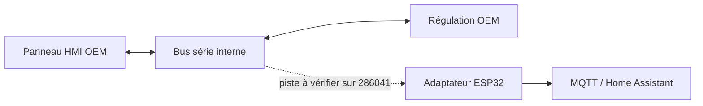

# Firmwares des appareils ASAMA et Calypso : recherche publique

Recherche du 17 novembre 2026, limitée aux sources publiques et aux fichiers locaux. **Aucune image de firmware OEM attribuable aux deux appareils de <PERSONNE> n'a été trouvée dans le périmètre décrit.** Aucun binaire appareil n'a donc été téléchargé ou exécuté. Les documents conservés permettent toutefois de préciser le chauffe-eau et d'ouvrir une piste série indépendante de Cozytouch.

## Identification utile et limites

| Appareil | Éléments établis dans le dossier | Ce qui reste à vérifier |
|---|---|---|
| Sèche-serviettes | Cache IC3 : marque `53` interprétée Sauter, modèle ASAMA, valeurs de puissance 1750 et de tension 230. Profil **52/1**, fabricant 12, sous-type 4. | Référence commerciale à six chiffres, génération, lettre/révision de carte et microcontrôleurs. Les unités ne sont pas réinterprétées à partir du seul cache. |
| Chauffe-eau | Profil **51/0**, fabricant 12, sous-type sélectionné 9 : `AtlanticDomesticHotWaterProductionV2_CETHI_V4_IOComponent`. Le PKM historique décrit un **Atlantic Calypso 250 L, 286041**, acheté en février 2022. | Présence actuelle de cet exemplaire et lettre de produit sur sa plaque. Le code PKM ne constitue pas une nouvelle lecture de la plaque. |

Le code 286041 n'est plus une simple hypothèse de marque commerciale. Il est documenté dans `Références/Maison - équipements.md`, révision `sha256:34c3f4dc3672ee82e89b00ceee0a8470be991d46795da6ea6d392bd90315a37f`, consultée en lecture seule. Cette note provient de l'export Workflowy du 9 octobre 2026 et qualifie les présences comme historiques. La copie privée est conservée dans `sources/pkm-maison-private.json`.

La [nomenclature Atlantic 1454A](https://www.piecesxpress.com/docs/atlantic/531416048.pdf), datée du **12 mars 2018**, confirme 286041 = **CALYPSO CONNECTE VS 250L**, lettre B. Elle distingue une carte de régulation **CV4 250L ATL 029765**, un boîtier de commande numérique **CV4 029761** et leur faisceau **026335**. Ce sont des références de pièces, pas des images logicielles. Le document est une publication constructeur rehébergée par un distributeur ; le lien vise uniquement le PDF technique. Ses pages 1 et 3 ont été rendues et inspectées localement. La lettre B de cette nomenclature n'est pas attribuée à l'exemplaire de <PERSONNE>.

Les versions **E725008** (ASAMA) et **E722804** (eau chaude) sont bien présentes dans `COZYTOUCH_ANALYSIS.md`, lignes 29–34, enquête du **6 avril 2026**. Elles ne sont pas des mesures du 17 novembre. Le complément `../../offline-next/radio-memory/RESULTAT-IDENTIFICATION.md` confirme qu'aucune nouvelle valeur logicielle CETHI n'a été obtenue. Une chaîne de version n'est pas un firmware récupérable.

## Résultat des recherches de firmware et d'OTA

Les recherches ont combiné les noms commerciaux, les versions, les profils IC3/CETHI, le code 286041 et les références 029765/029761, avec firmware, bin, hex, dump, bootloader, téléchargement et mise à jour. Elles ont porté sur les pages constructeur indexées, GitHub et des discussions originales. Le journal `RECHERCHES.md` précise les requêtes et les exclusions.

| Surface examinée | Résultat utile | Limite |
|---|---|---|
| [Assistance officielle ASAMA connecté](https://www.confort-sauter.com/assistance/radiateurs-seche-serviettes/asama-connecte) et [documentation Sauter](https://www.confort-sauter.com/assistance/espace-de-documentation) | Notice ASAMA connecté 2021 et informations de support. | Aucun téléchargement de firmware ni procédure de lecture mémoire attribuable à IC3 identifié dans ces pages. Les variantes ASAMA, ASAMA connecté et ASAMA II ne sont pas interchangeables. |
| Versions E725008/E722804 et profil exact | Chaînes d'identification, diagnostics d'intégrations et discussions. | Aucun fichier bin/hex/DFU ou archive OEM identifié. Une occurrence publique d'E722804 sur un autre compte ne permet pas d'identifier la carte de <PERSONNE>. |
| Calypso 286041 et cartes 029765/029761 | Références matérielles CV4 précisées. | Aucun paquet public de programmation, de secours ou de lecture de Flash attribuable à ces références identifié. |
| Applications mobiles et outils professionnels | Fiches officielles Cozytouch/Atlantic Services Pro et notices de générations plus récentes. | Une mise à jour d'application mobile ne prouve pas une mise à jour d'actionneur. Aucun installateur public contenant une image identifiée IC3 ou CV4 286041 n'a été localisé. Aucun compte, portail SAV privé, endpoint authentifié ou paquet d'un miroir APK n'a été utilisé. Aucun APK n'a été acquis et analysé : son absence de firmware embarqué n'est donc pas établie. |
| Firmware présent dans la NAND locale | L'étude antérieure a identifié MRIO 2.4.1/2.4.2, RTX et IdealRF. | Ces images concernent le bridge. Elles ne deviennent pas les firmwares d'ASAMA ou du Calypso. L'inventaire antérieur par noms et extensions ne couvre pas toutes les ressources opaques possibles. |

Aucun mécanisme OTA ou bootloader **exact pour ASAMA IC3 ou Calypso 286041/CV4** n'a été qualifié dans cette recherche. Une notice Calypso Split plus récente mentionnant une application de mise à jour ne suffit pas à établir la même fonction sur CV4 286041. Les dépôts de pilotage cloud Home Assistant/Homey et leurs « dumps » JSON sauvegardent des descriptions ou états d'appareil ; ils ne contiennent pas nécessairement son code embarqué.

Les résultats négatifs restent bornés : ils ne prouvent ni l'absence d'une image dans tout Internet, ni l'impossibilité d'une maintenance fabricant, ni l'absence d'une image opaque dans un paquet non inspecté.

## Nouvelle piste de réemploi : le bus série du chauffe-eau

[AquaMQTT](https://github.com/tspopp/AquaMQTT/tree/814fd16e45a5f9190c2f0c0c69188f7773d8181b) documente une interface locale entre le panneau HMI et la carte principale de chauffe-eau Groupe Atlantic. Le projet installe son propre logiciel sur **un adaptateur ESP32**. Il ne remplace pas le firmware OEM du chauffe-eau.

Le dépôt a été épinglé au commit `814fd16e45a5f9190c2f0c0c69188f7773d8181b`, daté par l'API GitHub du **18 janvier 2026 à 07:45:26 UTC**. Les [appareils rapportés compatibles](https://github.com/tspopp/AquaMQTT/blob/814fd16e45a5f9190c2f0c0c69188f7773d8181b/DEVICES.md) incluent Calypso VR, Calypso Split Inverter et Odyssée Pi 2015, avec variantes de protocoles et de circuits d'adaptation. Aucun lien explicite entre ces essais et **286041/029765/029761** n'a été trouvé dans les fichiers téléchargés.

La [description du protocole](https://github.com/tspopp/AquaMQTT/blob/814fd16e45a5f9190c2f0c0c69188f7773d8181b/PROTOCOL.md) rapporte, pour le matériel de référence, une liaison USART demi-duplex sur un fil, 9600 bit/s, 8 bits et 2 bits d'arrêt. Elle déclare un HMI à **STM32F103RFT6**. Le [câblage](https://github.com/tspopp/AquaMQTT/blob/814fd16e45a5f9190c2f0c0c69188f7773d8181b/WIRING.md) décrit des niveaux logiques 5 V et un mode d'écoute. **Ces caractéristiques sont celles du matériel décrit par les auteurs ; elles ne sont pas des mesures du Calypso de <PERSONNE>.** Le bus n'est pas assimilé à un UART 3,3 V accessible sans adaptation.

Rendu Mermaid non vérifié. La liaison HMI/régulation est documentée par AquaMQTT ; son implantation exacte sur 286041 n'a pas été inspectée. Le projet fournit une piste de lecture d'états et de contrôle local, **pas un service démontré de dump Flash/RAM**. Aucun câblage, émission, compilation ou commande d'appareil n'a été effectué.

L'API publique GitHub retourne **15 releases**, de v1.0.0 à v1.8.1, dans la limite `per_page=20` consultée. Elles possèdent toutes une liste `assets` vide. La dernière est datée du **16 novembre 2025**, et non du 16 novembre 2026 malgré un résultat de recherche affichant seulement « 16 Nov ». Le code source reste disponible ; aucune image de firmware d'adaptateur n'a été sélectionnée ou compilée. Le relevé structuré est conservé dans `sources/AquaMQTT-releases.json`.

## Ce que demanderait une sauvegarde des appareils

1. **ASAMA :** retrouver le code commercial et la révision de la commande, puis identifier ses cartes et leurs microcontrôleurs. Une nomenclature d'une autre génération ne suffit pas à choisir un fichier ou des broches.
2. **Calypso :** confronter la plaque actuelle au repère historique 286041, puis relever la lettre et les références réelles HMI/régulation. Comparer ensuite le bus avec les traces AquaMQTT avant de choisir une variante de décodeur.
3. **Pour un dump :** identifier les interfaces de lecture du composant exact et ses protections. Il faut prouver la lecture en sens inverse. Un mode OTA de programmation ne garantit pas la possibilité de sauvegarder le firmware installé.

Les fonctions `ModbusMemoryDumping`, `DumpMemory` et `DebugFlash` étudiées antérieurement concernent OVP/Cotherm. Les commandes de téléchargement retrouvées dans un namespace Somfy ne prouvent aucune compatibilité Atlantic. Le lecteur du bootloader STM32 du bridge lit **le bridge**. Ces trois familles de faux positifs restent exclues, selon `../../offline-next/radio-memory/RESULTAT.md`.

## Conservation et vérifications

Les huit fichiers de documentation/licence AquaMQTT, le relevé de releases, la nomenclature Atlantic et ses deux rendus, ainsi que la source PKM privée sont conservés dans `sources/`. `source-receipts.json` épingle les huit documents GitHub par commit et URL. `MANIFEST-SHA256.json` décrit les fichiers produits avec leur taille et SHA-256. Aucun fichier image de firmware OEM n'est déclaré dans ce manifeste.

La nomenclature PDF possède 306 082 octets et le SHA-256 `5ab9775c5e33dcf3965406efb2e197d3712fbb462aede1e1f0c4cec9ab191778`. Son rendu présente une table de paramètres serrée dans la source ; les références de produit et de cartes utilisées ici restent lisibles. Les sources ne sont pas modifiées. Aucun lien d'achat, secret, adresse unique d'appareil ou URL de document comportant un jeton n'est reproduit dans ce rapport. Aucun fichier historique n'a été déplacé ou supprimé.

> Les empreintes historiques des fichiers expurgés se rapportent aux originaux privés.
