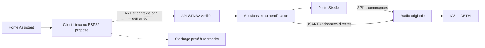

# Réutiliser la radio du hub : frontière Linux–STM32 établie sur le dump réel

Analyse hors ligne du **17 novembre 2026**. **Conserver le STM32 et la radio d’origine, puis remplacer leur client Linux, est la voie la mieux étayée.** Le STM32 réalise déjà les sessions radio, l’authentification, le traitement des trames et le pilotage Si446x. L’hôte fournit les opérations métier, les adresses, les informations de nœud et le contexte de clé. Un ESP32 pourrait jouer ce rôle d’hôte UART. Le dump ne fournit pas une pile ESPHome prête à compiler.

Cette étude n’a accédé à aucun hub, compte, réseau ou port série. Aucun firmware, script constructeur, code extrait ou commande d’appareil n’a été exécuté. Les valeurs privées ne sont pas reproduites.

**Complément du 17 novembre 2026 :** deux nouvelles lectures effectuées et capturées par le coordinateur ont été contre-vérifiées hors ligne. L’addendum de capture qualifiée (non publié) confirme les offsets, la demande de statut et le contexte `stack1.key` pour ces deux transactions. Il borne séparément leur portée pour un futur client autonome.

## 1. Ce que change la sauvegarde réelle

Le contrôle local identity-verification.json (non publié) relit les deux fichiers sources et établit :

- Flash réelle : 262 144 octets, SHA-256 `991abbf44b078e7877d5f7cab6186b96c8de409f9857712c0d353f0ffc35f121`.
- Bootloader `0x08000000..0x08001fff` et suffixe applicatif `0x08002800..0x0803ffff` **identiques octet par octet** à l’image complète distribuée v2.4.2.
- Seulement 48 octets différents, dans le secteur de données de carte `0x08002000..0x080027ff`. Les adresses des plages sont conservées, sans leurs valeurs.

Les décompilations Ghidra existantes peuvent donc être appliquées au code de ce dump sans nouvelle décompilation globale. Cela ne transforme pas une analyse statique en observation d’exécution. Le dump est une image de **Flash**, sans SRAM, option bytes, ROM ST ou mémoire des appareils IC3/CETHI.

Les mentions « dump non acquis », « version installée inconnue » et « calibration absente » des études antérieures décrivent leurs dates respectives. Leurs originaux restent inchangés. La sauvegarde réelle apporte maintenant le corpus personnalisé de carte. Elle ne révèle pas les clés courantes en SRAM.

## 2. Carte des responsabilités



Les blocs STM32 sont établis par le code identique au dump. Le client Linux/ESP32 et son intégration HA sont proposés. Le schéma ne valide ni le câblage, ni les temporisations matérielles. Rendu Mermaid non vérifié.

| Responsabilité | Emplacement et preuve | Limite |
|---|---|---|
| Catalogue et opérations métier | Linux : profils, paramètres, commandes privées Atlantic, nœuds persistés, choix du contexte de clé | Les noms des états Overkiz ne suffisent pas à encoder leurs requêtes RF. |
| Transport de commande | Hôte : trame UART, sérialisation des informations de nœud et clé ; STM32 : parseur et répartiteur | Aucun identifiant de transaction universel n’est présent dans l’enveloppe. La corrélation dépend des callbacks et du contexte. |
| Adresses et clé de session | L’hôte les fournit ; STM32 les installe dans ses structures SRAM avant les requêtes | Une lecture de Flash ne remplace pas un inventaire privé du stockage Linux ni une capture RAM. |
| Sessions radio et mécanismes cryptographiques | STM32 : objets de trame, ordonnanceur, AES, défis et authenticants | Machine complète 2W et règles d’acceptation anti-rejeu encore partielles. |
| Circuit radio | STM32 : SPI1, USART3, interruptions, temporisations et calibration | Porter ce pilote sur ESP32 exige de reconstruire les contraintes matérielles. |
| Intégration HA | Nouveau client proposé, avec valeurs décodées et fraîcheur connue | Aucun composant ESPHome pour cette UART n’est validé ici. |

## 3. Contrat UART exploitable

`0x08021d20` installe l’API hôte sur le port logique 3, USART1, **115200 bauds**. Le code est distinct du port logique 5 à 9600 bauds. La trame est :

```text
02 | groupe:u8 | commande:u8 | longueur:u16be | payload | CRC8(payload) | 03
longueur = taille(payload) + 1
taille totale = taille(payload) + 7
CRC8 : polynôme 0x07, init 0, pas de réflexion, xorout 0
```

Le CRC couvre le payload seul. Il ne couvre pas le groupe, la commande ou la longueur. `0x08023274` contrôle la trame ; `0x08023354` la construit ; `0x08023188` remet les trames complètes au callback du répartiteur `0x08021c98`. Les callbacks C++ indirects expliquent plusieurs absences d’arêtes dans les graphes d’appels directs.

La limite de payload du STM32 est 762 octets. Le lecteur Lua étudié refuse un champ longueur supérieur à 128, soit un payload supérieur à 127. Un nouveau client doit choisir et tester explicitement ses plafonds. L’enveloppe seule n’autorise pas à rejouer une ancienne commande radio.

interface-matrix.json (non publié) contient **24 commandes entrantes**, leurs tables et gestionnaires, **52 identifiants de callbacks** déclarés par Linux, les producteurs à constantes explicitement trouvés et les étapes d’initialisation. Les noms proviennent des enums livrés. Un callback déclaré sans producteur direct retrouvé reste une couverture incomplète, pas une fonction absente.

Les réponses de lecture, d’écriture et d’état ne portent pas toujours le même identifiant que la demande. Exemple local : MD5 `0x0504` répond sous `0x0517`. Les notifications `0x0401`, `0x0403` et `0x050e` ont aussi des usages asynchrones. Un seul appel UART suivi d’un seul `read()` ne constitue donc pas un pilote.

### Contexte des requêtes

Les offsets suivants sont relatifs au payload transmis au handler, sans les cinq octets d’enveloppe initiale :

| Commandes | Chargeur | Source | Destination | Bloc de clé | Sous-commande/données |
|---|---|---:|---:|---:|---|
| `0x0100`, `0x0101` | `0x08021d98` | 0, 3 octets | 3, 3 octets | 18, 16 octets | Sous-commande à 34 ; données à partir de 35, transformations legacy conditionnelles |
| `0x0300`, `0x0301`, `0x0302` | `0x08022390` | 0, 3 octets | 3, 3 octets | 24, 16 octets | Données à partir de 41 |
| `0x0200` découverte | `0x0802286c` | 0, 3 octets | Champ hôte présent ; usage du handler à qualifier | 6, 16 octets | Type à 22, répétition à 23, protocole à 24 |

Ces offsets sont vérifiés dans les copies du code. L’ordre des octets des champs multioctets et les champs conditionnels doivent rester conformes à `FrameDefinition.lua`, pas être déduits d’un alignement C. La destination désigne un nœud radio de 24 bits ; ce n’est pas une adresse IP ni un identifiant d’état HA.

**Conséquence :** un simple pilote peut envoyer une demande complète avec son contexte. Un `SET MASTER` préalable n’est pas une nécessité universelle démontrée pour chaque commande : les chemins ordinaires rechargent eux-mêmes adresse et clé. La bonne séquence de démarrage hôte reste à vérifier.

## 4. Clés : stockage SRAM démontré et portée de la Flash

Le handler `0x08022c7c` traite `ACCESSOR_MASTER`, commande `0x0502` :

- Octet 0 : `ADDRESS=0` ou `KEY=1`.
- Octet 1 : `SET=0`, `GET=1`. Le code prend toute valeur non nulle comme GET, mais un générateur doit respecter l’enum 1.
- Valeur à partir de l’octet 2 : 3 octets d’adresse ou 16 octets de clé.
- Réponse : 5 octets pour l’adresse ; 18 pour la clé, sélecteur et accès compris.

Cette disposition évite une confusion avec les getters production/calibration/série : pour ces derniers, l’octet d’accès se trouve à une autre position.

La chaîne de clé est précisément :

```text
0800411c → 0800d084(mode0) → 0801cd7c → 0800aab8 : conserve l’ancienne clé
         → 0800d084(mode1) → 0801cd14 → 0800a9cc : installe la clé courante
```

`0x0800411c` est appelée par l’accesseur de maître, la découverte et les chargeurs de requêtes ordinaires. La table de blocs est en **SRAM à `0x20005e8c`**, avec une entrée de `0x22` octets : clé courante à `+2`, ancienne clé à `+0x12`. Les structures de contexte passent par `0x200028bc` ; le contexte applicatif temporaire est à `0x20002c3c`. ram-literals.json (non publié) contient uniquement ces adresses, jamais leur contenu.

Les notifications de changement `0x08029d38` et de suppression `0x08029d40` sont des fonctions vides dans cette construction. `0x0800a8d8` initialise les blocs à zéro. L’accesseur de clé courante `0x0800aaa4` retourne une adresse SRAM, pas une adresse Flash. Le désassemblage key-path-thumb.txt (non publié) confirme que le registre `r1`, pointeur de clé, traverse les wrappers où Ghidra avait omis des paramètres dans ses prototypes.

**Résultat vérifié : les chemins étudiés stockent et réinstallent leurs clés en RAM. Ils ne les persistent pas par ces callbacks.** La différence de 48 octets de Flash se limite aux régions de carte connues, pas à un nouveau répertoire de clés. Cela ne prouve pas l’absence de toute clé compilée partagée, de tout état dans un autre support ou de tout autre chemin non découvert. Cela prouve surtout qu’un dump Flash ne suffit pas à connaître les clés utilisées actuellement pour chaque appareil.

Les contextes Linux `oldSystemKey`, `stackMaster.key` et la clé effective d’un nœud restent à distinguer. Les analyses de schéma précédentes indiquent déjà des contextes propres aux appareils. Le nouveau client devra reprendre leur association et leur sélection sans publier ni remplacer leurs valeurs.

## 5. Authentification, défis et rejeu : faits et inconnues

| Chemin | Fait établi dans le code | Ce qui reste à démontrer |
|---|---|---|
| Primitive AES | `0x0801a7e8` transforme 16 octets avec dix tours ; `0x0801a844` applique les mêmes tours et tronque le résultat à la longueur demandée | Comparaison de sorties à des vecteurs connus ou émulation contrôlée non effectuée ici. |
| Préparation d’authentifiant | `0x0801a6fa` mélange le message dans un bloc de 16 octets, complète les octets courts et y copie six octets de contexte à l’offset 10 | Sémantique exacte de chaque champ dans toutes les classes de trame. |
| Génération de défis | `0x0800529c` et `0x080064ac` construisent six octets par `0x08009d10`; `0x08005c64`/`0x08005d10` ajoutent un authentifiant de six octets après un prétraitement dépendant de la commande | Tables de dispatch complètes pour rattacher chaque constructeur à chaque phase 2W et type de découverte. |
| Réponse authentifiée | `0x080065ec` calcule une réponse de six octets à partir du message, du contexte de six octets et d’une clé ; `0x080072bc`/`0x0800764c` recalculent et comparent des blocs de six octets | Corrélation défi/réponse, adresses couvertes et transitions de session complètes. |
| Transfert 2W | General Information, sous-commande `PAIRED=6`, va de `0x08021f24` à `0x0800d028` ; `0x08006378`, `0x08006440` et `0x0801c308` utilisent des blocs de 16 octets et un changement de contexte de clé | Schéma complet du message chiffré et toutes les conditions d’acceptation côté appareil. |
| Authentification 1W | `0x08022a5c` vérifie six octets, avec compteur 16 bits et un second essai après incrément d’un octet de la clé candidate ; `0x0801a62c` répète l’adresse de 3 octets dans le bloc de travail | Fenêtre anti-rejeu d’un récepteur réel. Cette vérification UART ne suffit pas à établir sa persistance. |

Le générateur `0x08009b3c` est un générateur arithmétique déterministe, pas une primitive de génération aléatoire cryptographique identifiée. `0x0800b088` prévoit une initialisation depuis deux octets fournis par la radio si le générateur n’est pas déjà initialisé. La table radio `0x08035654`, entrée `+0x4c`, pointe vers `0x08028134` : cette routine échantillonne le bit de poids faible d’une lecture radio. La branche exacte exécutée et l’entropie réelle ne sont pas mesurées. Aucune conclusion de contournement ou de sécurité anti-rejeu ne découle de ce seul constat.

**Réutiliser la carte originale permet de conserver ces mécanismes radio sans les réimplémenter.** Un portage RF natif vers ESP32 exige au contraire de résoudre ces inconnues et de les vérifier. Réémettre une ancienne trame RF ne valide pas un nouveau client.

## 6. Si446x : ce qu’un client UART conserve

`0x080284c0` construit l’objet radio. `0x08027620` charge les fréquences/calibrations et les callbacks de données. `0x080272bc` séquence le reset radio, `POWER_UP`, les commandes et propriétés. `0x08026d64` attend CTS par `READ_CMD_BUFF=0x44`. Le composant physique était marqué 44612A ; le code prouve la famille Si446x sans nouvelle lecture `PART_INFO`.

Les chemins TX et RX sont séparés : `0x08027924`/`0x08027814` émettent `START_TX=0x31`, `0x080277d8`/`0x08027e10` utilisent `START_RX=0x32`. Le flux direct TX passe par `0x08028d20` puis `0x0802886c`, avec préambule et octets envoyés sur le port logique 2, USART3. `0x08028c58` installe ses callbacks. SPI1 configure la radio ; il ne transporte donc pas à lui seul tous les octets radio.

Les trois fractions nominales conduisent aux fréquences 868,25 / 868,95 / 869,85 MHz avec l’hypothèse OUTDIV=4 de l’étude antérieure. La modulation directe 2FSK et les propriétés livrées sont déjà conservées dans `../../stm32/radio-properties.json` et `radio-derived.json`. La sauvegarde réelle contient maintenant les données de calibration de cet exemplaire, conservées privées. Aucune mesure RF ne remplace ici l’hypothèse du diviseur, le débit exact, la déviation ou le câblage.

Un client Linux ou ESP32 relié au STM32 **n’a pas à reconfigurer directement ces propriétés Si446x**. Une nouvelle carte RF autonome aurait à les porter, avec l’ordonnancement, les interruptions, les données directes et les contraintes électriques.

## 7. Initialisation : acquis et séquence minimale proposée

Le chemin de démarrage statique est : reset `0x080030a8` → `0x08003004` → initialisation matérielle `0x0802d1f8`, vérifications et ordonnanceur. L’API UART est installée par `0x08021d20`. La tâche `0x08003280` appelle `0x08003248`, puis `0x08003aa0`, qui construit la pile, le maître et la radio.

`0x08003aa0` prépare des notifications `0x0403` (information générale), `0x0517` (MD5 en cache) et `0x050e` (cause de reset). Le constructeur n’attend pas une commande Linux de chargement de tout le firmware radio. Le handler `POLLING=0x0503` dépend d’un état de pile et produit aussi des informations applicatives ; le qualifier de simple ping universel serait prématuré.

La séquence minimale suivante reste **un protocole de prototype à vérifier**, pas une recette matérielle validée :

1. Un unique propriétaire du flux UART. Parser les notifications, le CRC et les trames fragmentées avant toute gestion métier.
2. Identifier révision et événements de démarrage. Ne pas déclencher de reset ou d’updater en réaction à un callback inconnu.
3. Charger le contexte d’un nœud existant dans une requête complète ; choisir explicitement sa clé et sa version de protocole. Vérifier hors ligne la nécessité éventuelle d’un accesseur de maître préalable.
4. Limiter le premier scénario métier à une lecture déjà identifiée, avec une seule transaction en cours et corrélation jusqu’à son callback terminal.
5. Traiter événements spontanés, erreurs, délais et perte de contexte au reset. Reconstituer l’état hôte sans découverte ou transfert de clé automatiques.

Le service existant avait obtenu des réponses UART aux GET bruts tout en laissant les commandes Linux sans fin. Ses délais ont ensuite provoqué des resets radio. Le nouveau pilote doit donc gérer **la fin de transaction de sa propre couche**. La réussite d’un CRC, un PID vivant ou un ACK de bus ne suffit pas. Voir la correction et le contrôle fonctionnel dans `../../../donnees/stm32-live-2026-11-17/README.md`.

## 8. Appairage : périmètre à conserver séparément

Linux choisit les parcours `VIRGIN`, `SYSTEM_WITH_LPM` ou privés, puis envoie la découverte `0x0200` avec le contexte de clé. `0x0802286c` installe source et clé, puis choisit la machine de découverte `0x0800446c`. Pour un appareil nouveau, `PAIRED=6` précède `SYSTEM_VERIFICATION=4`. Pour un appareil déjà dans le système, le parcours Lua étudié vérifie le système sans nouveau transfert explicite.

Le code distingue donc découverte, transfert de clé, vérification et création du nœud. La présence d’une entrée Linux ne remplace pas ces états. Les appareils actuels peuvent être étudiés avec leurs contextes conservés ; refaire l’association n’est pas une condition démontrée d’un nouveau pilote. Les procédures physiques exactes IC3/CETHI et les effets d’une autre passerelle sur les associations existantes restent non vérifiés.

L’analyse [pairing antérieure](../../offline-next/pairing/RESULTAT.md) contient les modules et exceptions. Le prototype hors ligne ne doit pas transformer découverte ou transfert en étapes automatiques de démarrage.

## 9. Prototype hors ligne vérifiable

Le livrable immédiat utile est un **moteur de transactions UART sans backend matériel**, exécutable sur PC. Il ne doit ouvrir ni TTY ni socket. Son backend recevra seulement des fichiers de fixtures synthétiques ou des captures autorisées déjà conservées.

| Étape proposée | Entrée | Critère de réussite |
|---|---|---|
| Codec commun Linux/ESP | Trames synthétiques, CRC, tous les découpages d’une trame | Même objet après réassemblage ; rejet borné des longueurs et CRC invalides ; plusieurs trames et bruit intercalé gérés. |
| Schéma de demande | Adresses et clés factices, champs de `FrameDefinition.lua` | Offsets et tailles égaux à la matrice ; aucune clé dans le journal normal. |
| Machine de transaction | Révision→réponse, MD5 `0504→0517`, événements intercalés, délais et reset simulé | Une seule terminaison par demande ; aucun retry implicite d’écriture ; état marqué inconnu après perte de contexte. |
| Lecture métier exacte | Paramètre IC3 ou CETHI déjà identifié, données factices | Même payload que le constructeur Linux, puis même décodage du callback attendu. Aucun essai de commande mémoire. |
| Portabilité | Même fixture et même séquence dans le futur composant ESPHome | Octets sérialisés et transitions identiques au moteur PC ; pas de bibliothèque constructeur ou de cloud requis par ce test. |

Les captures de démarrage disponibles ont une couverture insuffisante : la tentative de capture de boot signalée dans la sauvegarde réelle a expiré avant l’ouverture UART. Elles ne permettent donc pas de déclarer une séquence hôte minimale complète. Une observation matérielle future resterait une étape distincte, avec un seul propriétaire UART et les contrôles de service appropriés. Aucun programme de transmission n’est inclus dans ce dossier.

## Sources, méthode et reprise

- build_evidence.py (non publié) : comparaison des images, extraction ciblée des exports existants, matrices et désassemblage Thumb de quelques wrappers. Reproduction : `python analyse-2026-11-17/continuation-radio/stm-real/build_evidence.py`, depuis la racine du projet.
- verification-result.json (non publié) : dix contrôles réussis, 24 commandes, 52 callbacks, 70 fonctions sélectionnées. Ce sont des contrôles statiques, pas des essais de radio.
- function-index.json (non publié) et focused-existing-decompilation.c (non publié) : extraits indexés, adresses originales, lignes du corpus `all-functions.c`. Aucune nouvelle décompilation globale.
- source-manifest.json (non publié) : chemins, tailles et SHA-256 des sources. Les originaux restent inchangés.
- Sources de contexte : `../../stm32/README.md`, `../../direct-devices/`, `../../offline-next/radio-memory/RESULTAT.md`, `../../live-interface/offline-stm32/README.md`, `../../../donnees/stm32-live-2026-11-17/README.md`.

**REA a été consulté et l’ouverture du dump réel explicitement tentée.** L’adaptateur Ghidra de REA 6.9.0 sur cet hôte Windows refuse `raw-binary ARM` : « Windows Ghidra P0 accepts native PE, DOS MZ, and explicitly selected raw 6502 targets only ». Aucune session native n’a donc été ouverte. Les résultats nouveaux reposent sur la comparaison binaire, les exports Ghidra autonome 12.1.4 existants et un désassemblage ciblé Capstone. Ils ne sont pas présentés comme de nouvelles Evidence de décompilation REA. L’échec de capacité est conservé dans rea-capability.json (non publié).

Restent principalement à résoudre : séquence d’initialisation hôte et délais, sérialisation métier complète des lectures choisies, corrélation des callbacks, sélection des clés privées existantes et câblage électrique d’un éventuel hôte ESP32. Le portage complet RF et de la cryptographie vers une radio différente est un projet plus large.

> Les empreintes historiques des fichiers expurgés se rapportent aux originaux privés.
