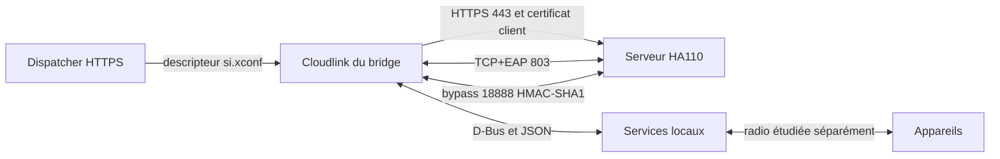

# Cozytouch — cloud, Moria/Mithril et modifiabilité

Analyse hors ligne du 17 novembre 2026. Source : `donnees/nand-2026-11-17/nand-data-128MiB.bin`, SHA-256 `91797af053f204d5fc5bf10ff664d3c47f458a7185d88f03573b7ab12c8c94c2`. Les clés, jetons et identifiants individuels ne sont pas reproduits ici. Aucun accès au bridge ou au cloud, aucune exécution du firmware et aucune programmation flash.

## Résultat principal

Le firmware contient une liaison fabricant **TCP+EAP avec amorçage HTTPS et certificat client**, une API locale protégée, et des scripts de mise à jour des volumes A/B. L’image est lisible et son code LuaJIT peut être étudié. Les fonctions de cette variante déclarent l’authentification UBIFS et le chiffrement désactivés. Ces éléments rendent une modification sur copie plausible ; ils ne prouvent ni le redémarrage d’une image modifiée ni l’absence de vérification dans tous les étages de démarrage.

Les noms recherchés « Mori/Mitril » correspondent aux outils publics **Moria et Mithril**, et non à des agents IA. Les deux outils ont été construits et exécutés sur le HP, dans `<CHEMIN_LOCAL>`.

## Liaison fabricant vérifiée dans les fichiers

Le fichier `extracted/data/dispatcher/connections/si.xconf:2-7` décrit :

| Usage | Destination et protocole configurés | Preuve |
|---|---|---|
| Descripteur de connexion | HTTPS `ha-upgrade-overkiz-2048.overkiz.com/si.xconf` | `rootB/usr/share/wait-for-network/scripts/dispatcher:11-16,121` et `security/envvars` (seule URL partagée extraite) |
| Amorce Cloudlink | `ha110-overkiz-2048.overkiz.com:443/connection-listener/cl` | `si.xconf:4` |
| Canal persistant | `ha110-overkiz-2048.overkiz.com:803`, `tcp+eap` | `si.xconf:2,6` |
| Canal nommé bypass | Même hôte, port `18888`, HMAC-SHA1, anti-rejeu activé | `si.xconf:5` |
| Journaux Cloudlink | Même hôte, HTTPS 443 `/connection-listener/log` | `si.xconf:7` |
| Images système | HTTPS `/images/at91-kizboxmini/` sur le serveur de mise à jour | `rootB/usr/share/kizosenv.sh:254-262` |
| Provisionnement sécurité | HTTPS `/pod/security.squashfs` et métadonnées | `rootB/usr/sbin/image-download:28-33` |

Le descripteur impose les chemins de certificat client, clé privée et CA (`si.xconf:3`). Curl reçoit aussi `--cacert`, `--cert` et `--key` dans `rootB/etc/curl.d/pod-serial.conf:1-3`. Les originaux correspondants existent dans le volume `security`. Leur présence ne prouve pas que le fabricant accepte encore ces éléments à la date d’analyse.

Le canal EAP prévoit une négociation de 15 secondes, un keep-alive de 20 secondes et une durée de vie de 4 heures (`si.xconf:6`). Le code Lua décompilé `Cloudlink/Dispatcher.lua:25-29,136-138` sérialise/désérialise des objets JSON puis passe par `sendObject`. `Cloudlink/Server.lua:5-52,101-102` expose les abonnements et envois par D-Bus, avec topic, payload, TTL et urgence. `Network/EapClient.lua:1,22-30,49` délègue à la bibliothèque native `Overkiz.Network.Eap`.

Le daemon ARM `appsB/overkiz/ows/bin/owsd` contient aussi `tcp+eap` à l’offset fichier `0x52504` et le message `Open TCP/EAP stream` à `0x52f34`. Ses imports EAP et ces chaînes sont conservés dans `owsd-network-strings.json` avec son SHA-256. Ce daemon est un ELF. Les sorties Lua décompilées facilitent la lecture, mais elles ne sont pas une reconstruction source validée pour recompilation.

**Portée :** il s’agit de la configuration sauvegardée et du code livré. Aucun DNS, paquet réseau, protocole effectif ou état de connexion actuel n’a été mesuré. Le fichier prouve un transport `tcp+eap` configuré ; il ne suffit pas à décrire le chiffrement de chaque octet du canal 803 ou 18888. Aucun rôle MQTT ou WebSocket n’est établi pour cette connexion Cloudlink. La présence de bibliothèques WebSocket ailleurs ne démontre pas leur utilisation pour cette liaison.



Le schéma représente les chemins configurés, sans preuve d’un échange actuel. Rendu Mermaid non vérifié.

## Mise à jour et contraintes de modification

- Le dispatcher peut demander une mise à jour du bootloader, de root/apps, de la sécurité ou du bootstrap ; il prévoit aussi un redémarrage et un mode parking (`rootB/usr/share/wait-for-network/scripts/dispatcher:36-103`). Ces branches sont lues, pas exécutées.
- Les images root/apps sont des UBIFS compressés XZ ; sécurité est un SquashFS. `image-download` obtient les métadonnées et vérifie le MD5 du fichier téléchargé (`rootB/usr/sbin/image-download:170-204`). Le téléchargement réseau est protégé par TLS avec certificat client. MD5 vérifie ici une concordance de contenu ; il ne constitue pas une signature autonome du fabricant.
- `image-update-functions.sh:202-240` sélectionne les volumes inactifs root/apps, puis écrit le choix de démarrage dans `boot_information_file`. Le chemin destiné à U-Boot existe dans le code générique mais `have_u_boot()` retourne `false` pour cette variante.
- Dans `rootB/usr/share/kizosenv.sh:69-95`, les fonctions retournent : `have_trusted=false`, `have_u_boot=false`, `have_k_boot=true`, `have_encryption=false`, `have_authentication=false`, `have_apps_ro=false`. La racine A contient les mêmes valeurs. Ce sont des choix du script livré, pas une mesure des fusibles du SoC.
- `rootB/etc/init.d/mount-apps.sh:22-37` ajoute les options UBIFS authentifiées seulement lorsque `have_authentication` est vrai. Le script `image-update` étudié n’apporte pas de preuve d’une signature cryptographique pour root/apps. Des certificats de signature USB et des chemins génériques FIT existent ; leur seule présence ne prouve pas une chaîne de démarrage vérifiée active sur ce bridge.
- Le mécanisme A/B et le remplacement automatique depuis le fabricant peuvent écraser une modification. Une copie modifiée doit être construite et testée séparément avant tout essai matériel. Aucun patch, reconditionnement ou essai de restauration n’est réalisé dans cette piste.

Une API HTTPS locale est déjà configurée dans le firmware : `rootB/etc/lighttpd.d/local.conf:3-9` relie `/enduser-mobile-web/` au socket Unix `/var/run/luaUserAPI`. Le port 443 demande un certificat client et porte le scope `local` (`443/localsocket.conf:2-17`). Le port 8443 porte le scope `devmode` (`8443/devmodesocket.conf:2-16`). **Ces fichiers ne prouvent pas que les services écoutent actuellement.** La génération de jetons et l’activation sont traitées dans la synthèse principale. Un accès D-Bus sans authentification ou la suppression des contrôles de jeton ne sont pas nécessaires pour poursuivre l’analyse.

## Moria et Mithril : exécution réelle

| Élément | Résultat |
|---|---|
| Moria | Version 0.3.0, révision `ae463d6ac74e1fd077db5af037e7de69dcfeee81` |
| Mithril | Version 0.4.0, révision `8dcf57784505c3a83a91d9c2a18f941e322aeda4` |
| Construction | GNU C++ 15.2.0, CMake 4.4.5 décompressé dans le dossier isolé ; aucun paquet système installé |
| Codecs Moria | zlib 1.3.1 et liblzma 5.8.3 détectés ; option `MORIA_OPTIONAL_CODECS=ON` |
| Entrée Moria | Copie brute128 Mio sans OOB ; pas de correction ECC ajoutée par cet agent |
| Détection | UBI à `0x20000`, 13 volumes, confiance structurée99 |
| Extraction | 2 585 fichiers, 1 130 dossiers, 918 liens, 114 053 677 octets ; état **partial**, 3 fichiers orphelins récupérés dans lost+found et second avertissement tronqué |
| Mithril sur extraction Moria | 2 640 fichiers scannés, 11 composants/versions, 3 licences, 32 indices de démarrage ; aucune erreur signalée |
| Secrets | 4détections structurées de clés privées, 21 fichiers notables ; rapport détaillé privé |
| CVE | Passe non exécutée : aucun miroir de vulnérabilités téléchargé. Aucun verdict de vulnérabilité ou d’absence de vulnérabilité |

Les noyaux détectés sont 5.4.294 (A) et 5.4.302 (B). Les bibliothèques détectées incluent OpenSSL 3.0.16 (A) et 3.0.18 (B), Dropbear 2020.81, lighttpd 1.4.67, curl 7.82.0 et glibc 2.35. Ces versions viennent de bannières et ne démontrent pas le niveau de correctifs apportés par le fabricant. Le champ global `kernel_version` de Mithril ne retient que 5.4.294, alors que sa liste de composants comprend les deux noyaux : ne pas l’interpréter comme le noyau actif.

**Faux positif identifié :** Mithril classe les deux fichiers `etc/ssl/dhparam.pem` comme clés RSA avec exposant pair. Leur en-tête est `BEGIN DH PARAMETERS` ; ce sont des paramètres Diffie-Hellman, pas des clés RSA. Ce diagnostic n’établit aucune clé RSA faible. Aucun autre résultat du scan ne prouve une clé privée compromise ou publiée.

Les rapports `mithril.json` et `mithril-secrets-private.json` correspondent à la première copie des fichiers extraits sous Windows, avec liens omis. Les rapports de référence de cette piste sont `moria.json`, `mithril-moria.json` et `mithril-moria-secrets-private.json`, issus de l’extraction Moria native Linux. Leur état partiel reste explicite. La récupération UBIFS et les éventuelles corrections de bit par l’agent extraction constituent une autre chaîne de preuve ; les corpus ne sont pas assimilés.

Le bilan corrigé de l’autre chaîne annonce 2 597 fichiers réguliers, contre 2 585 dans le compteur d’extraction Moria. L’écart ne démontre pas douze fichiers absents : tous les chemins des 2 574 membres réguliers des six archives POSIX corrigées ont été trouvés comme fichiers réguliers sur le HP. Les douze exécutables setuid existent aussi dans l’extraction Moria, avec bits setuid retirés. Les métriques, les corpus brut/corrigé et les orphelins diffèrent ; aucune égalité globale de contenu n’est affirmée. Voir `ACTIVATION-NATIVE.md` pour le contrôle et la nouvelle piste d’activation native.

Reproduction sur le HP depuis le dossier isolé :

```sh
cmake-tool/cmake/data/bin/cmake -S mithril -B mithril/build -DCMAKE_BUILD_TYPE=Release
cmake-tool/cmake/data/bin/cmake --build mithril/build -j4
cmake-tool/cmake/data/bin/cmake -S moria -B moria/build -DCMAKE_BUILD_TYPE=Release -DMORIA_OPTIONAL_CODECS=ON
cmake-tool/cmake/data/bin/cmake --build moria/build -j4
moria/build/moria -j -e -C moria-extracted <CHEMIN_LOCAL>
mithril/build/mithril -j --sbom --licenses --boot --keys moria-extracted
mithril/build/mithril -j --secrets moria-extracted
```

Ne pas publier la dernière sortie. Les commandes ci-dessus exécutent uniquement les outils d’analyse sur les copies.

## Preuves et sources

`evidence-cloud-update.json` conserve les chemins, les SHA-256 et les lignes sélectionnées sans clé privée. `tool-sha256.txt` conserve les empreintes des exécutables construits. `tools/` conserve les exécutables Linux, les sources avec leur révision Git et le paquet CMake. `hp-reports/` conserve les sorties originales. Le SHA-256 de la NAND sur le HP a été recalculé après les analyses et concorde avec la source Windows. Les fichiers détaillés contenant les signalements de secrets restent privés.

Les sources publiques ont servi de pistes de recherche ; elles ne prouvent pas l’état de cette image : [Moria](https://github.com/nmatt0/moria), [Mithril](https://github.com/nmatt0/mithril), [Maasland, Connexoon](https://blog.unauthorizedaccess.nl/2021/04/07/no-clouds-just-sunshine.html), [Lafois, partie 5](https://www.lafois.com/2020/12/20/rooting-the-cozytouch-aka-kizbox-mini-part-5/), [Aldohrs/tahoma-jailbreak](https://github.com/Aldohrs/tahoma-jailbreak).

> Les empreintes historiques des fichiers expurgés se rapportent aux originaux privés.
