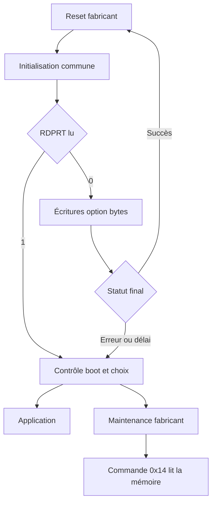

# Sauvegarde STM32 — audit du bootloader fabricant et de fw-updater

Audit statique du 17 novembre 2026, sans accès réseau ni exécution des binaires cibles. Le dossier Ghidra `updater-audit` est indépendant. Les historiques et projets d'analyse des autres agents sont conservés.

## Conclusion pratique

**Le chemin `fw-updater -C read` n'envoie aucune commande d'effacement ou de programmation Flash.** Il ouvre et reconfigure le port, purge ses files UART, effectue une synchronisation fabricant, lit la mémoire avec l'opcode `0x14`, puis ferme le port. Il ne sélectionne pas le mode `update` et ne réinitialise pas le STM32 lui-même. Cette conclusion provient de la décompilation complète du petit ELF livré, recoupée avec son désassemblage ARM et ses constantes.

**Le passage en mode fabricant reste une intervention distincte, non qualifiée sans écriture.** Le démarrage livré appelle une routine d'activation RDP avant de choisir application ou maintenance. Si `FLASH_OBR.RDPRT=0`, cette routine efface et programme les option bytes. L'état actuel du bit n'a pas été mesuré. Ne pas sélectionner `update` sur la seule base du nom `read`.

L'application active v2.4.2 rend plausible un bootloader voisin de celui livré. Elle ne démontre ni son identité intégrale ni l'état RDP. Même sous l'hypothèse d'identité, un passage antérieur par le démarrage ne prouve pas mathématiquement RDP actif : les chemins d'erreur des routines Flash peuvent revenir et laisser continuer le démarrage.

Le lecteur fabricant reste techniquement intéressant : il s'exécute depuis la Flash principale. ST autorise ce code utilisateur à lire la Flash protégée lorsque le débogage n'est pas actif. Cela évite d'avoir besoin d'une déprotection destructive. Voir [PM0075, §2.4.1](https://www.st.com/resource/en/programming_manual/pm0075-stm32f10xxx-flash-memory-microcontrollers-stmicroelectronics.pdf).

## Preuves STM32 contrôlées directement

Image livrée : `../../extracted/appsB/overkiz/share/io-homecontrol/bin/io-homecontrol-boot-stm32-MRIO_v1-v2.4.2.bin` depuis le dossier d'analyse du 17 novembre ; 262 144 octets, SHA-256 `c9346388a534b588438112f65692a166e89f51c7c8656f0b0ccd4a8adddb97f5`.

Le script local audit_stm32.py (non publié) relit l'image immuable et produit boot-literals.json (non publié) et boot-critical.asm.txt (non publié). Le désassemblage inclut des pools de constantes ; seules les plages de code et les littéraux explicitement référencés servent aux conclusions.

| Étape vérifiée | Adresse et comportement |
|---|---|
| Vecteur de reset | Mot à `0x08000004 = 0x080001e5`, donc entrée Thumb `0x080001e4`. |
| Fonction principale boot | `0x0800087c` appelle `0x08000768`, puis `0x0800083c`, puis `0x08000700`, avant application ou `0x080003cc`. |
| Initialisation commune | Appel `BL 0x08000718` à `0x080007c4`, avant le retour et avant le choix maintenance. |
| Lecture du bit | `0x080015f8` lit `[0x40022000 + 0x1c]`, puis `UBFX r0,r0,#1,#1`. C'est `FLASH_OBR.RDPRT`. |
| Condition | `0x08000718` appelle les routines d'option bytes seulement si cette lecture retourne zéro. |
| Effacement d'options | `0x08001690` déverrouille `OPTKEYR`, pose `OPTER=0x20` et `STRT=0x40`. Après attente, pose `OPTPG=0x10` et écrit `0xA5` à `0x1ffff800` si RDPRT initial nul. |
| Configuration utilisateur | `0x080017ec(1,0,0)` prépare `0xF9`, programme le demi-mot à `0x1ffff802` sous `OPTPG`. |
| Activation RDP | `0x08001760(1)` déclenche un nouvel effacement d'options, puis écrit zéro à `0x1ffff800` (instructions `0x080017ac..0x080017b4`). |
| Reset conditionnel | Si le statut retourné vaut 4, écrit la demande `SYSRESETREQ` avec clé `0x05fa0004` dans `SCB_AIRCR` à `0xe000ed0c`, puis boucle. |
| Lecture fabricant | Slot `0x14` enregistré via littéral `0x08000410 = 0x080002c9` ; fonction `0x080002c8` → `0x08000aca` lit les octets à l'adresse et longueur demandées. |

La seconde routine d'effacement empêche de considérer `USER=0xF9` comme configuration finale garantie. L'audit établit les écritures tentées et leur ordre, sans remplacer une lecture des options réelles. Aucun effacement de Flash principale n'est explicitement demandé par ce chemin d'activation ; cela ne rend pas les écritures d'options acceptables pour une acquisition de conservation.

Les retours Flash de `0x08001630` distinguent succès 4, occupation, erreur de programmation, erreur de protection et délai dépassé. Les routines `0x08001690`, `0x080017ec` et `0x08001760` peuvent revenir sur échec. La condition externe ne transforme pas ces retours en blocage systématique du démarrage. Une version applicative fonctionnelle ne suffit donc pas à prouver le bit.

## Chemin exact de fw-updater -C read

ELF livré : `../../extracted/rootB/usr/bin/fw-updater` depuis le dossier d'analyse ; 13 848 octets, SHA-256 `f62df1ab7390235b9efab38ca989ce2f634db215cacf5d0787e2ca803c835520`.

Preuves : fw-updater.c (non publié), updater-critical.asm.txt (non publié), updater-literals.json (non publié), script audit_updater.py (non publié). La décompilation est complète pour le code interne reconnu. Les fausses fonctions du bloc `EXTERNAL` sont des importations libc, pas du code cible exécuté.

1. `main` à `0x00010a90` analyse les options. Le littéral `0x00010fc0` pointe sur la chaîne `read` à `0x00012880`. Cette branche appelle `0x00011cc4` à `0x00010f20`.
2. Avant la distribution, `0x00011ad8` → `0x000117b0` → `0x00011e0c` ouvre le port et règle termios. Cette dernière appelle `tcflush(fd,2)` avant `tcgetattr`, `cfmakeraw`, `cfsetospeed`, `tcsetattr`. Le défaut de vitesse est `0x1002` (constante Linux ARM de 115200). `open` reçoit `0x102`.
3. `0x000117b0` envoie les **8 octets** `SYNCHRO\0` via `0x00011f98`, puis attend les **11 octets** `SYNCHRO_ACK\0` et les compare. Aucune commande `start`, `erase`, `program` ou `write` n'est appelée par cette initialisation.
4. `0x00011cc4` alloue un tampon de la longueur demandée, puis appelle `0x0001152c`. Le template lu via `0x00011620` à `0x00012240` commence par `02 06 14 08`. La trame émise comporte 13 octets : en-tête, adresse 32 bits little-endian, longueur 32 bits little-endian, puis somme sur les 12 premiers octets modulo 256.
5. `0x0001152c` attend un statut nul, lit exactement la longueur demandée, puis attend un second statut nul. La fonction n'appelle que les helpers d'émission et de lecture UART.
6. Avec `-F`, `0x00011cc4` écrit les octets dans un fichier local avec `fopen(...,"w")` et `fwrite`. Sans `-F`, elle écrit les octets au format hexadécimal sur stdout. Le `Done` de la fonction principale peut aussi être imprimé : ne pas traiter tout stdout comme des octets bruts de sauvegarde.
7. `0x00011af0` → `0x00011844` → `0x00011f60` ferme le descripteur. La même fermeture existe sur les retours d'erreur. Aucun retour automatique à l'application n'est envoyé.

**Conséquence pour le daemon radio :** ne pas ouvrir ce programme en parallèle du propriétaire UART actif. Il purge des files et change la discipline du port. Un nom de commande de lecture ne garantit pas l'absence d'effet sur le transport. Une éventuelle acquisition devra posséder l'UART exclusivement et prévoir séparément le retour applicatif.

Le script Linux fabricant `fwupdate.sh` utilise déjà cette commande pour lire 256 octets à `0x0803ff00`. Mais le script complet sélectionne `update`, peut télécharger, programmer, recommencer et finalement appeler `stm32-upgrader`. Il ne constitue pas un outil de sauvegarde sûr à lancer tel quel.

## Préconditions d'une acquisition future

Ces points sont une proposition de préparation, pas une autorisation ni une procédure exécutée.

1. Établir `RDPRT=1` avant de passer par le démarrage fabricant, par une vraie lecture d'OBR ou une méthode indépendante qualifiée. Une identité de version et une inférence de démarrage antérieur ne remplacent pas cette preuve.
2. Vérifier la logique GPIO de la carte réelle, l'exclusivité du port, la suspension temporaire de la radio et le retour applicatif. Conserver SSH Linux en RAM.
3. Identifier le bootloader réellement présent par une lecture bornée puis comparaison des octets critiques, après satisfaction des préconditions. Sa chaîne de version seule ne suffit pas à identifier son code.
4. Lire d'abord des zones de mémoire ordinaires et connues. Le lecteur fabricant ne filtre pas les adresses : ne pas élargir une collecte aux périphériques sans qualification.
5. Pour une sauvegarde physique complète attendue du F101RC, couvrir `0x08000000..0x0803ffff`, y compris le secteur personnalisé `0x08002000..0x080027ff`. Produire deux lectures indépendantes, comparer taille et SHA-256, puis comparer aux images livrées par plages. Sauvegarder aussi les options et identifiants uniquement par des lectures qualifiées.
6. Conserver les deux originaux, un manifeste et une copie vérifiée avant de proposer toute modification durable.

## Sources ST vérifiées

- [PM0075 rév. 2, §2.3.5 et §2.4.1–2.5, p.16–20](https://www.st.com/resource/en/programming_manual/pm0075-stm32f10xxx-flash-memory-microcontrollers-stmicroelectronics.pdf) : programmation et effacement des options ; lecture de Flash par code exécuté depuis Flash ; lecture interdite par debug ; retour protégé → non protégé avec effacement de la Flash principale ; options toujours lisibles. Ces propriétés documentaires ne constituent pas une lecture de l'appareil.
- [AN3155 rév. 21, §3.4 et §3.12](https://www.st.com/resource/en/application_note/an3155-usart-protocol-used-in-the-stm32-bootloader-stmicroelectronics.pdf) : `Read Memory` ROM `0x11`, limité à 256 octets par transaction, avec refus lorsque RDP est actif ; `Readout Unprotect` efface la Flash. Ce protocole est distinct du fabricant `0x14`. `Get Version` retourne deux zéros de compatibilité, pas une mesure fiable des options.
- [AN2606 rév. 71, glossaire F1 et tableau 3](https://www.st.com/resource/en/application_note/an2606-introduction-to-system-memory-boot-mode-stmicroelectronics.pdf) : STM32F101 de 256 Kio dans la famille high-density ; bootloader ROM USART1 v2.2. Le routage et les niveaux effectifs de la carte restent une question matérielle séparée.

## Schéma du risque d'entrée

Le schéma représente le binaire livré, pas un état observé du STM32. Source Mermaid conservée ; rendu visuel non vérifié.

> Les empreintes historiques des fichiers expurgés se rapportent aux originaux privés.
