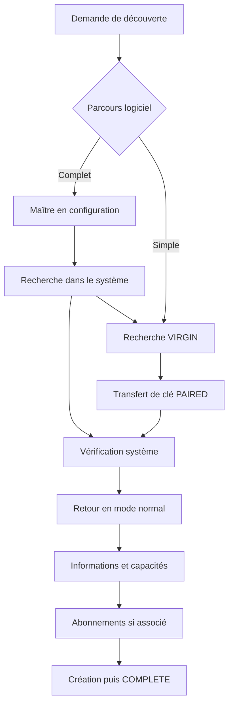

# Association io-homecontrol — mécanisme retrouvé hors ligne

Analyse du 17 novembre 2026. Le logiciel du bridge contient un parcours local complet de découverte et d'association des actionneurs. **La découverte radio, le transfert de clé et la création d'un appareil sont des étapes distinctes.** L'existence d'un appareil dans une liste ne suffit donc pas à prouver son association.

Cette analyse lit les fichiers déjà acquis. Aucun accès au bridge, au LAN, au cloud ou à la radio. Aucun appairage, transfert de clé ou changement d'appareil. Le code livré ne démontre pas le fonctionnement actuel de ces parcours.

## Parcours d'un nouvel actionneur

Les modules de référence proviennent de `appsB/overkiz/io-homecontrol/bin/io-homecontrold`, version de construction `5.3.4`. `source-index.json` relie chaque module à son conteneur, son offset et son SHA-256. Les reconstructions Lua servent à suivre les appels. Pour `CommandTracker`, dont LJD échoue, la pseudo-assembleuse des instructions a été conservée dans `CommandTracker.asm.txt`.

Schéma du code statique, avec les deux recherches du parcours complet représentées. Chaque appareil suit la branche de sa recherche. Le parcours spécial `DISCOVER_UNSET_ACTUATOR` peut poursuivre avec `Unpaired` après un échec de transfert/vérification. Les télécommandes ont un parcours distinct. Rendu Mermaid non vérifié.

Le chemin complet `DiscoverActuatorAllUseCase.run` met d'abord le maître de pile en `CONFIGURATION` avec `SMART_REPEAT_MODE`. Il lance ensuite `DISCOVER_ACTUATOR_IN_SYSTEM`, puis `DISCOVER_ACTUATOR`, avant de terminer les nœuds reçus. Le parcours simple choisit directement ce second cas.

| Parcours | Recherche demandée au STM32 | Avant la lecture des informations |
|---|---|---|
| Actionneur nouveau, `DiscoverActuatorUseCase` | `VIRGIN = 0` | `transfertKey`, puis `systemVerification` |
| Actionneur déjà dans le système, `DiscoverActuatorInSystemUseCase` | `SYSTEM_WITH_LPM = 1` | `systemVerification`, sans nouveau transfert explicite dans ce module |
| Variante Somfy privée, `DiscoverActuatorInDPCUseCase` | `PRIVATE_SOMFY = 6` | Transfert puis vérification |
| Variante non associée, `DiscoverUnsetActuatorUseCase` | `VIRGIN = 0` | Essaie transfert et vérification ; peut conserver le statut `Unpaired` |

Le nom `VIRGIN` est celui du firmware. Il ne prouve pas qu'un appareil doit être réinitialisé en usine. Le fichier `DiscoverActuatorExecutor` nomme aussi le choix simple `IN_CONFIG_STATE` : il concerne les appareils rendus disponibles à cette recherche, selon leur état de configuration.

Dans le parcours « dans le système », le logiciel envoie d'abord `discovered` aux actionneurs/balises déjà connus. Il lance la recherche, puis demande leur retour en mode normal. Le filtre de résultats ne crée que les adresses d'actionneur encore absentes du gestionnaire. Une nouvelle recherche n'équivaut donc pas à une réassociation de toutes les entrées existantes.

Après la phase préalable, `AbstractDiscoverActuatorUseCase.discoverNode` demande `NORMAL_OPERATING_MODE`, lit GeneralInfo1/2, puis les capacités et objets supplémentaires si la version de protocole les permet. Il applique les traitements fabricant, crée le nœud dans le gestionnaire ou le délègue à OGP, publie ses états et termine le nœud par l'action `COMPLETE`. Certaines lectures GeneralInfo ont un repli en cas d'échec. Le statut logiciel final ne prouve pas à lui seul que chaque capacité a répondu.

## Ce que signifie le transfert de clé

Le bytecode `CommandTracker` établit les appels suivants, sans exécution :

| Fonction Lua | Sous-commande de General Information |
|---|---|
| `transfertKey(node)` | `PAIRED = 6` |
| `systemVerification(node)` | `SYSTEM_VERIFICATION = 4` |
| `discovered(node)` | `DISCOVERED = 15` |
| `configState(node, state)` | `CONFIG_STATE = 8` |

`startDiscover` construit `MASTER_MANAGEMENT__DISCOVER` avec l'adresse source du maître, le type de découverte, le mode de répétition, la version de protocole et une `ioSystemKey` obtenue par `getCurrentSystemKey`. La clé est donc fournie à la couche STM32 par Linux dans cette API. Ce constat ne signifie pas qu'une clé est diffusée en clair sur les ondes.

La construction de General Information sélectionne `node.oldSystemKey` lorsqu'il existe, sinon `stackMaster.key`, et le place dans `ioSystemKey`. Cela confirme que le firmware gère plusieurs contextes de clé. **Il ne justifie pas de copier arbitrairement la clé globale de pile dans le champ d'une nouvelle passerelle.** Le choix effectif de `getCurrentSystemKey` délègue à la couche C++ et n'est pas résolu par la simple lecture de ces modules.

Un autre parcours, `SendKeyUseCase`, exécute `SEND_KEY`, recharge le nœud, installe les abonnements, puis le passe à `Done`. Le firmware prévoit donc aussi une étape de finalisation pour une entrée connue nécessitant un transfert. Elle reste une opération active sur les clés.

La méthode locale `propagateTransferKey` est également livrée. `ConfigDelegate` encode les options `propagate` et `saveMasterNode` vers le paramètre `IoTransferKeyUseCase`. Son implémentation principale est native ; les noms d'exports REA confirment sa présence mais ne suffisent pas à décrire tous ses effets. Elle ne doit pas être confondue avec une lecture ou une découverte passive.

## Appareil découvert, associé et disponible

Le modèle de nœud distingue `Intermediate_Discover = 4`, `Intermediate_Discovered = 3`, `Intermediate_Paired = 2`, `Intermediate_Unpaired = 9`, `Done = 1`, `Partial = 11` et `Unpaired = 12`. Ce sont des valeurs du modèle, pas une chronologie exhaustive démontrée de toutes les transitions natives.

`DiscoverUnsetActuatorUseCase` peut conserver un appareil en `Unpaired` après l'échec de son étape préalable. Il publie alors `NO_KEY_TRANSFER_SETUP_REQUIRED`. Le parcours commun saute l'abonnement aux événements lorsque le statut est `Unpaired`, et `nodeModel.isAvailable` exclut ce statut. Une entrée peut ainsi exister et être décrite sans offrir le même service qu'un appareil associé.

Pour IC3 et CETHI V4, cette analyse n'examine pas les valeurs privées des clés ni leur validité actuelle. Les tailles et différences déjà établies restent documentées dans `../../direct-devices/key-schema-only.json`.

## Contrôleur et actionneur sont deux rôles

Un **actionneur** réalise une fonction commandée. Les profils `ELECTRICAL_HEATER = 52` et `DOMESTIC_HOT_WATER = 51` couvrent ici les familles IC3 et CETHI V4. Un **contrôleur** émet des commandes ou des événements utilisateur. Le modèle distingue les classes ACTUATOR, CONTROLLER, MASTER, STACK, SENSOR et BEACON.

Le code commun teste explicitement le profil `REMOTE_CONTROLLER = 1023` rencontré pendant la découverte d'actionneurs. Dans ce cas, il demande le mode normal et journalise « Closing config state without pairing ». Ce n'est donc pas le parcours destiné à ajouter une télécommande.

Le chemin séparé `Discover1WControllerDynamicUseCase` attend des événements de configuration, récupère les informations du contrôleur, sa clé 1W, ses capacités et ses actions, puis crée/met à jour une classe CONTROLLER. Il ne faut pas appliquer ce mécanisme 1W aux deux appareils Atlantic 2W.

Le **maître de pile** fournit le contexte local d'adresses et de clés. Sa présence dans le stockage ne constitue pas un troisième appareil de chauffage.

## Interface locale et rôle du geste physique

Les routes HTTP `io/discover`, `io/discover/simple`, celles de découverte de capteurs/télécommandes et `io/propagateTransferKey` sont présentes dans le logiciel local. **Elles exigent `TokenScopes.Pro` dans le code étudié.** La disponibilité d'un jeton `devmode` ne démontre donc pas un droit HTTP d'association. La délégation `ConfigDelegate` construit ensuite une exécution sur le nœud de pile, avec un identifiant d'exécution et une durée de 120 secondes. Ces routes ne sont pas appelées ici.

Le firmware du bridge sait envoyer des changements d'état de configuration. Cela ne démontre pas qu'il peut rendre à distance découvrable un appareil neuf ou appartenant à une autre installation. L'interface utilisateur exacte, le bouton et la durée d'ouverture d'association des modèles IC3/CETHI V4 restent inconnus dans les preuves locales étudiées.

La copie primaire déjà conservée de la fiche Home IO Control **Adelis** décrit, pour ce modèle voisin, un menu de connectivité sur l'appareil puis une action Discover & Pair de la passerelle. Elle rapporte aussi une clé propre à chaque sèche-serviettes. La fiche **Calypso Connecté** rapporte l'acceptation du transfert de clé sur un appareil testé. Ces résultats soutiennent le mécanisme général ; ils ne prouvent ni la procédure du modèle exact de <PERSONNE>, ni l'innocuité d'une nouvelle association pour ses commandes existantes. Aucune recette de bouton, réinitialisation ou transfert n'est proposée sur cette seule base.

## Sources et limites de reprise

Les modules déterminants sont répertoriés avec leurs empreintes dans source-index.json (non publié). Les fichiers ci-dessous sont les reconstructions locales de banque B, sous `../../lua/embedded/` :

- `fcf15076243d/ConfigDelegate.lua` : délégation locale et encodage des options de transfert.
- `bc8f8fa38646/DiscoverActuatorExecutor.lua` : choix des cinq parcours.
- `93392cab0747/DiscoverActuatorAllUseCase.lua` : parcours complet.
- `db0bad92c0bd/DiscoverActuatorUseCase.lua`, `62613ecca430/DiscoverActuatorInSystemUseCase.lua`, `d03a3d25d643/DiscoverUnsetActuatorUseCase.lua` : découverte et phase préalable.
- `cccedec6c474/AbstractDiscoverActuatorUseCase.lua` : filtrage, exception des contrôleurs, interrogation, abonnement et création.
- `950e190ee80a/nodeModel.lua` : rôles, profils et statuts.
- `196c30b920b8/SendKeyUseCase.lua`, `069ca9fe4ffe/Discover1WControllerDynamicUseCase.lua` : parcours séparés.
- `3c08eb8cc9a8/GeneralInformationSubCommand.lua` et `80a997bebd14/ConfigState.lua` : constantes.
- `098196fe0933/Overkiz/HomeAutomation/Local/API/enduser/config/ioAPI.lua` : vérification de scope `Pro`.
- CommandTracker.asm.txt (non publié), lignes 281–384 : découverte et sous-commandes ; lignes 1784–1787 et 1877–1955 : choix et insertion de la clé. La commande LJD a écrit cette pseudo-assembleuse avant d'échouer pendant la reconstruction Lua ; aucun fichier Lua reconstitué de ce module n'est présenté comme réussi.
- `../../stm32/README.md`, section « Appairage, cryptographie et données de carte » : API de découverte, clé de maître, AES et limites de stockage durable.
- `../../direct-devices/sources/docs__devices__atlantic-adelis.md` et `docs__devices__atlantic-calypso.md` : copies primaires épinglées lors de l'étude précédente, consultées hors ligne ici. Leur version et leurs URL sont dans `../../direct-devices/SOURCES.md`.

La suite utile hors ligne est de résoudre l'état machine natif du transfert et la sélection de clé, puis d'identifier les notices exactes IC3/CETHI V4 à partir des références commerciales déjà acquises. Une future opération d'association devra être étudiée comme une modification de sécurité des appareils ; cette enquête ne l'exécute pas et ne la rend pas nécessaire pour poursuivre les lectures avec les appairages conservés.

> Les empreintes historiques des fichiers expurgés se rapportent aux originaux privés.
