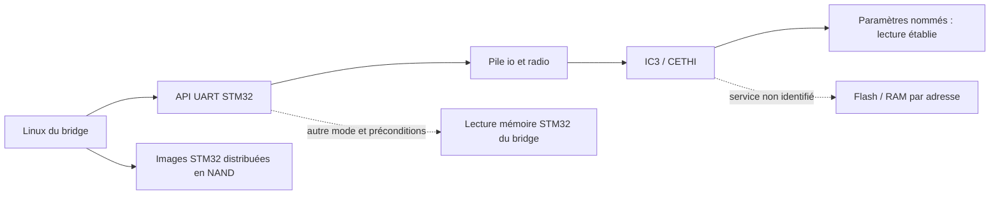

# Mémoire des actionneurs : ce que permet le chemin radio retrouvé

Analyse strictement hors ligne du 17 novembre 2026. Aucun accès au bridge, aucune émission radio et aucun programme extrait exécuté. REA et Ghidra avaient déjà produit les exports STM32. Les nouvelles décompilations natives ont utilisé Ghidra autonome 12.1.4, dans son projet existant ouvert en lecture seule. Elles ne constituent pas de nouvelles Evidence REA.

**Le bridge sait lire des paramètres des deux appareils. Aucune lecture de leur Flash ou de leur RAM par adresse n'est établie.** Plusieurs fonctions portant les mots mémoire, Flash ou téléchargement existent dans le logiciel partagé. Leur domaine réel empêche de les assimiler à un service de sauvegarde IC3/CETHI.

## Périmètre et méthode

- Banque appsB issue de la NAND initiale, `io-homecontrold` 5.3.4 et `Daemon.so` SHA-256 `899ff3434c2e79f20872660ad6f4098f3ec55bba101fd7e376472c4ffb8fd593`.
- Inventaire des 795 modules Lua imbriqués propres à ce daemon : 793 décompilés. Les deux échecs sont `ovk/iovp/Command/CommandTracker.lua` et `ovk/iovp/Local/Driver/Driver.lua`. Leurs désassemblages antérieurs restent lisibles. Recherche complémentaire de chaînes dans les 795 bytecodes, y compris les deux échecs.
- Catalogue exact IC3 et CETHI V4, avec résolution de la référence CETHI `slot4[604]`. Les fichiers `*-catalog.txt`, `cethi-component-604.txt` et `*-parameter-modules.json` conservent les lignes et correspondances. La correspondance numérique d'un état ne suffit jamais à établir une commande.
- Recherche des symboles natifs mémoire/firmware/diagnostic, puis décompilation ciblée de `ModbusMemoryDumping` et des constructeurs Atlantic. Les noms viennent des symboles livrés. Les types décompilés peuvent être approximatifs.

Reproduction des inventaires : `python analyse-2026-11-17/offline-next/radio-memory/inventory_radio.py`. Ce script lit uniquement des fichiers locaux et écrit ses résultats dans son propre dossier. Il ne charge ni Lua ni bibliothèque native du fabricant.

## Trois objets différents

Rendu Mermaid non vérifié. Le STM32 représenté est celui du bridge. Il n'est pas le microcontrôleur interne du sèche-serviettes ou du chauffe-eau. Les images présentes en NAND sont des images du bridge. Leur conservation ne sauvegarde pas les appareils radio.

Les lectures natives et leurs preuves ont déjà été consignées dans `../../live-interface/offline-stm32/LECTURES-APPAREILS.md`. Elles démontrent une lecture de paramètre principal et une lecture ciblée IC3. Elles ne contiennent pas d'adresse mémoire ni de longueur de Flash. Les caches de paramètres doivent conserver leur date, leur provenance et leur limite de fraîcheur.

## Résultats vérifiés dans les fichiers

### Le mot Firmware désigne une version

Le module `lua/embedded/07edee9d878a/Firmware.lua` déclare une fonctionnalité `commandLess = true`. Son gestionnaire lit `getSoftwareVersion` depuis `ACTUATOR_GENERAL_INFO_1`. Il n'y a dans ce module ni transfert de blocs, ni adresse mémoire, ni lecture de code appareil.

Le catalogue CETHI V4 expose `201342977`, dont `lua/embedded/d4b867b1113d/NumeroSoft.lua` définit l'accès READ et le rafraîchissement de démarrage. C'est une identification logicielle, pas une image de cette version.

### Les accès Atlantic sont des registres de protocole

`../../live-interface/offline-stm32/atlantic-private.c` établit deux constructeurs de requêtes : `Atlantic::Parameter::Generic::create` et `GenericV2::create`. Leurs branches READ et WRITE choisissent des octets d'accès distincts et empaquettent l'identifiant de paramètre et la valeur. Ils ne transforment pas un identifiant Overkiz en pointeur de RAM/Flash.

Le nouvel export `atlantic-constructors.c` complète cette observation. `Generic::getCmdIndex`, Ghidra `0x001a57b0`, extrait un octet du champ identifiant, aux bits 8–15 ou 16–23 selon le type enregistré. C'est un indice de commande. Le constructeur reçoit aussi l'accès et l'identifiant fixés lors de l'enregistrement. `ParameterManager::getParameter`, déjà exporté dans `atlantic-private.c`, exige une correspondance de l'identifiant complet. Une tentative d'utiliser une adresse Flash comme paramètre n'est donc pas un mécanisme de lecture démontré.

Le transport privé accepte des octets fabricant. Cela laisse techniquement une place à un service fabricant encore inconnu. **L'absence d'un service trouvé n'est pas une preuve d'impossibilité matérielle.** Il faudrait identifier le service réel et son comportement sur le firmware des actionneurs avant toute requête.

### ModbusMemoryDumping existe, mais concerne un autre profil

La classe native `Overkiz::IoHomecontrol::ModbusMemoryDumping` est réelle. `memory-dumping.c` conserve sa décompilation : constructeur Ghidra `0x001d6cf0`, création `0x001d7010`, analyse des réponses `0x001d76f4`. La création transporte un Blob et l'analyse traite plusieurs étapes. Ce n'est pas un lecteur de mémoire Linux local.

La liaison logicielle retrouvée est **OVP**, profil `OverkizModbusGateway`, dans `lua/embedded/9b9c191c439c/257.lua`. Ce profil charge `ovk.ovp.Parameter.Private.Overkiz.Modbus.ModbusMemoryDump`. La définition `lua/embedded/de9cf7809921/ModbusMemoryDump.lua` utilise le paramètre **186843135**, READ, avec démarrage et intervalle de 18 heures.

Ni IC3 ni CETHI V4 ne sont ce profil. Le namespace C++ `IoHomecontrol` commun aux composants ne prouve pas que ce dump est pris en charge par ces actionneurs. Aucun test de ce paramètre n'est proposé.

### DumpMemory et DebugFlash appartiennent à Cotherm OVP

`lua/embedded/342df2d23ee7/15.lua` décrit **CothermThermostat**, dans `ovk/ovp/Node/Class/C0/P260`. Il charge les deux objets suivants :

| Objet OVP | Paramètre Overkiz | Valeur de préparation déclarée |
|---|---:|---|
| DumpMemory | 83935233 | `0B 14 09` |
| DebugFlash | 83935233 | `0B 14 10` |

Sources : `lua/embedded/c834e90ede51/DumpMemory.lua` et `lua/embedded/d2707fa1f8e7/DebugFlash.lua`. Ces valeurs sont des constantes publiques de protocole, pas des données d'appareil.

**Le même identifiant 83935233 existe dans IC3 pour un autre objet.** `lua/embedded/b5921c6b51d1/CoexistenceIdentifierObject.lua` prépare `00 C0 01`. La partie discriminante réside donc aussi dans le profil, le protocole et le payload. La présence du nombre dans IC3 ne prouve aucun service mémoire. Transposer les payloads Cotherm à IC3/CETHI serait une expérimentation non qualifiée.

### GO_IN_DOWNLOAD_STATE reste une piste Somfy non établie pour Atlantic

`lua/embedded/65099d6020dc/Command.lua`, namespace `ovk/iovp/PresentationLayer/Model/Private/Somfy`, déclare :

- `GO_IN_DOWNLOAD_STATE = 222`, soit `0xDE`.
- `GET_DATA = 236`, soit `0xEC`.
- `PUT_DATA = 235`, soit `0xEB`.
- `PREPARE_DATA_FOR_READ_DATA_REQ = 221`, soit `0xDD`.

La recherche dans les modules décompilés et les bytecodes du daemon appsB ne retrouve `GO_IN_DOWNLOAD_STATE` que dans cette déclaration. Le module `GetDataBaseCommand.lua` prépare une commande Somfy `02 EC` suivie d'un identifiant 16 bits, puis retire l'en-tête de la réponse. `ReadPrivateBaseCommand.lua` passe explicitement `Manufacturer.SOMFY` à `sendPrivate`.

Ce sont des indices d'une maintenance ou d'un transfert privé Somfy. Aucune compatibilité Atlantic, entrée de bootloader IC3/CETHI ou relecture de Flash n'en découle. Une entrée en téléchargement peut changer le mode d'un appareil. Ces opcodes ne sont pas des sondes de lecture à envoyer.

### Les images livrées concernent le STM32 du bridge

L'inventaire local trouve les images MRIO v2.4.1 et v2.4.2, les images RTX et IdealRF dans les dossiers de distribution. Aucune image nommée pour les versions d'actionneurs historiques E725008/E722804 n'a été identifiée dans cet inventaire de fichiers `.bin/.hex/.fw`. Cette recherche par chemins et extensions ne prouve pas qu'aucune ressource opaque de ce type n'existe ailleurs.

Le firmware STM32 du bridge contient des accès radio, de version, de calibration et de personnalisation. Son lecteur mémoire de bootloader lit la mémoire **du bridge**. Les risques d'entrée en mode bootloader sont détaillés dans `../../stm32/LECTURE-ET-COMMANDES.md`. Rien dans cette analyse ne l'autorise ou ne le rend nécessaire pour lire les paramètres Atlantic.

## Lectures ciblées possibles à qualifier

Ces candidats sont présents dans les profils exacts et possèdent une définition READ. Ils prolongent la route native déjà utilisée avec succès. **Ils n'ont pas été exécutés par cet agent.** Ils ne donnent ni une sauvegarde complète des réglages ni un dump mémoire. Une relecture du cache avant/après, un callback final et une réponse radio décodée permettront de qualifier la valeur obtenue.

| Profil | Paramètre | Champ | Preuve Lua |
|---|---:|---|---|
| IC3 | 201398273 | Identité de marque | `d3a73d3eae36/IdentiteMarque.lua` |
| IC3 | 201398529 | Identité de modèle | `f58427bc5dfe/IdentiteModele.lua` |
| IC3 | 201398785 | Identité de puissance | `8de2fe13abcd/IdentitePuissance.lua` |
| IC3 | 201408769 | État d'erreur 6 | `f9a584fda393/EtatErreur6Ssv.lua` |
| CETHI V4 | 201342977 | Numéro logiciel | `d4b867b1113d/NumeroSoft.lua` |
| CETHI V4 | 201327105 | Erreurs | `4903e332a0fe/Erreurs.lua` |

Les chemins de cette table sont sous `analyse-2026-11-17/lua/embedded/`. La route proposée est un paramètre exact, READ=true, valeur Blob vide, sur l'adresse déjà vérifiée du nœud. Ne pas ajouter une adresse mémoire, ne pas découvrir de nouveaux nœuds et ne pas utiliser les commandes OVP/Somfy ci-dessus. Le callback de la route précédente ne portait pas toujours la valeur ; sa terminaison seule ne suffit pas à établir le contenu lu.

## Ce qui reste inconnu

| Question | État |
|---|---|
| Sauvegarder les paramètres lisibles et les caches existants | Possible pour les champs identifiés, avec fraîcheur et couverture documentées. |
| Lire la version logicielle des actionneurs | Route d'identification établie dans le code ; champs réels à relire si nécessaire. |
| Télécharger un firmware IC3/CETHI distribué | Aucun paquet identifié dans les fichiers examinés. Un paquet distribué ne serait pas un dump personnalisé. |
| Mettre à jour IC3/CETHI par radio | Aucun chemin qualifié retrouvé dans cette surface ; opcode Somfy de téléchargement sans compatibilité Atlantic établie. |
| Lire RAM/Flash IC3/CETHI par adresse via radio | Aucun service identifié, aucune preuve de dump. Possibilité fabricant cachée non exclue. |
| Lire les appareils par SWD/JTAG ou bootloader interne | Microcontrôleur, broches, protections et procédure non établis. Nécessite une étude propre à chaque carte. |

La prochaine étape utile pour une sauvegarde réelle des actionneurs est d'identifier leurs cartes et leurs microcontrôleurs, ou de retrouver une documentation/implémentation de maintenance exacte. Un protocole de mise à jour ne suffit pas : il faut démontrer une lecture en sens inverse avant d'envisager de préserver leur mémoire via radio.

## Preuves conservées

- `module-inventory.json`, `symbol-inventory.json`, `content-scan.json`, `bytecode-string-scan.json` : périmètre et recherches bornées.
- `ic3-catalog.txt`, `cethi-catalog.txt`, `cethi-component-604.txt`, `*-parameter-modules.json` : extraits avec lignes d'origine. Les correspondances de modules incluent volontairement les collisions de nombres OVP et ne doivent pas être interprétées comme des dépendances de profil.
- `memory-dumping.c`, `atlantic-constructors.c` et journaux Ghidra : nouvelles décompilations statiques ciblées, base ELF augmentée de `0x10000`.
- `manifest-sha256.json` : hashes des nouveaux livrables. Aucun secret, adresse unique, clé d'appairage ou configuration privée n'y figure.

> Les empreintes historiques des fichiers expurgés se rapportent aux originaux privés.
