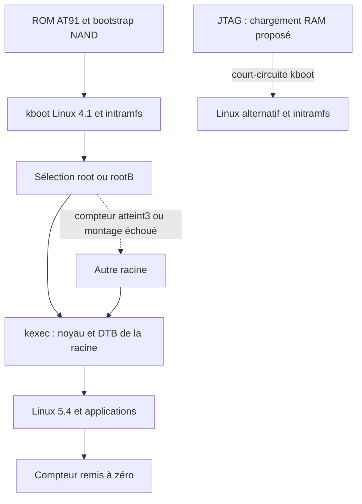

# Linux alternatif : conserver le démarrage et commencer en RAM

Étude du 17 novembre 2026, limitée aux copies locales et à onze petits fichiers publics primaires. Aucun SSH, arrêt CPU, redémarrage, accès radio, montage du stockage réel ou écriture de firmware n'a été exécuté par cet agent.

**Un Linux alternatif est techniquement crédible sur cette carte. Le support matériel exact existe dans Linux amont. La première cible utile est un système minimal en initramfs, chargé en RAM par le chemin JTAG déjà démontré avec le noyau constructeur.** Le remplacement persistant doit attendre la qualification du redémarrage, du retour automatique et de la restauration NAND. Aucun besoin de remplacer le bootstrap ou kboot n'est établi.

## Matériel et stockage effectivement identifiés

| Élément | Preuve locale | Conséquence |
|---|---|---|
| Carte | DTB `Overkiz Kizbox Mini`, compatible `overkiz,kizboxmini-base` ; straps `miniio` qualifiés dans les essais RAM | Employer le DTS `base`, pas celui d'une Kizbox ou d'une carte d'évaluation voisine. |
| Processeur | Marquage photo AT91SAM9G25-CU, DTB `atmel,at91sam9g25`, JTAG cohérent ; runtime ARMv5TEJ | ARM926EJ-S/ARMv5 ; pas de noyau ARMv7/ARM64 ni d'ABI hard-float. |
| DDR | DTB livré : `[0x20000000,0x28000000)`, soit128 Mio ; RAM Micron D9RZH sur photo | Dimensionner noyau, initramfs décompressé et services dans128 Mio. Il ne s'agit pas d'un test exhaustif de chaque cellule. |
| NAND | Macronix MX30LF1G18AC-TI ; acquisition physique65536 pages |128 Mio de données +4 Mio OOB, pages2048+64, blocs64 pages, PEB128 Kio. |
| ECC | DTB : matériel, force4 bits/512 octets ; contrôles BCH indépendants de l'extraction | Préserver PMECC et disposition OOB. La copie brute contient les erreurs stables que corrige la lecture ECC. |
| Partitions physiques | `bootstrap` offset0 taille`0x20000` ; `ubi` offset`0x20000` taille`0x7fe0000` | Conserver ce découpage ; le bootstrap n'est pas un volume UBI. |
| UBI | MinIO2048, données à+4096, LEB126976=`0x1f000`=124 Kio ; BBT en flash | Ne pas utiliser une recette générique avec LEB126 Kio. Préserver les blocs défectueux et réserves UBI. |
| Volumes |13 volumes : dtb/spare, kboot/spare, security/spare, persistent/spare, root/rootB, apps/appsB, data | Une sauvegarde de root/apps ne suffit pas à récupérer toute la carte. |

Sources : `../../extraction/dtb-interesting-properties.json`, `../../extraction/ubireader-info.txt`, `../../../donnees/nand-2026-11-17/README.md`, `dtb-verified-properties.json`. La RAM et les registres des périphériques ont déjà été utilisés lors des essais RAM du coordinateur ; cette étude ne refait aucune mesure.

## Chaîne de démarrage et retour existant

Les chemins pleins sont établis par les artefacts ou les essais déjà conservés. Le chemin JTAG vers un **nouveau** Linux reste proposé. Le chemin JTAG avec le noyau constructeur5.4.302 a déjà donné un SSH root en RAM. Source Mermaid modifiable ; rendu non vérifié.

**Nouvelle inspection du kboot réel :** le volume 2 et son spare 3 reconstruits depuis l'acquisition Linux avec correction ECC sont identiques. Chacun fait4893365 octets et porte le SHA-256 `2e0bee6b763c35b1ede9039b1f65407a5c1d9e8fbafeb49d4e713de2588b5f74`. Les78 blocs statiques ont leurs CRC EC/VID/données vérifiés. Le gzip du zImage est valide et révèle **Linux 4.1.31, construit le2 août 2018**, avec un initramfs de5849600 octets et490 entrées. Ce noyau de démarrage est distinct du runtime5.4.302.

Les extractions kboot de l'acquisition JTAG brute initiale ne passent pas le CRC gzip. Elles diffèrent respectivement de25 et22 octets des versions ECC ultérieures. Elles restent conservées comme références brutes. L'acquisition Linux ultérieure est non atomique ; l'identité des deux volumes et leurs CRC structurés étayent ici les images kboot reconstruites, pas l'atomicité de toute la NAND.

Le script extrait `kboot-selected-scripts/usr/sbin/boot-ubifs` établit le contrat de démarrage :

1. Lire `/persistent/boot/boot_information_file` et `boot_count_file` ; incrémenter le compteur.
2. À partir de3, choisir l'autre racine et écrire le compteur0. En cas de montage impossible, essayer également l'autre racine.
3. Monter la racine choisie en lecture seule, lire son script `at91-kizboxmini-bootscript-vars` et sélectionner le DTB selon les straps.
4. Charger `/boot/zImage`, `/boot/dtb` ou le DTB choisi, `/boot/cmdline`, et **facultativement `/boot/initrd`**, puis exécuter `kexec`.
5. Imposer `root=ubi0:root` ou `root=ubi0:rootB` dans la commande du noyau.

Le runtime5.4 réinitialise le compteur avec `etc/init.d/bootcount-reset`. **Ce mécanisme n'est pas une validation de santé applicative.** Il peut déclarer le démarrage réussi avant que le service local ou la radio soit fonctionnel. Une nouvelle image qui l'appelle trop tôt perd son retour automatique utile.

Autre limite concrète : `boot-ubifs` peut remonter la racine en écriture pour un identifiant de bootloader manquant. Le kboot livré peut formater `persistent` si son montage échoue. Le runtime possède aussi des chemins de formatage et de nettoyage de données. Ces scripts ne doivent pas servir d'init à l'essai RAM qui promet l'absence d'écriture NAND.

Le mode USB du kboot n'est pas une entrée libre : `boot-usb` exige une vérification RSA du noyau et du script de paramètres avec un certificat de la zone security. Aucune clé de signature correspondante n'est supposée disponible. Les fonctions `have_authentication=false` des scripts runtime ne suppriment pas cette vérification USB.

## Noyau amont, Buildroot et OpenWrt

Linux **v6.12**, commit`adc218676eef25575469234709c2d87185ca223a`, fournit le [DTS exact KizboxMini base](https://github.com/torvalds/linux/blob/adc218676eef25575469234709c2d87185ca223a/arch/arm/boot/dts/microchip/at91-kizboxmini-base.dts) et son [fichier commun](https://github.com/torvalds/linux/blob/adc218676eef25575469234709c2d87185ca223a/arch/arm/boot/dts/microchip/at91-kizboxmini-common.dtsi). Celui-ci décrit la DDR128 Mio, NAND/ECC4 bits, partitions bootstrap/UBI, USART0, MACB, USB et watchdog. Cela réduit nettement le portage de carte. Cette version sert de référence reproductible ; elle n'est pas présentée comme la dernière révision de sécurité à déployer.

La [configuration AT91 de cette version](https://github.com/torvalds/linux/blob/adc218676eef25575469234709c2d87185ca223a/arch/arm/configs/at91_dt_defconfig) fournit notamment ARMv5, initrd, kexec, MTD/UBI, NAND Atmel, Ethernet MACB et console série. C'est une base à réduire. Sa ligne de commande générique et ses adresses initrd ne constituent pas la configuration de cette carte.

Deux différences doivent être traitées explicitement : le DTB runtime livré désactive DBGU, alors que le DTS amont l'active ; les interfaces `/sys/kboot/*` des scripts constructeur relèvent d'une intégration spécifique, dont l'équivalent amont n'est pas établi ici. Un remplacement de noyau ne peut donc pas reprendre les scripts de redémarrage constructeur sans adaptation. L'USART radio doit rester distinct de la console.

**Buildroot est le choix recommandé pour préparer le premier système minimal.** Le [defconfig SAM9X5 du tag 2026.08](https://github.com/buildroot/buildroot/blob/d5180309b1b66ef3b8eaccca70ad69be8e0729a1/configs/at91sam9x5ek_defconfig) confirme la chaîne ARM et une recette AT91, mais cible une carte d'évaluation et ses bootstrap/U-Boot. Il faut un defconfig propre KizboxMini avec DTS exact, initramfs et chaîne de compilation épinglée. Aucune image de carte d'évaluation ne doit être chargée telle quelle. Le choix de libc et la reprise éventuelle des bibliothèques OEM sont traités par l'axe utilisateur séparé.

OpenWrt **v24.10.0**, commit`1fad1b4965dc6f4e5f4ba7b9605987f443a4c276`, propose la [cible AT91/SAM9X ARMv5](https://github.com/openwrt/openwrt/blob/1fad1b4965dc6f4e5f4ba7b9605987f443a4c276/target/linux/at91/sam9x/target.mk). Aucun profil KizboxMini n'est présent dans le [fichier des images sam9x examiné](https://github.com/openwrt/openwrt/blob/1fad1b4965dc6f4e5f4ba7b9605987f443a4c276/target/linux/at91/image/sam9x.mk). Son défaut NAND utilise LEB126 Kio, différent des124 Kio OEM ; plusieurs recettes attendent un démarrage FIT/U-Boot. Le support SoC existe, mais il faut créer une recette d'image et de mise à jour adaptée au kboot. OpenWrt n'offre donc pas un gain immédiat pour ce premier essai.

## Essai RAM : étapes proposées et preuves attendues

La prochaine étape concrète est la **construction hors ligne** d'un noyau et d'un initramfs minimal, pas une modification de NAND. Aucun gros outil n'a été installé et aucune image de démarrage alternative n'a été compilée dans cette étude.

| Étape | Contenu et critère de réussite | Arrêt ou retour |
|---|---|---|
|1. Construction reproductible | ARM926/soft-float, DTSbase, BusyBox et accès d'administration local, watchdog ; versions et SHA figés. Premier noyau avec MTD/UBI désactivés pour empêcher les écritures NAND par ce système. | Ne pas charger si le DTS, l'ABI, les tailles ou le mécanisme d'administration ne sont pas vérifiés. |
|2. Validation des placements | Recalculer décompression, BSS, pile et emplacement initramfs pour **la nouvelle image** dans128 Mio ; prouver absence de chevauchement. | Les marges du noyau5.4.302 ne se transfèrent pas à un autre noyau. |
|3. Chargement JTAG limité à la RAM | Après autorisation matérielle distincte : reprendre la quiescence DMA, MMU/cache et watchdog déjà qualifiée ; transférer et relire par SHA, puis entrer dans le noyau selon l'ABI ARM. | Abandon sur écart de hash, watchdog, DMA ou état CPU. Après engagement de la quiescence, ne pas reprendre l'ancien contexte Linux. |
|4. Validation minimale | Prouver noyau/initramfs attendus,128 Mio déclarés, Ethernet/SSH et watchdog ; aucun montage NAND ni service OEM. | Sans accès attendu ou en cas de reset répété : revenir au démarrage NAND connu, pas réessayer automatiquement. |
|5. Retour matériel | Vérifier démarrage NAND et banque attendue, état du service constructeur et lectures connues. | Une sauvegarde seule ne satisfait pas ce critère. Le SSH actuellement ajouté en RAM sera perdu. |
|6. Cycle froid/chaud | Vérifier séparément redémarrage logiciel, watchdog et coupure/rétablissement d'alimentation. Préserver l'identité réseau et qualifier chaque raison de reset. | Sans ces preuves, ne pas décider d'une installation persistante ou d'une OTA. |

Le chargement JTAG direct a un précédent matériel réussi avec le noyau constructeur. La nouvelle image n'en bénéficie pas automatiquement. Les adresses historiques `zImage0x22000000` et `DTB0x21000000` sont seulement des repères à recalculer. La [documentation ARM du noyau épinglé](https://github.com/torvalds/linux/blob/adc218676eef25575469234709c2d87185ca223a/Documentation/arch/arm/booting.rst) décrit les registres et l'état CPU ; elle ne prouve pas l'arrêt réel des DMA.

Le kexec disponible **dans kboot** apporte une seconde voie à étudier. Sa présence ne prouve ni un shell interactif accessible dans kboot, ni un outil kexec utilisable depuis le runtime actuel. L'essai par JTAG demeure le chemin de contrôle déjà démontré. Aucun nouveau redémarrage n'est proposé comme simple vérification de fichier.

### Cas concret : futur essai RAM4 et absence d'Internet dès le démarrage

Le coordinateur rapporte désormais un reset matériel normal du **STM32 radio**, suivi des deux READ autonomes sous blocage IP, sans initialisation constructeur. C'est un progrès pour le démarrage de la pile radio ; **Linux n'a pas redémarré pendant cet essai**. Le résultat ne couvre donc pas encore le cycle complet ROM → kboot → runtime.

Pour un futur RAM4, l'initramfs peut fournir son propre PID1, plus lisible qu'une commande noyau limitée à 1024 octets. Son ordre vérifiable doit être : monter proc/sys/dev et démarrer l'entretien du watchdog ; établir une politique DROP IPv4/IPv6 ; autoriser seulement la boucle locale et le poste d'administration du LAN ; contrôler le résultat ; seulement ensuite activer Ethernet et SSH. En cas d'échec du pare-feu ou d'une famille IP, rester dans le secours sans activer le réseau. `ip=off` doit désactiver l'autoconfiguration IP précoce du noyau de test. Un noyau compilé pour cet essai doit inclure les fonctions de filtrage nécessaires ; leur disponibilité dans le runtime actuel ne garantit pas celle de cette nouvelle image.

Un wrapper PID1 peut également poser ces règles avant `/sbin/init` dans le noyau constructeur chargé en RAM. Il doit disposer des binaires/bibliothèques requis avant l'init réseau et arrêter le démarrage normal si les règles ne s'installent pas. Ce montage ne bloque cependant pas les écritures ordinaires des services OEM qui suivent. Le premier essai sans écriture NAND doit donc rester dans l'initramfs minimal, sans lancer ces scripts.

**Pour un redémarrage électrique complet, le filtrage du runtime arrive après kboot.** Le kboot possède ses propres chemins réseau et de récupération. Une barrière externe au bridge — réseau d'essai isolé ou règle du routeur conservant l'accès d'administration — est nécessaire pour étayer l'absence d'Internet dès les premiers étages. La remise du pare-feu dans le PID1 runtime apporte une seconde protection ; elle ne remplace pas cette barrière externe.

La procédure préparatoire doit figer les empreintes du noyau, du DTB et de l'initramfs, leur carte mémoire, le moyen d'accès SSH et le retour NAND. Le contrôleur prépare une clé d'hôte privée en RAM avant le démarrage, ou prévoit explicitement le délai de génération déjà observé d'environ 103 secondes, avec watchdog entretenu. Après chargement : vérifier l'identité du système, l'isolation, puis seulement les préconditions MRIO. L'essai interrompt le Linux actuel et perdra son SSH RAM ; il ne doit pas être lancé pour une simple consultation. L'arrêt des DMA ne vaut pas arrêt propre des écritures UBIFS : leur synchronisation et leur quiescence doivent faire partie de la préparation.

## Installation future et OTA : ce qui doit être ajouté

La cible persistante proposée conserve ROM/bootstrap, kboot et ses deux DTB de démarrage, security et la banque constructeur de retour. Elle emploierait une racine inactive contenant le contrat `/boot` attendu par kboot, avec son noyau, son initramfs ou son rootfs. Cette proposition n'autorise aucune réécriture actuelle de rootA.

Les scripts OEM mettent root/apps à jour sur la banque inactive, puis écrivent `boot_information_file`. Leur mode bootloader écrit successivement kboot, dtb et leurs spares. Leur mode forcé peut demander l'effacement des données au redémarrage. Il faut donc un updater local propre, limité aux volumes prévus ; réutiliser `image-update all` ne constitue pas une stratégie de conservation.

Pour une OTA locale vérifiable, les conditions suivantes sont nécessaires : manifeste signé et empreintes du couple noyau/rootfs ; contrôle de compatibilité matérielle et de place avant écriture ; écriture de la seule banque inactive puis relecture ; sélection de démarrage après validation ; compteur d'essais borné ; validation de santé avant confirmation ; retour vers la banque précédente en cas d'échec. Le journal de mise à jour et le choix de banque doivent résister à une coupure entre chaque étape.

Le fichier OEM de sélection est mis à jour par un simple `echo > fichier` dans le script livré ; son atomicité sous coupure n'est pas démontrée. La stratégie de confirmation doit être conçue sans attribuer au kboot un protocole de marqueur qu'il ne lit pas. Les échecs d'un appareil radio momentanément absent doivent être distingués d'un échec de démarrage pour éviter des bascules répétées injustifiées.

**Le point bloquant pour écrire la NAND reste la restauration.** Les copies JTAG complètes, OOB inclus, et la copie STM32 sont vérifiées, mais aucune restauration physique n'est testée. Une restauration doit préserver ou reconstruire correctement ECC, BBT, blocs défectueux et UBI ; copier une extraction Windows ou écrire aveuglément l'ancien OOB n'est pas une méthode qualifiée. Le premier essai de restauration doit porter sur un support de test ou une zone explicitement choisie après sauvegarde, pas sur l'unique chemin de démarrage.

Verdict : **poursuivre la construction d'un initramfs Buildroot et d'un noyau KizboxMini pour un essai RAM est justifié. Remplacer le bootloader ou écrire un nouveau système persistant n'est pas encore prêt.** Le chantier décisif après le premier boot RAM sera le retour démontré et la confirmation de santé, avant le déploiement OTA.

## Preuves conservées

`inspection-boot.json` décrit les deux images kboot validées ; `kboot-initramfs-inventory.json` et `kboot-selected-scripts/` conservent les chemins de démarrage utiles. Les binaires dérivés portent le suffixe`private` et ne sont pas destinés à la publication. `inspect_boot_offline.py` reproduit leur reconstruction et leurs contrôles sans réseau ni exécution d'artefact. `sources/receipts.json` épingle les onze fichiers publics par commit et SHA-256. Le manifeste de ce dossier décrit les résultats et sources. Les historiques, backups, PKM et fichiers des autres axes restent inchangés.

> Les empreintes historiques des fichiers expurgés se rapportent aux originaux privés.
