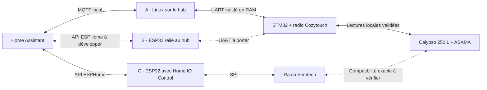

# Home IO Control pour Cozytouch — analyse du 18 novembre 2026

## Conclusion

**Avis.** Garder le Linux personnalisé sur le hub comme voie principale et **Home IO Control sur un ESP32 à radio indépendante comme plan B**. Le Linux en RAM a déjà lu les deux appareils de l’installation et publié les résultats par MQTT. Home IO Control fournit un contrôle local de bout en bout sur un Calypso Connecté de 200 L et plusieurs Adelis. La couverture du Calypso CETHI V4 de 250 L et de l’ASAMA IC3 reste à établir. L’ESP32 branché sur le STM32 ajoute un portage UART et une intervention sur le hub. [Essai Linux](../../analyse-2026-11-17/buildroot-ram/variante-service-20261118/RESULTAT.md) · [Calypso public](https://github.com/laberning/home_io_control/blob/f10feccf6e59aeb3348658df6356a17973aa36eb/docs/devices/atlantic-calypso.md#L4-L28) · [Adelis publics](https://github.com/laberning/home_io_control/blob/f10feccf6e59aeb3348658df6356a17973aa36eb/docs/devices/atlantic-adelis.md#L24-L46) · [Étude UART](../../analyse-2026-11-17/continuation-radio/esphome/RESULTAT.md)

**Documenté.** Le projet public confirme trois mécanismes utiles pour l’ASAMA. L’Adelis change de mode sur `0x0136`, démarre ou termine un boost ou un séchage sur `0x013E`, et prend une dérogation sur `0x011D` pendant une période éco. **Inconnu pour l’ASAMA.** Le choix entre `0x0138` et `0x0103` pour sa consigne ordinaire reste ouvert. [Code des registres](https://github.com/laberning/home_io_control/blob/f10feccf6e59aeb3348658df6356a17973aa36eb/components/home_io_control/proto_heating.cpp#L73-L103) · [Essais Adelis](https://github.com/laberning/home_io_control/blob/f10feccf6e59aeb3348658df6356a17973aa36eb/docs/devices/atlantic-adelis.md#L24-L46) · [Rapport ASAMA](../asama-ecriture/RAPPORT.md)

**Périmètre.** Analyse statique de `f10feccf6e59aeb3348658df6356a17973aa36eb`, conservée dans source/ (non publié). Les seuls accès réseau ont porté sur le dépôt public et ses tickets. Le code a été lu sur disque, sans compilation ni exécution. Les rapports locaux servent à comparer les voies et à identifier les appareils. Les résultats matériels qu’ils citent sont datés. L’état actuel des appareils reste **Inconnu** dans cette étude. [Commit étudié](https://github.com/laberning/home_io_control/commit/f10feccf6e59aeb3348658df6356a17973aa36eb) · Reprise du projet (non publié)

**Niveaux de preuve.** **Code** désigne un comportement lu dans les sources. **Documenté** désigne une déclaration ou un essai rapporté, public ou local. **Inféré** désigne un rapprochement ou une conséquence estimée. **Inconnu** désigne un point que les sources consultées ne permettent pas de trancher.

## 1. Projet et maturité

- **Code.** Composant externe ESPHome pour ESP32, dont ESP32-S3. ESPHome génère le firmware à partir du YAML. Le C++ implémente le protocole, les pilotes radio et les entités. Le Python valide la configuration et produit le code de liaison avec ESPHome. **Documenté.** Les cadres ESP-IDF et Arduino sont pris en charge. Le développement vise surtout ESP-IDF. Licence MIT. [Installation](https://github.com/laberning/home_io_control/blob/f10feccf6e59aeb3348658df6356a17973aa36eb/README.md#L52-L62) · [Architecture](https://github.com/laberning/home_io_control/blob/f10feccf6e59aeb3348658df6356a17973aa36eb/docs/adr/0001-layered-protocol-radio-hub-architecture.md#L16-L65) · [Licence](https://github.com/laberning/home_io_control/blob/f10feccf6e59aeb3348658df6356a17973aa36eb/LICENSE#L1-L12)
- **Code.** Le dépôt contient des tests unitaires sur ordinateur, un corpus de captures pour les régressions, des tests de configuration et une CI qui compile plusieurs configurations. **Documenté.** Le README présente encore le chauffage comme expérimental et sans essai matériel. Les fiches par appareil détaillent des retours réels, modèle par modèle. Elles donnent une base plus précise pour les deux familles étudiées. [CI](https://github.com/laberning/home_io_control/blob/f10feccf6e59aeb3348658df6356a17973aa36eb/.github/workflows/ci.yml#L98-L131) · [Tests et corpus](https://github.com/laberning/home_io_control/blob/f10feccf6e59aeb3348658df6356a17973aa36eb/docs/development-setup.md#L33-L61) · [README](https://github.com/laberning/home_io_control/blob/f10feccf6e59aeb3348658df6356a17973aa36eb/README.md#L40-L50) · [Matrice de compatibilité](https://github.com/laberning/home_io_control/blob/f10feccf6e59aeb3348658df6356a17973aa36eb/docs/supported-devices.md#L127-L141)
- **Documenté — relevé du 18 novembre.** Le commit demandé est daté du 17 novembre et ajoute la lecture du chauffage central de l’Adelis mixte. Le dernier commit de `main` observé est `bb2a60c512f0471dac4f3bcc7802619d952b0a94`, du 18 novembre, 16 commits après. Les derniers changements portent notamment sur la détection de canal occupé, les durées de boost et de séchage, et le câblage d’un LLCC68. Aucun tag ni release relevé. L’API publique GitHub recensait 21 tickets et 2 pull requests ouverts. Les tickets Calypso et Adelis restaient ouverts, ainsi qu’un ticket de compilation sur la bêta ESPHome. **Avis.** Le projet est actif. Pour une installation maintenue, épingler le commit et la version ESPHome, puis qualifier chaque mise à jour sur les fonctions utilisées. [Commit demandé](https://github.com/laberning/home_io_control/commit/f10feccf6e59aeb3348658df6356a17973aa36eb) · [Dernier commit](https://github.com/laberning/home_io_control/commit/bb2a60c512f0471dac4f3bcc7802619d952b0a94) · [Historique des écarts](https://github.com/laberning/home_io_control/compare/f10feccf6e59aeb3348658df6356a17973aa36eb...bb2a60c512f0471dac4f3bcc7802619d952b0a94) · [Tickets](https://github.com/laberning/home_io_control/issues?q=is%3Aissue%20state%3Aopen) · [Releases](https://github.com/laberning/home_io_control/releases) · [Tags](https://github.com/laberning/home_io_control/tags) · [Bêta ESPHome](https://github.com/laberning/home_io_control/issues/223)

## 2. Radio et câblage

- **Code.** L’ESP32 pilote par SPI une radio Semtech **SX1276, SX1262 ou LR1121**. Le Cozytouch est absent du trajet normal de commande. Le projet n’implémente aucun pilote CC1101. Les trois canaux sont **868,25 / 868,95 / 869,85 MHz**, à **38,4 kbit/s**. Le SX1276 utilise la FSK à mise en forme gaussienne et son mode matériel `IoHomeOn`. Le SX1262 et le LR1121 utilisent la GFSK générique, avec le format radio io-homecontrol géré en logiciel. Le nom commercial « LoRa » des cartes désigne leur capacité matérielle. [Pilotes SPI](https://github.com/laberning/home_io_control/blob/f10feccf6e59aeb3348658df6356a17973aa36eb/docs/adr/0002-direct-spi-radio-drivers.md#L6-L38) · [Canaux](https://github.com/laberning/home_io_control/blob/f10feccf6e59aeb3348658df6356a17973aa36eb/components/home_io_control/proto_timing.h#L19-L24) · [SX1276](https://github.com/laberning/home_io_control/blob/f10feccf6e59aeb3348658df6356a17973aa36eb/components/home_io_control/radio_sx1276.cpp#L173-L225) · [Couche logicielle SX1262/LR1121](https://github.com/laberning/home_io_control/blob/f10feccf6e59aeb3348658df6356a17973aa36eb/docs/adr/0003-shared-software-phy-base-for-sx1262-lr1121.md#L8-L34)
- **Documenté.** Une carte intégrée évite de réaliser le câblage SPI à la main. Le dépôt recommande la **Heltec WiFi LoRa 32 V3/V3.2, SX1262 868 MHz**. Son SPI utilise SCK/MOSI/MISO sur GPIO 9/10/11. CS/RESET/DIO1/BUSY utilisent les GPIO 8/12/14/13. Le TCXO de cette carte est déclaré à 1,8 V. La **Heltec V2, SX1276** est aussi confirmée. Les essais publics du Calypso 200 L et de deux Adelis 2 Digit ont utilisé un SX1276. Un Adelis 2 M a été associé avec un SX1262. **Inconnu.** Le guide ne fournit aucun prix indicatif. [Guide matériel](https://github.com/laberning/home_io_control/blob/f10feccf6e59aeb3348658df6356a17973aa36eb/docs/hardware.md#L4-L21) · [Table des cartes](https://github.com/laberning/home_io_control/blob/f10feccf6e59aeb3348658df6356a17973aa36eb/docs/hardware.md#L59-L84) · [Calypso testé](https://github.com/laberning/home_io_control/blob/f10feccf6e59aeb3348658df6356a17973aa36eb/docs/devices/atlantic-calypso.md#L4-L28) · [Adelis testés](https://github.com/laberning/home_io_control/blob/f10feccf6e59aeb3348658df6356a17973aa36eb/docs/devices/atlantic-adelis.md#L4-L21)

## 3. Authentification, association et coexistence

| Cas | Mécanisme et niveau de preuve |
|---|---|
| Commande courante | **Code.** Le chauffage et l’eau chaude utilisent des échanges bidirectionnels **2W**, avec défi-réponse fondé sur AES-128 et identification du contrôleur et de l’appareil. Le composant choisit la clé configurée pour l’appareil quand il en a une, sinon celle du contrôleur. Le mode **1W** correspond à un contrôleur de type télécommande, avec enrôlement et compteur propres. Les fonctions Adelis et Calypso étudiées reposent sur le 2W. [Échanges](https://github.com/laberning/home_io_control/blob/f10feccf6e59aeb3348658df6356a17973aa36eb/components/home_io_control/exchange_engine.cpp#L528-L557) · [Authentification](https://github.com/laberning/home_io_control/blob/f10feccf6e59aeb3348658df6356a17973aa36eb/docs/adr/0007-self-contained-aes-implementation.md#L6-L28) · [Choix de clé](https://github.com/laberning/home_io_control/blob/f10feccf6e59aeb3348658df6356a17973aa36eb/docs/adr/0053-a-device-may-carry-its-own-system-key.md#L26-L39) · [Mode 1W](https://github.com/laberning/home_io_control/blob/f10feccf6e59aeb3348658df6356a17973aa36eb/docs/configuration/oneway-transmit.md#L4-L37) · [Compatibilité chauffage](https://github.com/laberning/home_io_control/blob/f10feccf6e59aeb3348658df6356a17973aa36eb/docs/supported-devices.md#L127-L141) |
| Installation déjà associée | **Documenté.** Le projet prévoit de réutiliser l’identité radio et la clé du contrôleur existant. Son mécanisme de récupération présente temporairement l’ESP32 comme un appareil neuf au contrôleur d’origine, qui lui transmet son contexte lors d’une association. Le composant peut ensuite interroger les appareils qui reconnaissent cette clé. La récupération est un échange radio actif. Dans le déroulement décrit, les appareils installés restent associés et leur réinitialisation est inutile. Les exemples portent notamment sur Somfy et VELUX. [Choix du parcours](https://github.com/laberning/home_io_control/blob/f10feccf6e59aeb3348658df6356a17973aa36eb/docs/pairing.md#L7-L33) · [Récupération](https://github.com/laberning/home_io_control/blob/f10feccf6e59aeb3348658df6356a17973aa36eb/docs/key-extraction.md#L4-L37) · [Limites documentées](https://github.com/laberning/home_io_control/blob/f10feccf6e59aeb3348658df6356a17973aa36eb/docs/key-extraction.md#L64-L86) |
| Appareil libre ou qui remet sa clé | **Documenté.** `Discover & Pair` vise d’abord un appareil disponible pour une nouvelle association. Le Calypso 200 L de l’issue #198, dont le propriétaire déclare ne pas avoir de passerelle, a accepté la clé de l’ESP32. Les trois Adelis documentés ont une clé par appareil. La voie documentée pour l’Adelis suit celle de l’Agilia, qui remet sa propre clé. Le logiciel distingue le refus d’un transfert et l’absence de confirmation. Un transfert sans confirmation peut avoir été appliqué. Le composant peut vérifier une clé remise par un appareil lors d’un échange authentifié. La récupération depuis une passerelle existante demande une vérification auprès d’un appareil. [Appairage 2W](https://github.com/laberning/home_io_control/blob/f10feccf6e59aeb3348658df6356a17973aa36eb/docs/pairing.md#L34-L78) · [Calypso, installation d’essai](https://github.com/laberning/home_io_control/issues/198#issuecomment-6617417409) · [Adelis](https://github.com/laberning/home_io_control/blob/f10feccf6e59aeb3348658df6356a17973aa36eb/docs/devices/atlantic-adelis.md#L49-L73) · [Diagnostics d’association](https://github.com/laberning/home_io_control/blob/f10feccf6e59aeb3348658df6356a17973aa36eb/docs/pairing.md#L140-L152) · [Limites de la récupération](https://github.com/laberning/home_io_control/blob/f10feccf6e59aeb3348658df6356a17973aa36eb/docs/key-extraction.md#L64-L86) |
| Foyer équipé d’un Cozytouch | **Documenté.** Un utilisateur a envoyé des commandes à une interface fil pilote Thermor encore associée, avec le Cozytouch branché. Le retour d’état y était limité. C’est un exemple de coexistence sur une autre famille. **Inféré.** Réutiliser le bon contexte sans nouvel appairage ni réinitialisation limite le risque pour l’association existante. Deux contrôleurs actifs peuvent néanmoins modifier le même réglage, et la remontée par interrogation périodique peut différer l’affichage. **Inconnu.** La récupération depuis ce Kizbox Mini, les clés acceptées en commande par l’ASAMA et le CETHI V4, ainsi que leur coexistence avec le Cozytouch restent à vérifier. Une nouvelle association ou une réinitialisation peut obliger à rétablir l’association d’origine. [Retour Thermor](https://github.com/laberning/home_io_control/issues/228#issuecomment-6898766199) · [Limite du retour d’état](https://github.com/laberning/home_io_control/issues/228#issuecomment-6893296198) · [Précautions d’association](https://github.com/laberning/home_io_control/blob/f10feccf6e59aeb3348658df6356a17973aa36eb/docs/pairing.md#L7-L33) · [Interrogation Adelis](https://github.com/laberning/home_io_control/blob/f10feccf6e59aeb3348658df6356a17973aa36eb/docs/devices/atlantic-adelis.md#L75-L85) · Contexte UART des lectures existantes (non publié) |

## 4. Appareils et fonctions couverts

| Profil | Couverture de la révision étudiée |
|---|---|
| **Atlantic Adelis**, type **52/1** (`0x34/1`), modèle `towel_dryer` | **Code.** Le modèle explicite sélectionne les registres du sèche-serviettes. Le profil générique 52/1 est celui d’un radiateur à consigne, avec un autre registre de mode. **Documenté.** Deux Adelis 2 Digit et un Adelis 2 M figurent dans la matrice. Température ambiante, consignes, mode et état de chauffe remontent. Les essais rapportent les changements de consigne, arrêt/manuelle/programme, boost et séchage, avec relecture ou affichage. La dérogation a été essayée en période éco. Les fonctions dépendent de la variante, notamment sur le modèle mixte. [Sélection du modèle](https://github.com/laberning/home_io_control/blob/f10feccf6e59aeb3348658df6356a17973aa36eb/docs/configuration/climate.md#L62-L78) · [Implémentation 52/1](https://github.com/laberning/home_io_control/blob/f10feccf6e59aeb3348658df6356a17973aa36eb/components/home_io_control/proto_heating_profiles.cpp#L414-L436) · [Résultats Adelis](https://github.com/laberning/home_io_control/blob/f10feccf6e59aeb3348658df6356a17973aa36eb/docs/devices/atlantic-adelis.md#L24-L46) · [Dérogation sur l’afficheur](https://github.com/laberning/home_io_control/issues/202#issuecomment-6929746735) |
| **ASAMA IC3**, type **52/1** | **Inféré.** Le type/sous-type commun et plusieurs registres concordants font de `towel_dryer` un profil d’étude pertinent. **Inconnu.** La recherche du 18 novembre par nom et les sources suivies ne fournissent aucune qualification ASAMA/IC3. Le type radio commun ne détermine ni les écritures OEM, ni la liste des actions acceptées. [Identification locale](../../analyse-2026-11-17/continuation-radio/esphome/RESULTAT.md) · [Matrice 52/1](https://github.com/laberning/home_io_control/blob/f10feccf6e59aeb3348658df6356a17973aa36eb/docs/supported-devices.md#L209-L218) · [Recherche ASAMA](https://github.com/laberning/home_io_control/issues?q=is%3Aissue%20ASAMA) · [Recherche IC3](https://github.com/laberning/home_io_control/issues?q=is%3Aissue%20IC3) · [Rapport ASAMA](../asama-ecriture/RAPPORT.md) |
| **Atlantic Calypso Connecté 200 L**, type **51/0** (`0x33/0`) | **Code.** La table comporte une plateforme `domestic_hot_water` pour 51/0. **Documenté.** Un exemplaire 200 L sur SX1276 a fourni température de l’eau, cible, mode, énergie et activité PAC/appoint. Les essais rapportent les changements de cible et des trois modes, ainsi que l’activation et l’arrêt du boost et de l’absence. L’afficheur et les relectures corroborent l’effet. Les cibles relevées sont 50, 54 et 62 °C pour cet exemplaire. Le sélecteur ESPHome couvre 20–62 °C par pas de 1 °C. Le ballon prend ses propres paliers. L’absence depuis HA est sans date de fin. Aucun arrêt complet n’est proposé. [Table de types](https://github.com/laberning/home_io_control/blob/f10feccf6e59aeb3348658df6356a17973aa36eb/components/home_io_control/proto_device_types.cpp#L221-L227) · [Tests Calypso](https://github.com/laberning/home_io_control/blob/f10feccf6e59aeb3348658df6356a17973aa36eb/docs/devices/atlantic-calypso.md#L4-L28) · [Paliers 200 L](https://github.com/laberning/home_io_control/blob/f10feccf6e59aeb3348658df6356a17973aa36eb/docs/devices/atlantic-calypso.md#L36-L48) · [Boost et absence sur l’appareil](https://github.com/laberning/home_io_control/issues/198#issuecomment-6880836840) |
| **Calypso CETHI V4 250 L**, type **51/0** | **Documenté.** Le dossier local rattache le 250 L à la régulation CV4 et rapporte des lectures avec la radio Cozytouch. **Inféré.** Le profil public 51/0 justifie une comparaison directe des lectures et de leur décodage. **Inconnu.** Couverture exacte des sondes, paliers, modes, boost et absence du 250 L avec l’ESP32. Le mode et la première sonde ont des indices communs dans le relevé local. Les indices publics de l’énergie et de l’activité PAC n’apparaissent pas dans l’entrée CETHI examinée. Les paliers du 200 L ne suffisent pas à établir ceux du 250 L. [Comparaison statique des registres](../../analyse-2026-11-17/continuation-radio/esphome/RESULTAT.md) · [Identification 250 L](../../analyse-2026-11-17/continuation-radio/esphome/RESULTAT.md) · [Lectures locales](../../analyse-2026-11-17/live-interface/RESULTAT.md) · [Recherche CETHI](https://github.com/laberning/home_io_control/issues?q=is%3Aissue%20CETHI) · [Calypso public](https://github.com/laberning/home_io_control/blob/f10feccf6e59aeb3348658df6356a17973aa36eb/docs/devices/atlantic-calypso.md#L4-L28) |
| Autres chauffages | **Documenté.** La matrice rapporte aussi des essais sur Atlantic Agilia io, Sauter Hekla, Thermor Emotion 3 H et une interface fil pilote Thermor 52/0. Chaque profil a sa propre couverture. Le support de l’Explorer V4 figurait dans une pull request ouverte au relevé. [Matrice Atlantic/Thermor](https://github.com/laberning/home_io_control/blob/f10feccf6e59aeb3348658df6356a17973aa36eb/docs/supported-devices.md#L127-L141) · [PR Explorer V4](https://github.com/laberning/home_io_control/pull/246) |

**Point à vérifier en priorité sur l’ASAMA.** Le catalogue IC3 examiné n’inclut pas la température ambiante `0x0115`. **Code.** Le profil Adelis commence son interrogation par ce registre et arrête la série si une lecture de base échoue. **Inféré.** Un ASAMA qui ne répond pas à ce registre peut empêcher le profil Adelis de remonter des états par ailleurs disponibles. **Inconnu.** Réponse RF de l’ASAMA à ce registre. [Comparaison locale](../../analyse-2026-11-17/continuation-radio/esphome/RESULTAT.md) · [Registre de température ambiante](https://github.com/laberning/home_io_control/blob/f10feccf6e59aeb3348658df6356a17973aa36eb/components/home_io_control/proto_heating.cpp#L73-L103) · [Ordre des lectures](https://github.com/laberning/home_io_control/blob/f10feccf6e59aeb3348658df6356a17973aa36eb/components/home_io_control/proto_heating_profiles.cpp#L150-L155) · [Arrêt du sondage](https://github.com/laberning/home_io_control/blob/f10feccf6e59aeb3348658df6356a17973aa36eb/components/home_io_control/heater_controller.cpp#L824-L839)

## 5. Ce que l’Adelis apporte à l’étude des écritures ASAMA

Les numéros ci-dessous désignent des paramètres. **Code.** Home IO Control utilise un protocole radio de registres privés, alors que le dossier OEM décrit des paramètres de profil et un transport applicatif sur l’UART du STM32. **Inféré.** Une concordance d’indice et de valeur renforce un candidat. Elle ne suffit pas à relier une commande OEM ASAMA à une opération radio. [Protocole des registres](https://github.com/laberning/home_io_control/blob/f10feccf6e59aeb3348658df6356a17973aa36eb/docs/adr/0054-heaters-are-read-back-over-the-private-register-protocol.md#L9-L46) · Frontière UART/radio (non publié) · [Rapport ASAMA](../asama-ecriture/RAPPORT.md)

| Fonction | Adelis dans le projet public | Portée pour ASAMA IC3 |
|---|---|---|
| **Mode `0x0136`** | **Code.** Un octet. Le profil propose 0 arrêt, 2 programme et 3 manuel. Il n’expose pas 1, jamais observé selon le commentaire du profil. **Documenté.** Les trois modes proposés ont été relus et comparés à l’afficheur. [Descripteur](https://github.com/laberning/home_io_control/blob/f10feccf6e59aeb3348658df6356a17973aa36eb/components/home_io_control/proto_heating.cpp#L73-L103) · [Valeurs et modes](https://github.com/laberning/home_io_control/blob/f10feccf6e59aeb3348658df6356a17973aa36eb/components/home_io_control/proto_heating.h#L108-L124) · [Modes proposés](https://github.com/laberning/home_io_control/blob/f10feccf6e59aeb3348658df6356a17973aa36eb/components/home_io_control/proto_heating_profiles.cpp#L108-L119) · [Essai](https://github.com/laberning/home_io_control/blob/f10feccf6e59aeb3348658df6356a17973aa36eb/docs/devices/atlantic-adelis.md#L24-L46) | **Code local.** L’IC3 lit cet indice pour le mode. Le helper OEM encode `standby=0`, `auto=1`, `internal=2`, `external=3`. **Inféré.** Candidat fort pour le mode. **Inconnu.** Destination réelle de l’écriture OEM et sens des états acceptés par l’ASAMA. Conserver les libellés de chaque appareil. [Rapport ASAMA, mode](../asama-ecriture/RAPPORT.md) |
| **Boost et séchage `0x013E`** | **Code.** Un octet, 0 fin de l’état temporaire, 1 boost, 2 séchage. Le mode de fond reste distinct. **Documenté.** Exécution et retour d’état rapportés sur Adelis. [Descripteur](https://github.com/laberning/home_io_control/blob/f10feccf6e59aeb3348658df6356a17973aa36eb/components/home_io_control/proto_heating.cpp#L73-L103) · [Valeurs](https://github.com/laberning/home_io_control/blob/f10feccf6e59aeb3348658df6356a17973aa36eb/components/home_io_control/proto_heating.h#L108-L124) · [Presets](https://github.com/laberning/home_io_control/blob/f10feccf6e59aeb3348658df6356a17973aa36eb/components/home_io_control/proto_heating_profiles.cpp#L121-L147) · [Essai](https://github.com/laberning/home_io_control/blob/f10feccf6e59aeb3348658df6356a17973aa36eb/docs/devices/atlantic-adelis.md#L24-L46) | **Code local.** Même indice en lecture et mêmes valeurs dans le helper OEM pour chauffe permanente, boost et séchage. **Inféré.** Candidat fort pour l’activation et la fin. **Inconnu.** Effet et éventuelles écritures associées sur l’ASAMA. Les paramètres de durée `0x013B/0x013D` et les états de temps `0x013A/0x013C` sont distincts. Le commit ultérieur `d21016b` publie des capteurs en lecture seule sur ces quatre registres et ne valide aucune écriture de durée. [Rapport ASAMA, état et durées](../asama-ecriture/RAPPORT.md) · [Ajout postérieur](https://github.com/laberning/home_io_control/blob/d21016b4469e7c9f0d0fa00d1737a201af88cdbb/components/home_io_control/proto_heating.h#L116-L137) |
| **Dérogation `0x011D`** | **Code.** Entier non signé 16 bits, petit-boutiste, dixièmes de °C. Le codec accepte 7 à 28 °C, ou 0 pour annuler. **Documenté.** En éco, la dérogation apparaît sur l’afficheur et cesse au retour au confort ou à l’annulation. En confort, l’Adelis a acquitté la demande, puis relu 0 et conservé sa consigne. [Codec](https://github.com/laberning/home_io_control/blob/f10feccf6e59aeb3348658df6356a17973aa36eb/components/home_io_control/proto_heating.cpp#L73-L103) · [Bornes](https://github.com/laberning/home_io_control/blob/f10feccf6e59aeb3348658df6356a17973aa36eb/components/home_io_control/proto_heating.h#L133-L145) · [Annulation et périodes](https://github.com/laberning/home_io_control/blob/f10feccf6e59aeb3348658df6356a17973aa36eb/docs/adr/0094-a-towel-dryer-target-in-a-comfort-period-changes-the-comfort-temperature.md#L14-L41) · [Essai](https://github.com/laberning/home_io_control/issues/202#issuecomment-6929746735) | **Code local.** L’IC3 lit `0x011D` avec la même représentation. **Inféré.** Candidat principal pour une consigne temporaire. **Inconnu.** Règles par mode, comportement de 0 et limites exactes de l’ASAMA. Le seul acquittement serait insuffisant. [Rapport ASAMA, dérogation](../asama-ecriture/RAPPORT.md) |
| **Consigne ordinaire `0x0103` / `0x0138`** | **Code.** Le profil Adelis écrit `0x0103` en dixièmes de °C, entier non signé 16 bits petit-boutiste. Le codec arrondit au dixième et rejette les valeurs hors de 7–28 °C. Le zéro observé sur l’afficheur en position été est hors de cette plage d’écriture. La carte propose un pas de 0,5 °C et tient compte d’un maximum inférieur lu dans `0x0102`. En mode programme, le code relit l’état avant de choisir `0x011D` en éco ou `0x0103` en confort. Si la période est indéterminée, il s’abstient dans ce cas. **Documenté.** `0x0103` est corroboré en manuel. La fiche de la révision demande encore une confirmation de l’effet en mode programme, période confort. [Descripteurs](https://github.com/laberning/home_io_control/blob/f10feccf6e59aeb3348658df6356a17973aa36eb/components/home_io_control/proto_heating.cpp#L73-L103) · [Encodage](https://github.com/laberning/home_io_control/blob/f10feccf6e59aeb3348658df6356a17973aa36eb/components/home_io_control/proto_heating.cpp#L200-L238) · [Bornes](https://github.com/laberning/home_io_control/blob/f10feccf6e59aeb3348658df6356a17973aa36eb/components/home_io_control/proto_heating.h#L133-L145) · [Interface et maximum](https://github.com/laberning/home_io_control/blob/f10feccf6e59aeb3348658df6356a17973aa36eb/components/home_io_control/platform_climate.cpp#L168-L179) · [Pas de 0,5 °C](https://github.com/laberning/home_io_control/blob/f10feccf6e59aeb3348658df6356a17973aa36eb/components/home_io_control/platform_climate.cpp#L48-L51) · [Plafond affiché](https://github.com/laberning/home_io_control/blob/f10feccf6e59aeb3348658df6356a17973aa36eb/components/home_io_control/proto_heating_profiles.cpp#L860-L874) · [Choix du registre](https://github.com/laberning/home_io_control/blob/f10feccf6e59aeb3348658df6356a17973aa36eb/components/home_io_control/proto_heating_profiles.cpp#L715-L751) · [Essais et limite](https://github.com/laberning/home_io_control/blob/f10feccf6e59aeb3348658df6356a17973aa36eb/docs/devices/atlantic-adelis.md#L24-L46) | **Code local.** `0x0138` est l’état de consigne confort IC3. `0x0137` est la température cible effective. Le helper encode des dixièmes de °C sans désigner le paramètre écrit. **Inconnu.** Destination de `setTargetTemperature` et de `setComfortTemperature`, éventuel alias avec `0x0103`, pas et limites de l’ASAMA. [Rapport ASAMA, consignes](../asama-ecriture/RAPPORT.md) |

**Code.** Le contrôleur distingue le défi d’authentification, l’acquittement de registre puis la relecture. Sans acquittement attendu, l’opération échoue côté composant. Après acquittement, il relit le registre et vérifie que la réponse correspond bien au registre demandé. Le résultat d’envoi peut rester positif si la relecture manque ou si la dérogation relue diffère. Pour établir l’effet, il faut la valeur relue concordante ou l’affichage correspondant. Cette distinction vaut aussi pour le Calypso. Après les changements, le composant vérifie par les états remontés ce que le ballon a retenu. Le boost et l’absence passent par le mode de fonctionnement, précédé d’un réglage de durée à l’activation. Une écriture de durée seule avait été acquittée sans effet sur le boost du Calypso d’essai. [Échange authentifié](https://github.com/laberning/home_io_control/blob/f10feccf6e59aeb3348658df6356a17973aa36eb/components/home_io_control/exchange_engine.cpp#L528-L557) · [Vérification de l’ACK](https://github.com/laberning/home_io_control/blob/f10feccf6e59aeb3348658df6356a17973aa36eb/components/home_io_control/heater_controller.cpp#L299-L334) · [Contrôle du registre](https://github.com/laberning/home_io_control/blob/f10feccf6e59aeb3348658df6356a17973aa36eb/components/home_io_control/heater_controller.cpp#L388-L402) · [Résultat après relecture](https://github.com/laberning/home_io_control/blob/f10feccf6e59aeb3348658df6356a17973aa36eb/components/home_io_control/heater_controller.cpp#L187-L223) · [Retour d’état Calypso](https://github.com/laberning/home_io_control/blob/f10feccf6e59aeb3348658df6356a17973aa36eb/docs/configuration/water-heater.md#L68-L107) · [Mode de fonctionnement eau chaude](https://github.com/laberning/home_io_control/blob/f10feccf6e59aeb3348658df6356a17973aa36eb/docs/adr/0081-a-water-heaters-boost-and-away-travel-in-the-operating-mode-word.md#L35-L52)

## 6. Intégration Home Assistant

- **Code.** Home Assistant utilise l’API native ESPHome sur le réseau local. `api:` est nécessaire au composant. MQTT peut s’ajouter via ESPHome. Le composant ne dépend d’aucun courtier pour ses entités. Les actions de gestion sont enregistrées dans l’API native. [Connexion HA](https://github.com/laberning/home_io_control/blob/f10feccf6e59aeb3348658df6356a17973aa36eb/docs/getting-started.md#L355-L363) · [Actions natives](https://github.com/laberning/home_io_control/blob/f10feccf6e59aeb3348658df6356a17973aa36eb/docs/adr/0006-management-actions-as-native-api-actions.md#L18-L30)
- **Code.** L’Adelis expose une entité `climate` avec température, cible, action de chauffe, modes `off/heat/auto` et presets boost et séchage. En option, un capteur texte affiche le niveau de chauffe et un capteur binaire indique le chauffage central d’un modèle mixte. La dérogation peut passer par le changement de cible ou l’action dédiée selon le cas. Le sondage par défaut est de cinq minutes. [Fiche Adelis](https://github.com/laberning/home_io_control/blob/f10feccf6e59aeb3348658df6356a17973aa36eb/docs/devices/atlantic-adelis.md#L24-L46) · [Options et sondage](https://github.com/laberning/home_io_control/blob/f10feccf6e59aeb3348658df6356a17973aa36eb/docs/configuration/climate.md#L43-L54) · [Action de dérogation](https://github.com/laberning/home_io_control/blob/f10feccf6e59aeb3348658df6356a17973aa36eb/docs/configuration/climate.md#L289-L303)
- **Code.** Le Calypso expose une entité `water_heater` avec température, cible et modes `eco/heat_pump/performance` et absence. Des entités facultatives publient l’énergie cumulée, l’état de la PAC, l’état de l’appoint et la source de chauffe. Un interrupteur facultatif commande le boost. La cible est absente en automatique et pendant l’absence. [Configuration eau chaude](https://github.com/laberning/home_io_control/blob/f10feccf6e59aeb3348658df6356a17973aa36eb/docs/configuration/water-heater.md#L43-L74) · [États et modes](https://github.com/laberning/home_io_control/blob/f10feccf6e59aeb3348658df6356a17973aa36eb/docs/configuration/water-heater.md#L68-L107)

## 7. Comparaison pour l’installation de <PERSONNE>

Les traits pointillés indiquent les maillons à qualifier pour cette installation. Le schéma représente les trajets retenus. Il ne donne aucun état opérationnel actuel. Source Mermaid modifiable. Rendu graphique non vérifié. [Essai Linux](../../analyse-2026-11-17/buildroot-ram/variante-service-20261118/RESULTAT.md) · [Étude UART](../../analyse-2026-11-17/continuation-radio/esphome/RESULTAT.md) · [Architecture publique](https://github.com/laberning/home_io_control/blob/f10feccf6e59aeb3348658df6356a17973aa36eb/docs/adr/0001-layered-protocol-radio-hub-architecture.md#L16-L65)

| Voie | Effort et maintenance | Matériel, association et retour arrière | Couverture des deux appareils |
|---|---|---|---|
| **A — Linux personnalisé sur le hub** | **Documenté.** Variante en RAM testée avec six lectures valides, publication MQTT et retour OEM en RAM. La variante fusionnée de l’autre essai n’a pas démarré. **Avis.** Effort restant concentré sur les écritures, le lancement autonome et le retour depuis une installation persistante. Il faut maintenir l’image Linux, le client UART et MQTT. [Essai RAM](../../analyse-2026-11-17/buildroot-ram/variante-service-20261118/RESULTAT.md) · [Préflight FUSION](../variante-fusion/essai-hub-20261118/RESULTAT.md) · Conception durable (non publié) | **Documenté.** Réutilise le STM32 et le contexte radio existants. Le retour OEM en RAM est établi pour l’essai. **Inconnu.** Retour à froid après bascule persistante. **Inféré.** Le risque matériel porte surtout sur l’installation persistante et la récupération. La réutilisation du contexte existant réduit l’intérêt d’un réappairage. Conception et repli (non publié) · Contexte UART (non publié) | **Documenté.** Lecture locale des deux appareils exacts. **Inconnu.** Qualification complète des écritures, en particulier sur IC3, et tenue en service permanent. [Lectures](../../analyse-2026-11-17/buildroot-ram/variante-service-20261118/RESULTAT.md) · [Écritures ASAMA](../asama-ecriture/RAPPORT.md) |
| **B — ESP32 sur l’UART du STM32** | **Avis.** Effort élevé à ce stade. Il faut écrire et maintenir un composant ESPHome pour l’API UART Cozytouch, avec initialisation, corrélation des réponses et gestion du contexte. Le pilote public Home IO Control traite des paquets radio et des canaux. Son interface n’est pas celle du STM32. [Interface radio publique](https://github.com/laberning/home_io_control/blob/f10feccf6e59aeb3348658df6356a17973aa36eb/components/home_io_control/radio_interface.h#L181-L290) · [Étude du portage](../../analyse-2026-11-17/continuation-radio/esphome/RESULTAT.md) | **Inféré.** Peut réutiliser le contexte existant si le portage le conserve correctement. Exige un seul maître UART actif et une validation de l’alimentation, des niveaux et du reset. Le retour dépend d’un montage déconnectable et de la restitution de la maîtrise UART au Linux. **Inconnu.** Démarrage autonome du montage et repli effectif. [Un seul maître et conditions électriques](../../analyse-2026-11-17/continuation-radio/esphome/RESULTAT.md) · Portée des essais STM32 (non publié) | **Inféré.** Les deux appareils sont accessibles à la pile radio réutilisée via Linux. Leur portée pourrait être conservée après portage. **Inconnu.** Lectures via ESP32 et mêmes lacunes métier sur les écritures. Lectures STM32 (non publié) · [Écritures ASAMA](../asama-ecriture/RAPPORT.md) |
| **C — ESP32 et radio indépendante** | **Avis.** Effort électronique faible avec une carte intégrée. L’incertitude porte surtout sur la qualification des profils et de la coexistence. La maintenance peut suivre le projet, sous réserve d’épingler des révisions testées. [Cartes](https://github.com/laberning/home_io_control/blob/f10feccf6e59aeb3348658df6356a17973aa36eb/docs/hardware.md#L59-L84) · [Activité en amont](https://github.com/laberning/home_io_control/compare/f10feccf6e59aeb3348658df6356a17973aa36eb...bb2a60c512f0471dac4f3bcc7802619d952b0a94) · [Compatibilité](https://github.com/laberning/home_io_control/blob/f10feccf6e59aeb3348658df6356a17973aa36eb/docs/supported-devices.md#L127-L141) | **Inféré.** Aucun branchement sur le hub. Le retrait de la carte suffit au retour matériel. La réversibilité de l’association dépend du maintien du contexte radio d’origine. Une réinitialisation ou une réassociation change les conditions de repli. **Inconnu.** Coexistence sur les deux appareils de <PERSONNE>. [Architecture directe](https://github.com/laberning/home_io_control/blob/f10feccf6e59aeb3348658df6356a17973aa36eb/README.md#L9-L17) · [Récupération de contexte](https://github.com/laberning/home_io_control/blob/f10feccf6e59aeb3348658df6356a17973aa36eb/docs/key-extraction.md#L4-L37) · [Retour Thermor](https://github.com/laberning/home_io_control/issues/228#issuecomment-6898766199) | **Documenté.** Adelis et Calypso Connecté 200 L testés publiquement. **Inconnu.** Couverture exacte de l’ASAMA IC3 et du Calypso CETHI V4 250 L. [Adelis](https://github.com/laberning/home_io_control/blob/f10feccf6e59aeb3348658df6356a17973aa36eb/docs/devices/atlantic-adelis.md#L24-L46) · [Calypso](https://github.com/laberning/home_io_control/blob/f10feccf6e59aeb3348658df6356a17973aa36eb/docs/devices/atlantic-calypso.md#L4-L28) · [Identification locale](../../analyse-2026-11-17/continuation-radio/esphome/RESULTAT.md) |

**Avis.** Faire servir le code Adelis de référence pour interpréter les écritures et définir leur preuve d’effet. Pour la voie C, la première preuve utile serait une lecture authentifiée et décodée de chaque appareil exact, avec association d’origine préservée. Conditionner ensuite toute utilisation en commande à une relecture concordante des fonctions retenues. La voie B devient intéressante si la radio directe ne couvre pas les appareils et si le maintien du Linux personnalisé devient plus coûteux qu’un client ESPHome UART. [Comparaison ASAMA](../asama-ecriture/RAPPORT.md) · [Limites du montage UART](../../analyse-2026-11-17/continuation-radio/esphome/RESULTAT.md) · [Critères de relecture](https://github.com/laberning/home_io_control/blob/f10feccf6e59aeb3348658df6356a17973aa36eb/components/home_io_control/heater_controller.cpp#L187-L223)

## Résumé

- **A — Documenté.** Linux en RAM a lu les deux appareils et publié en MQTT. Démarrage persistant et retour à froid restent à qualifier. [Essai RAM](../../analyse-2026-11-17/buildroot-ram/variante-service-20261118/RESULTAT.md) · Conception (non publié)
- **B — Inféré.** L’ESP32 sur le STM32 réutiliserait la radio d’origine, avec un portage UART et un montage à qualifier. [Étude UART](../../analyse-2026-11-17/continuation-radio/esphome/RESULTAT.md)
- **C — Code.** Home IO Control est un composant ESPHome MIT, avec radio Semtech 868 MHz et API native. [Installation](https://github.com/laberning/home_io_control/blob/f10feccf6e59aeb3348658df6356a17973aa36eb/README.md#L52-L62) · [Radio](https://github.com/laberning/home_io_control/blob/f10feccf6e59aeb3348658df6356a17973aa36eb/docs/hardware.md#L59-L84) · [API](https://github.com/laberning/home_io_control/blob/f10feccf6e59aeb3348658df6356a17973aa36eb/docs/getting-started.md#L355-L363)
- **Documenté.** Calypso 200 L et Adelis ont des lectures et écritures rapportées. ASAMA et CETHI V4 250 L restent à qualifier. [Calypso](https://github.com/laberning/home_io_control/blob/f10feccf6e59aeb3348658df6356a17973aa36eb/docs/devices/atlantic-calypso.md#L4-L28) · [Adelis](https://github.com/laberning/home_io_control/blob/f10feccf6e59aeb3348658df6356a17973aa36eb/docs/devices/atlantic-adelis.md#L24-L46) · [Identification locale](../../analyse-2026-11-17/continuation-radio/esphome/RESULTAT.md)
- **Inféré.** Les candidats ASAMA `0x0136`, `0x013E` et `0x011D` sont renforcés. La consigne `0x0138` ou `0x0103` reste ouverte. [Rapport ASAMA](../asama-ecriture/RAPPORT.md) · [Code Adelis](https://github.com/laberning/home_io_control/blob/f10feccf6e59aeb3348658df6356a17973aa36eb/components/home_io_control/proto_heating.cpp#L73-L103)
- **Avis.** Garder A en priorité et C comme plan B, avec des preuves par appareil et un retour d’état après chaque écriture étudiée. [Essai RAM](../../analyse-2026-11-17/buildroot-ram/variante-service-20261118/RESULTAT.md) · [Relecture](https://github.com/laberning/home_io_control/blob/f10feccf6e59aeb3348658df6356a17973aa36eb/components/home_io_control/heater_controller.cpp#L187-L223)
