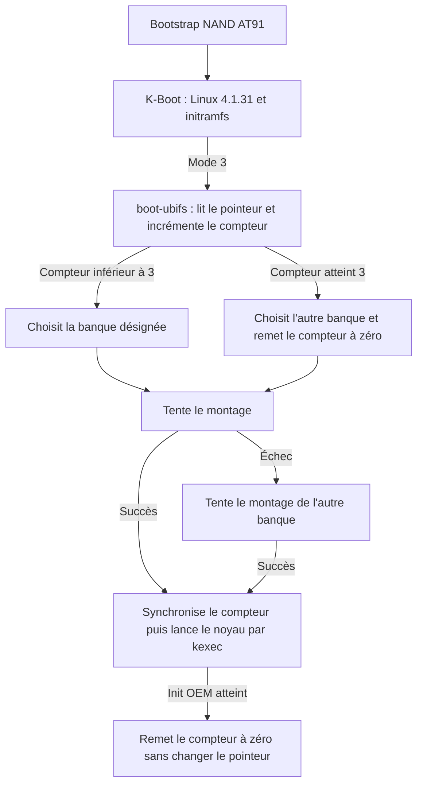

# Cozytouch — repli automatique entre les banques `root` et `rootB`

Analyse statique du 18 novembre 2026, sur les captures locales du 17 novembre. Aucun accès au hub ou au réseau, aucun script OEM exécuté, aucune écriture NAND ou flash. Ce rapport ne décrit pas l’état actuel du hub.

## Verdict

**Le K-Boot OEM sait démarrer l’autre banque automatiquement, mais il ne la rend pas durablement prioritaire.** Le mécanisme réside dans le script `boot-ubifs` de l’initramfs K-Boot, pas dans le pilote `/sys/kboot` ni dans `image-update`. Depuis un compteur à zéro et si la banque désignée reste montable, le sélecteur la choisit deux fois. Au troisième passage sans remise à zéro, il choisit l’autre pour ce démarrage. En cas d’échec du montage, il tente l’autre immédiatement. Aucun de ces deux replis ne modifie le pointeur de banque valide.

Le schéma représente le chemin démontré pour un pointeur valide, sans restauration exceptionnelle du volume `persistent`. Rendu Mermaid non vérifié.

## 1. Qui lit ou écrit `mode` et `next` ?

**Démontré — le pilote expose deux champs d’un registre, pas deux banques.** L’assemblage ARM du noyau OEM 5.4.302 lit le registre sur 32 bits. `next` expose les bits 31:16 ; `mode` expose les bits 15:0. Les écritures numériques préservent l’autre champ. Ces callbacks ne traitent ni compteur, ni validation, ni choix `root`/`rootB`.

| Image Linux décompressée | Attributs `next` / `mode` | `next` : lecture / écriture | `mode` : lecture / écriture |
| --- | --- | --- | --- |
| OEM 5.4.302, banque `rootB` | `0x5d0800` / `0x5d0810` (`0644`) | `0x258430` / `0x258314` | `0x258458` / `0x2583a4` |
| K-Boot 4.1.31 | `0x66626c` / `0x66627c` | `0x182114` / `0x1820b8` | `0x18213c` / `0x182060` |

Dans le 5.4.302, le nom `at91_kboot` apparaît à `0x538430` et l’initialisation du pilote à `0x59eb70`. Le DTB annexé au volume `kboot` déclare `overkiz,at91-kboot` à `0x4aa054` et `reg = <0xfffffe60 0x4>` à `0x4aa074`. Le DTB OEM `rootB/boot/at91-kizboxmini-base.dtb` donne les mêmes valeurs à `0x4884` et `0x48a4`, malgré le nom du nœud `kboot@fffffd50`. Les variantes `mb`, `rd` et `at91-smartkiz` du même dossier donnent la même plage (`reg` à `0x489c`, `0x4904` et `0x49d8`).

**Démontré — l’initramfs interprète des modes de démarrage.** `etc/init` (CPIO `0xa30cc`, l.17–20) lance `etc/rc.local` (CPIO `0xa3388`, l.82–106). Celui-ci lit `mode` et `next` après les hooks d’entrée, écrit le mode qu’il va exécuter dans `mode`, puis relit `next` si le script lui rend la main. La variable locale `max_loop=8` limite ce dispatch et n’est pas un compteur de démarrages. `usr/share/kboot/scripts.d/bin/modes.sh` (CPIO `0x5902cc`, l.1–7) et `modes.d/{0,2,3,4}` (CPIO `0x593a18`, `0x593cd4`, `0x593c20`, `0x593acc`) donnent : `0` sélection d’entrée, `1` USB, `2` migration, `3` démarrage UBI, `4` migration inverse, `9` tests. Le mode `4` ne désigne pas un retour A/B : `usr/sbin/boot-goback` (CPIO `0x417c30`, l.141–186) effectue une migration inverse avec réécriture du système.

- **Écritures OEM :** `analyse-2026-11-17/extracted/rootB/etc/init.d/kboot-base:3` écrit `next=0` au démarrage (`analyse-2026-11-17/extraction/metadata-rootB.json:4756`, lien `S05kboot-base`). Ce n’est pas un acquittement de banque. Le wrapper `rootB/usr/local/sbin/reboot:29–100` programme `next` selon le mode demandé, dont `3` pour `normal`, `update` et `-f`.
- **Lectures OEM :** sous `analyse-2026-11-18/boot-banks-grok/corpus/`, `etc/conf.d/internal:15–16` et `lua/Overkiz/HomeAutomation/Protocol/Internal/conf.lua:62–63` nomment les chemins. Dans ce même dossier Lua, `Admin/system.lua:275–281` lit `next` via `bootMode()` et `mode` via `rebootMode()`. `Transport/Admin/Objects/info.lua:162–163` publie ces lectures. Ces deux lecteurs n’écrivent pas le registre.

## 2. Compteur, confirmation et portée du retour

**Démontré — sélecteur de banque.** Dans le volume `kboot`, `modes.d/3` mène au wrapper `usr/share/kboot/scripts.d/bin/boot-ubifs` (CPIO `0x58f828`, l.3), qui lance `usr/sbin/boot-ubifs` (CPIO `0x402fdc`). Ce dernier :

1. Lit `/persistent/boot/boot_information_file` et `boot_count_file`. Il incrémente un compteur numérique, ou part à `1` si le compteur est absent ou non reconnu (l.41–60).
2. Au seuil **`>= 3`**, inverse `ubi0:root` et `ubi0:rootB` dans la variable `BOOTVOLUME` et écrit `0` dans le fichier compteur. Pour un pointeur non reconnu à ce seuil, la valeur de repli est `ubi0:root`. Sous le seuil, il conserve un pointeur valide ; il écrit `ubi0:root` uniquement pour corriger un pointeur invalide (l.62–87).
3. Tente le montage UBIFS. Si le premier montage échoue, il inverse la sélection et réessaie immédiatement, sans écrire le pointeur. Si le second échoue, il sort avant le `sync` de ce script. Après un montage réussi, il fait `sync` avant de préparer et lancer le noyau (l.89–110).
4. Charge le noyau de la banque sélectionnée, fixe `root=` à `BOOTVOLUME`, puis passe la main par `kexec` (l.121–154). Une fois le montage réussi, ce script n’essaie pas immédiatement l’autre banque si le noyau manque, si `kexec` échoue ou si le noyau lancé se bloque. Pour `rootB`, le lien `/boot/zImage` cible `zImage-5.4.302` (`extraction/metadata-rootB.json:12852–12860`).

**Démontré — remise à zéro OEM, pas de bit de confirmation.** `analyse-2026-11-17/extracted/rootB/etc/init.d/bootcount-reset:9–25` écrit `0` dans le fichier compteur puis fait `sync`. La branche `/sys/uboot` n’est pas celle de ce firmware (`rootB/usr/share/kizosenv.sh:73–80`). Le script est présent dans les deux banques et lié comme `S90bootcount-reset` (`analyse-2026-11-17/extraction/metadata-root.json:4318` et `metadata-rootB.json:4318`). Le dispatcher `rootB/usr/share/wait-for-network/scripts/dispatcher:27–85` peut également relancer ce reset. L’action `notify` après le reset signale une éventuelle restauration du volume persistant ; elle ne change pas de banque (`rootB/usr/share/bsp/manage-persistent-spare.sh:198–215`). L’action distincte `restore` peut restaurer un ancien état persistant et demander un redémarrage en cas d’écart (l.30–85, appel dans `rootB/etc/init.d/mount-persistent:23–36`) : ce n’est pas la confirmation d’un essai A/B.

**Conséquence déduite du code.** Si le pointeur désigne `rootB`, que `rootB` échoue et que le repli `root` atteint la remise à zéro OEM, le redémarrage suivant peut reprendre `rootB`. Le sélecteur ne mémorise ni la dernière banque fonctionnelle ni le fait qu’une mise à jour vient d’être installée. Le reset du compteur atteste seulement que l’amorçage a atteint ce jalon, pas que les applications fonctionnent. Le point d’écriture du pointeur par la mise à jour est `rootB/usr/share/image-update-functions.sh:237`. La capture extraite contenait `ubi0:rootB` et `0` (`analyse-2026-11-17/extracted/persistent/boot/boot_information_file:1` et `boot_count_file:1`) ; ces valeurs ne prouvent pas quelle banque tourne aujourd’hui.

**Démontré — redondance distincte en amont.** Dans `donnees/nand-2026-11-17/nand-data-128MiB.bin`, les noms `kboot`, `kboot-spare`, `dtb`, `dtb-spare` sont à `0x45c`, `0x462`, `0x46e`, `0x472`. Le bootstrap appelle le chargeur de paire aux offsets `0x1a80` et `0x1a98`. La routine Thumb appelle la recherche du spare si celle du principal renvoie un échec (`0x17ec–0x1810`, `0x1812–0x1838`). Ce n’est pas un second essai après le saut : le chemin inspecté teste les formats zImage/uImage (`0x28c2–0x28da`) puis passe la main à `0x2958`, sans retour observé vers le spare après un échec tardif. Ces deux paires ne sont pas les banques `root`/`rootB`. L’attribution à une version précise d’AT91Bootstrap ou à un U-Boot autonome n’est pas établie.

## 3. Watchdog : peut déclencher un nouvel essai, ne choisit pas la banque

**Démontré.** `boot-ubifs`, CPIO `0x402fdc` l.52–105, n’utilise pas la cause du reset. Le hook d’entrée `usr/share/kboot/scripts.d/rc.local/bin/next` (CPIO `0x5932a4`, l.32–46) peut forcer le mode `0` pour `general reset` ou `wakeup` ; il ne teste pas `watchdog reset`. Le DTB K-Boot déclare le watchdog à `0xfffffe40` (`kboot` `0x4a97ec`), distinct du registre `mode`/`next`. L’OEM lance BusyBox watchdog sur `/dev/watchdog0`, avec rafraîchissement de 15 s et délai demandé de 60 s (`rootB/etc/init.d/busybox-watchdog:5–15`, `extraction/metadata-rootB.json:4351`). Le wrapper OEM de redémarrage l’emploie aussi pour couvrir un reboot bloqué (`rootB/usr/local/sbin/reboot:103–113`). Le commentaire de `rootB/usr/share/profiling/fscheck.sh:139–144` cite un ancien bootloader et un seuil `>3` ; ce n’est pas le test exécuté par l’image étudiée.

**Déduit, à vérifier sur matériel dans un essai séparé.** Si le watchdog réinitialise le hub avant la remise à zéro OEM, et si le prochain passage atteint `boot-ubifs` avec le compteur incrémenté intact, le reset contribue indirectement au repli. Le code ne garantit ni un reset en cas de blocage d’un noyau personnalisé, ni la persistance de l’incrément avant `sync`, ni un repli pour une panne survenue après la remise à zéro.

**Autre chemin possible.** Un échec qui rend la main à `rc.local` peut enchaîner sur le mode `2` : le hook de pré-exécution de `boot-ubifs` programme `next=2` (CPIO `0x590de4`, l.4–5), puis `rc.local` relit `next` (CPIO `0xa3388`, l.33–48 et l.98–106). Si les préconditions de migration passent, `boot-migrate` peut renommer `rootB`, effacer une partie de `persistent` et tenter de télécharger et de réécrire les volumes (CPIO `0x3bc6c0`, l.124–192 ; contrôle réseau CPIO `0x58e80c`, l.3–21). Ce chemin n’est ni certain, ni un repli A/B non destructif.

## 4. Conséquence pour l’installation durable

- **Ne pas traiter le repli comme une garantie.** Conserver une banque OEM connue et les étages d’amorçage communs. Les copies `kboot-spare` et `dtb-spare` ne remplacent pas une banque système fonctionnelle.
- **Prévoir un moyen de récupération indépendant du Linux installé.** Il doit permettre de remettre durablement `/persistent/boot/boot_information_file` sur l’OEM préservé et de maîtriser `boot_count_file`. Écrire `next` ne suffit pas. Une confirmation fondée sur la santé des services et un retour durable après échec restent à assurer par notre procédure.
- **Garder le JTAG comme dernier recours, à qualifier.** Conserver l’image brute et l’OOB, vérifier les empreintes et préparer une restauration compatible avec l’ECC et la gestion des blocs. Le dossier `donnees/nand-2026-11-17/` contient les sauvegardes ; `jtag/ACQUISITION.md:42–44` confirme les contrôles de lecture, pas une restauration testée. Rien de cela n’a été exécuté ici.

## Provenance et repères d’audit

- **Bootstrap NAND.** Les premiers `0x20000` octets de `donnees/nand-2026-11-17/nand-data-128MiB.bin` sont identiques à `donnees/nand-live-2026-11-17/20261117T175226.846789Z/mtd0-data.bin` : SHA-256 `543daebeed9e14b7ea5ff99ac9c2f39338de500c34e107b4f5d574d16bec8bca`. Entrée ARM à `0xd0`, transition Thumb à `0x150–0x164`. Les offsets bootstrap sont des offsets dans les données NAND, hors OOB.
- **K-Boot.** Les images issues du dump JTAG sous `analyse-2026-11-17/extraction/volumes/nand-data-128MiB.bin/` ne passent pas le contrôle gzip. La source retenue est le fichier local `donnees/nand-live-2026-11-17/20261117T175226.846789Z/mtd1-data.bin`. Pour chacun des volumes statiques UBI `2` (`kboot`) et `3` (`kboot-spare`), les 39 blocs logiques ont un CRC UBI valide et ont été concaténés dans l’ordre logique, sans padding. Les premiers blocs de données sont à `0x1441000` et `0x1a41000` dans `mtd1-data.bin`. Les résultats sont identiques : SHA-256 `2e0bee6b763c35b1ede9039b1f65407a5c1d9e8fbafeb49d4e713de2588b5f74`, MD5 `7662ae5d6117dfd3aa9c9afa04f6b44c`, concordant avec `analyse-2026-11-17/extracted/persistent/boot/update/kboot.txt:1–2` et `kboot-spare.txt:1–2` (version `20180802`). Ces fiches ne constituent pas des indicateurs de banque.
- **Initramfs.** Dans le volume reconstitué, gzip du noyau à `0x4008`. Dans l’Image décompressée, chaîne Linux 4.1.31 à `0x292055`, gzip de l’initramfs à `0x39a1b4`. Les deux flux passent le contrôle gzip. SHA-256 de l’Image : `b38a89f2936d835820b49ec51708e626ec964a444a3da16577a0ae789be74a5b`. SHA-256 du CPIO : `ff8c80f4c98730b376ee47896596120366d050d530c6652b26cea0421af50244`. Les offsets CPIO désignent le début du contenu du fichier ; les numéros de ligne sont internes à ce fichier.
- **Pilote OEM.** Source binaire `analyse-2026-11-17/extracted/rootB/boot/zImage-5.4.302`, gzip à `0x457c`, SHA-256 zImage `8c58bb4c0bbb294f9e2b017f245183f09541ae394c59356c41b342e030d7475a` et Image `87b34210dc42d3d8f1daf2c680899a624ddc387f2b6bf0acf2681d1651141c16`. Capstone 5.0.7 local via Python `-I` ; pour les deux Linux, les repères d’assemblage sont des offsets dans leur Image décompressée (adresse virtuelle moins `0xc0008000`). Pas de source OEM du pilote identifiée ; les images et sources du Buildroot RAM de travail ne prouvent pas le comportement du firmware OEM.

> Les empreintes historiques des fichiers expurgés se rapportent aux originaux privés.
