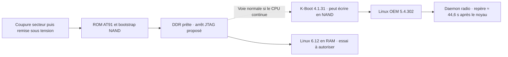

# Cozytouch — démarrage à froid du STM32

## Conclusion

**Le passage à une installation persistante reste bloqué.** La fusion Buildroot 6.12 et LuaJIT a lu CETHI et IC3 le 18 novembre 2026 après reprise d’une carte radio déjà démarrée. Le 17 novembre, un reset normal du **seul STM32**, avec Linux constructeur toujours en service mais son daemon radio arrêté, avait déjà permis ces deux lectures sans initialisation préalable du maître. Le premier essai à froid doit donc vérifier la mise sous tension, le démarrage de la pile et les deux lectures dans ce cas minimal. [Fusion sur le hub, l.54–69](../variante-fusion/essai-hub-20261118/RESULTAT.md) · [Reset STM32, l.3–16](../../analyse-2026-11-17/service-local/RESULTAT.md) · Conception durable, §7 (non publié)

**L’arrêt JTAG doit précéder l’exécution de K-Boot.** Celui-ci écrit le compteur de démarrage en NAND avant le noyau OEM 5.4.302. L’arrêt à 44,6 s ou au lancement de ce noyau arrive donc trop tard pour garantir un essai sans écriture NAND. Le lanceur actuel attend un Linux OEM déjà actif. Il faut qualifier un point d’arrêt à la sortie du bootstrap et préparer un préflight propre à cet état. Code K-Boot, l.52–105 (non publié) · Préflight v2, l.1–18 (non publié)

**Décision de <PERSONNE> si la pile reste muette après la mise sous tension.** L’action OEM de démarrage normal et le reset de secours empruntent la même séquence GPIO. Le premier scénario ne touche pas ces lignes. Un scénario distinct avec une seule activation normale par le Linux alternatif demanderait une autorisation qui nomme cette action. Gestionnaire OEM, l.91–104 et 149–184 (non publié) · Sélecteur des modes, l.26–40 (non publié)

Analyse effectuée le 18 novembre 2026 sur les fichiers locaux. Les constats matériels viennent des essais archivés. L’Inbox et la fiche Home Assistant n’ont pas été consultées dans SilverBullet, dont l’accès demande le réseau.

## 1. Ce que fait le démarrage constructeur

Le corpus de référence est celui de la banque B, `io-homecontrold` 5.3.4 et STM32 v2.4.2. **Code** désigne un comportement lisible dans les scripts ou les binaires analysés. **Observé** renvoie à un essai archivé. **Inféré** signale un rapprochement de sources qui reste à vérifier. **Inconnu** signale une mesure ou une preuve manquante. Index du corpus, l.3899–3925 (non publié) · [Révision STM32 observée, l.3](../../analyse-2026-11-17/offline-next/stm-ssh/RESULTAT-CAPTURE.md)

| Étape | Niveau de preuve et comportement | Sources |
|---|---|---|
| 1. Lancer le daemon et ouvrir l’UART | **Code.** Le script init charge la configuration de la banque. Le daemon utilise `/dev/io`, qui désigne la liaison interne USART0 (`ttyS1`). `IODriver` installe le routage et ouvre l’UART à 115 200 bit/s, 8 bits, sans parité, avant de demander `IoApplicationStarted`. Le pilote prépare la réception des trames et vérifie leur longueur, leur fin et leur CRC. **Observé.** Le daemon OEM possédait seul `ttyS1` aux contrôles du 18 novembre. | Init, l.11 et 60–81 (non publié) · Configuration livrée, l.2–4 (non publié) · IODriver, l.75–90 (non publié) · Pilote UART, l.51–111 et 152–174 (non publié) · [Fusion, l.45–48](../variante-fusion/essai-hub-20261118/RESULTAT.md) |
| 2. Sélectionner le démarrage normal de la carte radio | **Code.** Le gestionnaire arme l’attente de `STACK_START`, puis appelle le mode `start`. Le chemin est `daughterboard.sh → bootmode → setmode → io → serial_rf`. Le script abaisse PA2, configure PA3 (`TEST_RADIO=1`), PA5 (`BOOT0=0`) et PA6 (`BOOT1=0`), attend 35 ms puis remonte PA2. En mode `stop`, la consigne finale de PA2 est basse. Les modes maintenance fabricant (`update`) et ROM ST (`flash`) ont leurs propres combinaisons. **Inconnu.** Fonction électrique exacte de PA2 (reset, alimentation ou commande d’activation), niveaux des lignes au démarrage secteur et comportement sans intervention hôte. La séquence est une consigne logicielle. | Gestionnaire, l.91–104 et 195–206 (non publié) · [Liens POSIX, l.41](../../analyse-2026-11-17/service-local/linux-userland/RESULTAT.md) · bootmode, l.20–34 (non publié) · setmode, l.26–40 (non publié) · serial_rf, l.2–7 (non publié) |
| 3. Attendre la pile applicative du STM32 | **Code.** L’application en Flash installe l’API UART, construit sa pile et initialise elle-même le Si446x. Elle prépare `STACK_START` (information générale `0x0403`, événement 4), un MD5 en cache (`0x0517`) et la cause du reset (`0x050e`). Le processeur Lua de l’événement appelle le gestionnaire, qui marque la pile démarrée et résout l’attente. **Inconnu.** Ordre et délais sur le fil à la mise sous tension et disponibilité des notifications si l’UART hôte ouvre tard. Le comportement de `POLLING` dépend de l’état de la pile. | [Analyse STM32, l.120–142 et 166](../../analyse-2026-11-17/continuation-radio/stm-real/RESULTAT.md) · Contrat UART, l.19–21 (non publié) · Processeur d’événement, l.14–30 (non publié) · Gestionnaire, l.78–104 (non publié) |
| 4. Lire la révision logicielle | **Code.** Pour `IoApplicationStarted`, après `STACK_START`, le gestionnaire fait un GET local de révision logicielle puis compare par égalité à la cible. La cible par défaut de la banque B est v2.4.2. Une révision différente ou l’absence de `STACK_START` peut déclencher l’updater local, même sans WAN. La sentinelle `IO_SOFTWARE_REVISION=DO-NOT-UPDATE` bloque les deux déclencheurs étudiés lorsqu’elle est effective au lancement. Un appel direct à l’updater ou une relance déjà engagée reste possible. **Observé.** Un GET a confirmé v2.4.2 sur l’UART actif le 17 novembre. | Gestionnaire, l.106–140, 219–247 et 345–368 (non publié) · Configuration Lua, l.1–9 (non publié) · [Audit updater, l.45–65](../updater-stm32-sol/RAPPORT.md) · [Capture de version, l.3](../../analyse-2026-11-17/offline-next/stm-ssh/RESULTAT-CAPTURE.md) |
| 5. Charger le contexte local du maître | **Code.** Si le nœud de pile existe côté hôte, le daemon demande `SET KEY` puis `SET ADDRESS` à l’accesseur local du maître (`0x0502)). Il attend la fin de chaque commande. Le désassemblage Lua confirme les champs du nœud utilisés. Les chemins étudiés du STM32 installent ce contexte en SRAM. Le traitement est distinct de l’appairage et du transfert de clé à un appareil radio. **Inconnu.** Ces deux SET ne sont pas établis comme nécessaires après une coupure secteur. | Gestionnaire, l.250–253, 269–286 et 407–412 (non publié) · Contrat UART, l.9–23 et 42–54 (non publié) · [Référence STM32, l.79–103 et 146–152](../../analyse-2026-11-17/continuation-radio/stm-real/RESULTAT.md) |
| 6. Déclarer le service prêt et lire un appareil | **Code.** Après les deux SET, le daemon émet `Ready` dans Linux puis lit la calibration et le numéro de série pour alimenter ses états. Aucune ouverture de session UART distincte n’apparaît dans cette chaîne. Les lectures de l’alternative passent chacune leur contexte de nœud dans la demande et attendent leur réponse terminale. **Observé.** Après reset du STM32 seul, les deux lectures ont réussi sans SET préalable. **Inconnu.** La généralisation aux autres opérations, aux autres profils et à la mise sous tension complète reste à établir. | Gestionnaire, l.269–301 (non publié) · [STM32, l.67–103](../../analyse-2026-11-17/continuation-radio/stm-real/RESULTAT.md) · [Essai après reset, l.3–16](../../analyse-2026-11-17/service-local/RESULTAT.md) |

### Sens de `warm_session_required`

Le service LuaJIT écrit ce champ à `true` de façon fixe dans chaque état MQTT. Il prend le port en exclusivité et se déclare prêt après 300 ms de silence série avec un tampon vide, dans une fenêtre d’une seconde. Un événement de reset reçu pendant cette phase ou pendant les lectures fait arrêter le client. Le service ne masque donc pas une initialisation à froid déjà codée. Son hypothèse est que l’application STM32 fonctionne et peut accepter directement la requête de lecture. Le silence série ne mesure ni le démarrage de la pile, ni l’origine du contexte, ni la présence de la clé du maître en SRAM. L’essai après reset du STM32 seul utilisait déjà un diagnostic fixe `warm_session=true`, malgré le reset préalable. Service MQTT, l.28–52 (non publié) · [Client UART, l.183–225](../../analyse-2026-11-17/buildroot-ram/variante-service-20261118/overlay/usr/share/cozytouch/mqtt/uart.lua#L183) · Constat après reset, l.3–7 (non publié)

## 2. Initialisation minimale du service alternatif

1. **Réserver l’USART0 tôt.** Garder la console et le getty sur un autre port. Ouvrir `ttyS1` en exclusivité et enregistrer les marqueurs d’amorçage sans données privées. Si le STM32 démarre pendant le chargement JTAG, la capture passive commencée à la mise sous tension couvre le début que Linux a manqué. DTS et séparation des UART, l.5–10 (non publié)
2. **Distinguer le démarrage attendu d’une perte de contexte.** Dans l’état de démarrage, reconnaître les notifications de pile et de reset et confirmer v2.4.2 par un GET applicatif de révision avec réponse corrélée. Accepter la preuve passive du `STACK_START` si l’ouverture de l’UART arrive plus tard dans le même cycle d’alimentation. Après la mise en service, tout nouvel événement de reset invalide la transaction active et arrête l’essai. Le timeout d’amorçage et celui d’une lecture doivent être distincts et fixés avant l’essai. [Analyse STM32, l.130–144](../../analyse-2026-11-17/continuation-radio/stm-real/RESULTAT.md)
3. **Réutiliser les deux lectures qualifiées.** Consommer leurs contextes existants depuis le stockage privé en RAM. Garder une requête en vol et la corrélation jusqu’au statut terminal. Le premier scénario omet les SET du maître, la lecture de calibration et la lecture du numéro de série. Un échec isolé ne les rend pas nécessaires. Si l’analyse d’un échec désigne le contexte du maître, soumettre à <PERSONNE> un scénario séparé pour les éventuels SET locaux en SRAM. Le premier essai reste limité aux opérations de lecture et n’installe aucun nouveau contexte par accesseur. Contrat UART, l.44–54 (non publié)
4. **Isoler la voie d’échec.** Révision inconnue ou différente, délai dépassé, reset imprévu ou UART non exclusif conduisent à l’arrêt. Exclure les exécutables de maintenance, les images de mise à jour STM32 et toute relance automatique du chemin d’initialisation. Le mode `HardReset` OEM fait `stop → purge UART → start` et peut se rappeler en cas d’échec. L’activation normale examinée pour un second scénario serait un geste unique décidé par <PERSONNE>, avec la nature et les niveaux des lignes vérifiés au préalable. Aucun appairage, aucune découverte active, aucune commande de chauffe ni opération de maintenance ne fait partie de ce plan. Gestionnaire, l.149–184 et 303–342 (non publié) · [Audit des deux modes de maintenance, l.45–65](../updater-stm32-sol/RAPPORT.md)

## 3. Plan de l’essai en RAM — à autoriser par <PERSONNE>

### Fenêtre et chronologie

**Observé.** La capture de console de démarrage montre `RomBOOT`, le test DDR et l’identification de la NAND. Elle ne chronomètre pas l’entrée K-Boot ni le premier accès au STM32. **Code.** Le bootstrap charge K-Boot et son DTB, puis transfère le contrôle à K-Boot. L’analyse binaire situe ce transfert à l’offset NAND `0x2958`, après vérification du format d’image. Cet offset est un repère de désassemblage. Son adresse d’exécution, le mode ARM/Thumb et l’état DDR à cet endroit doivent être résolus et vérifiés avant de configurer un point d’arrêt matériel. Le rendu Mermaid n’a pas été vérifié. Capture DBGU, l.1–3 (non publié) · [Analyse bootstrap et K-Boot, l.41–58 et 70–74](../kboot-bootloader-sol/RAPPORT.md)

**Point d’arrêt candidat.** Après le dernier accès NAND nécessaire au bootstrap et l’initialisation DDR, avant le transfert vers K-Boot 4.1.31. Qualifier le chemin exécuté jusqu’au point d’arrêt pour exclure une commande NAND d’écriture, une action sur les GPIO radio et un dialogue hôte sur l’USART0. Le code de K-Boot incrémente le compteur, peut corriger le pointeur, appelle `sync` et peut remonter la racine en écriture avant `kexec`. Une capture DBGU seule ou un halt déclenché au chronomètre ne démontre pas que K-Boot n’a pas commencé. Le repère de **44,6 s après l’entrée du noyau 5.4.302** est fourni pour le lancement du daemon radio. Je n’ai pas retrouvé le journal correspondant dans les preuves locales. Même confirmé, ce repère n’établirait ni le premier contact possible avec le STM32 ni une fenêtre sans écriture NAND. K-Boot, l.52–118 et 144–154 (non publié) · [Risques K-Boot, l.42–54](../../analyse-2026-11-17/service-local/linux-boot/RESULTAT.md)

### Watchdog AT91 et reprise du lanceur

| Point à contrôler | Conséquence |
|---|---|
| AT91 arrêté tôt | **Inconnu à cette étape.** Lire le mode réel et la cause du dernier reset au point d’arrêt, sans modification du mode. Le registre de mode ne se programme qu’une fois entre resets. Le pilote 6.12 conserve le mode hérité s’il diffère de la valeur de reset. Si le watchdog est actif, le compteur matériel vaut environ 16 s au maximum. Établir l’effet de `WDDBGHLT` et la tenue du chemin JTAG au point d’arrêt avant tout transfert long. Si le mode est inconnu, si le gel attendu ne se confirme pas ou si l’état du CPU change, arrêter. [Complément watchdog, l.163–219](../internald-quiescence-grok/RAPPORT-COMPLEMENT.md) · Pilote 6.12, l.157–172 (non publié) |
| Référence à chaud | Le mode `0x1fff2fff` observé sous OEM indique watchdog actif, reset matériel autorisé et gel en debug demandé. Les 60 s d’`internald` sont un délai logiciel de battement. Le minuteur noyau s’arrête avec le CPU. Les délais de pause constatés à chaud ne donnent aucun budget de pause pour le bootstrap. Après reprise, garantir la prise en charge suffisamment tôt par le pilote puis le gardien utilisateur. RAM4 a déjà journalisé ces étapes à 1,382 s et 3,187 s dans son scénario à chaud. [Qualification, l.9](../../analyse-2026-11-17/acces-admin/QUALIFICATION-MATERIELLE.md) · [Complément, l.197–219](../internald-quiescence-grok/RAPPORT-COMPLEMENT.md) · RAM4, l.7–15 (non publié) |
| Préflight actuel | Il exige la cible arrêtée, le mode watchdog observé à chaud, les straps de carte et une MMU active. Il vérifie la stabilité de CE, le signal NAND prêt et l’absence de DMA NAND dans le contexte OEM qualifié. Le lanceur compare aussi l’identité réseau lue dans les registres du contrôleur. À la sortie du bootstrap, la MMU, le multiplexage GPIO, les horloges, le DMA et le contrôleur réseau peuvent être dans un autre état. Exiger des contrôles adaptés, avec identité de carte et audit DDR indépendants. Préflight, l.1–46 (non publié) · Lanceur, l.240–250 et 335–357 (non publié) |
| Quiescence actuelle | P1 met au repos un Linux déjà démarré. Elle garde `internald` vivant, synchronise et remonte les volumes. Elle n’a pas lieu au point d’arrêt avant K-Boot. La quiescence électrique actuelle vérifie puis modifie USB, MACB et HDMAC. À froid, auditer les périphériques et les maîtres du bus réellement actifs. Privilégier des preuves en lecture seule pour les périphériques déjà inactifs et revoir toute intervention indispensable. Requalifier aussi `soft_reset_halt` et la conservation de la DDR et du point d’arrêt avant de les utiliser dans ce contexte. [Rapport P1, l.263–298](../internald-quiescence-grok/RAPPORT.md) · Quiescence électrique, l.29–91 (non publié) · Lanceur, l.357–389 (non publié) |

### Déroulement et critères d’arrêt

1. **Préparer les preuves avant la coupure.** Revoir hors matériel le point d’arrêt, les références binaires, le budget watchdog, les empreintes des trois images et le retour indépendant. Rendre le réseau inaccessible au cloud dès la remise sous tension. Prévoir une capture passive de la console et, si le câblage est qualifié, des lignes UART radio et du rail d’alimentation STM32. La journalisation conserve des événements et des statuts expurgés. Avant de couper un OEM en cours de fonctionnement, confirmer l’absence d’updater engagé et convenir de l’arrêt initial avec <PERSONNE>. Les vidages éventuellement autorisés sur l’OEM avant la coupure relèvent de cette préparation. Conception durable, §3–4 et §7 (non publié) · [Audit updater, l.60–73](../updater-stm32-sol/RAPPORT.md)
2. **Établir le froid électrique.** Couper l’alimentation du hub et constater que le rail STM32 retombe, sans réalimentation par le JTAG ou un adaptateur série. Démarrer les captures avant la remise sous tension. Prépositionner un arrêt matériel sur le transfert qualifié après la DDR et conserver un seul contrôleur JTAG. La configuration actuelle déclare `reset_config none`. Elle ne garantit ni un arrêt sous reset physique ni la pose du point d’arrêt à temps. Si l’attache précoce, le PC attendu ou l’absence de passage par K-Boot ne sont pas établis, clore ce passage. Configuration JTAG, l.1–14 (non publié)
3. **Vérifier avant le chargement.** Prouver que le PC appartient au chemin bootstrap attendu, que la DDR et son rafraîchissement sont opérationnels, et que la NAND est prête avec des lignes stables et aucun DMA associé. Conserver l’historique des phases pour exclure toute activité OEM vers le STM32. Vérifier le watchdog, l’état MMU/caches et la disponibilité des zones RAM. Charger puis relire intégralement noyau, DTB et initramfs par SHA-256. Contrôler l’ABI d’entrée ARM et journaliser le saut. Un acquittement JTAG établit la demande de saut. La preuve du démarrage vient du noyau et du PID 1. Lanceur, l.273–298 et 363–392 (non publié)
4. **Faire les mesures RAM et radio.** Vérifier Linux 6.12, racine et `/run` en RAM, watchdog stable, confinement réseau et absence de MTD, UBI, périphérique bloc et `/dev/mem`. Vérifier la pile applicative et sa révision, avec un seul propriétaire UART. Exiger un READ frais CETHI puis un READ frais IC3, chacun de bout en bout, **`DONE` et `0/5/0`** (commande, exécution, détail), sans CRC rejeté, reset imprévu ni réponse tirée du cache. Horodater la mise sous tension, le halt, l’entrée noyau, les événements UART, la révision, puis chaque réponse. Après les deux lectures, vérifier que l’UART est restauré et libre. La qualification complète du service MQTT ajoute les PUBACK reçus par le service et la confirmation des états par un abonné indépendant, la reprise du courtier et une répétition après nouvelle coupure autorisée. [Qualification FUSION, l.62–65](../variante-fusion/essai-hub-20261118/RESULTAT.md) · [Corrélation et statuts, l.77–100](../../analyse-2026-11-17/buildroot-ram/variante-service-20261118/overlay/usr/share/cozytouch/mqtt/uart.lua#L77) · Autonomie, §7 (non publié)
5. **Arrêter au premier écart.** Clore l’essai sur perte de preuve du froid, activité OEM, défaut JTAG, watchdog hors budget, activité NAND, DDR non qualifiée, image différente, erreur UART, révision non conforme, absence de réponse attendue ou statut différent. Consigner la dernière étape établie et la raison de l’arrêt. Garder le chemin de retour propre à l’état atteint. Après prise de contrôle ou état incertain, aucune reprise de l’ancien PC, aucun reset radio de secours et aucune nouvelle lecture automatique. Si un indice montre une programmation déjà engagée, suspendre la coupure et laisser <PERSONNE> décider sur cet état. Lanceur, l.394–423 (non publié) · [Audit updater, l.67–73](../updater-stm32-sol/RAPPORT.md)
6. **Revenir au constructeur par le démarrage NAND d’origine.** Après arrêt sûr, libérer OpenOCD et remettre les lignes JTAG en entrée selon la procédure revue, puis laisser <PERSONNE> couper et rétablir l’alimentation. Vérifier la reprise OEM avec la voie de santé autorisée, sans attendre le retour du SSH temporaire. Le périmètre « sans écriture NAND » s’applique à l’essai RAM et à son trajet jusqu’au saut alternatif. Le redémarrage OEM exécute ensuite ses écritures normales de démarrage. Le retour doit aussi être revu pour le risque d’updater radio local au premier démarrage. Le contexte de mission indique un démarrage NAND vérifié le 18 novembre. Les pièces locales consultées attestent un **retour par reset vers la NAND** avec présence réseau à l’essai 03, et un **retour direct OEM RAM03** avec deux READ à l’essai 04. Le résultat FUSION s’arrête avant la coupure prévue. Le reçu qui établirait le retour secteur après FUSION reste à rattacher au plan, sans assimiler ces trois parcours. [Essai 03, l.104–119, et essai 04, l.126–141](../../analyse-2026-11-17/buildroot-ram/variante-service-20261118/RESULTAT.md) · [État à la fin de FUSION, l.67–71](../variante-fusion/essai-hub-20261118/RESULTAT.md) · Libération JTAG, l.1–28 (non publié)

## 4. Changements à préparer dans de nouvelles versions

| Composant | Changement proposé |
|---|---|
| Lanceur et préflight | Préparer un parcours dédié à l’arrêt après bootstrap. Valider hors matériel la résolution de l’adresse d’arrêt et le chemin parcouru. Remplacer les préconditions propres à l’OEM actif par des preuves explicites de l’état bootstrap, de la DDR, du watchdog, de l’identité de carte et de l’inactivité NAND/DMA. Garder le parcours à chaud séparé. Maintenir l’audit des images et des zones RAM, les relectures complètes, le compte rendu des phases et un point de non-reprise explicite. Retirer la reprise automatique du PC pour le cas froid. Évaluer le reset CPU et le nourrissage déjà revus à chaud avant de les réemployer. |
| Image Linux / PID 1 | Garantir le watchdog avant toute attente UART, SSH ou réseau. Marquer séparément l’amorçage et la disponibilité de l’administration, dont l’entropie peut retarder l’ouverture. Garder le filtrage avant réseau, `ttyS1` vide de console, l’exclusion MTD/UBI/bloc et le stockage de travail en RAM. Prévoir un démarrage UART d’observation qui fonctionne même si le courtier est absent. Si le scénario GPIO est approuvé, traiter le pinctrl, la polarité, la durée et le maintien des lignes comme des préconditions de cette variante. |
| UART et service MQTT | Ajouter un état d’amorçage avec provenance mesurée de la preuve, un GET de révision borné et la perte de contexte après un nouveau reset. Garder la liste des deux lectures autorisées, la corrélation et les délais. Faire évoluer le champ `warm_session_required` seulement quand un chemin froid est qualifié. Journaliser séparément le mode demandé et les preuves obtenues. Vérifier hors ligne les notifications avant ouverture, celles intercalées, les CRC, les délais, le reset avant et pendant une lecture et l’arrêt sans repli. Utiliser des données d’essai synthétiques pour ces vérifications. |

Les changements ci-dessus sont des propositions. Les scripts, images, preuves, documents historiques et notes du projet n’ont pas été modifiés.

## Résumé

- La fusion fonctionne à chaud. Le reset du seul STM32 a aussi permis les deux lectures sans SET du maître.
- Le premier essai à froid doit couper réellement le rail STM32 et arrêter l’AT91 après la DDR, avant K-Boot.
- K-Boot peut écrire en NAND avant le noyau OEM. Le départ du daemon vers 44,6 s arrive trop tard.
- Le watchdog au point d’arrêt reste à qualifier. Le préflight et la quiescence à chaud ne s’y appliquent pas en l’état.
- Essai à autoriser par <PERSONNE>. Réussite si CETHI et IC3 donnent chacun `DONE 0/5/0` avec preuve du froid et sans passage OEM.
- Une activation GPIO normale éventuelle exige une décision séparée. Avant tout essai, rattacher la preuve du retour secteur et revoir le risque d’updater OEM au retour.

> Les empreintes historiques des fichiers expurgés se rapportent aux originaux privés.
