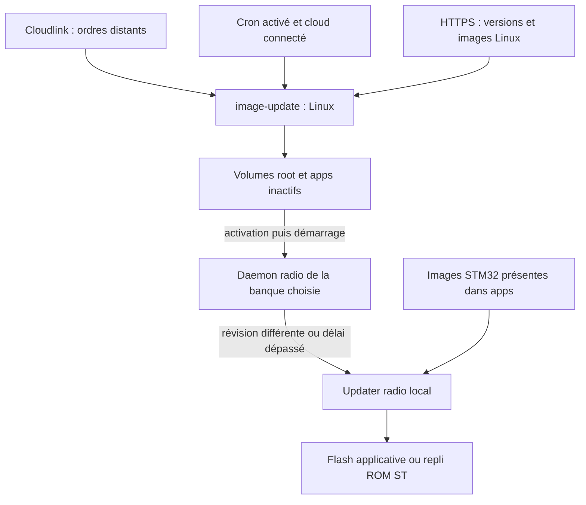

# Cozytouch — mises à jour Linux et STM32 hors cloud

Analyse statique du 18 novembre 2026. **Couper le cloud ne suffit pas à protéger le STM32 : le daemon OEM peut lancer un flash avec une image déjà présente dans la NAND.** Il faut donc protéger séparément la banque Linux et le démarrage du daemon radio.

Les références sont relatives à `analyse-2026-11-17/`, sauf celles qui commencent par `../`. Les sources principales correspondent à `internald` 1.4.1 et `io-homecontrold` 5.3.4 de `appsB` (`mori/internal-modules-index.json:224–240` ; `lua/embedded-index.json:3899–3906,4836–4842`). Le retour OEM du 17 novembre 2026 à 23 h 24 CET est un constat historique. La reprise précise de ne pas présumer que l’ancien blocage en RAM a survécu (`../REPRISE.md:7,15`). Aucun accès réseau ni contrôle matériel n’a été effectué pour ce rapport.

Le lien Linux → radio est indirect. Un changement de banque peut charger un autre daemon et d’autres images radio. Le daemon peut aussi déclencher l’updater radio sans changement de banque ni cloud. Le schéma représente le code étudié ; rendu Mermaid non vérifié.

## 1. Déclencheurs et transports Linux

| Déclencheur | Comportement démontré | Source |
|---|---|---|
| `updateAuto` | Le daemon lit le réglage au démarrage. Il est désactivé par défaut et vaut `false` dans la copie sauvegardée. S’il est activé, le cron programme une vérification quotidienne à une heure tirée au sort, sans lancement immédiat. Si Cloudlink n’est pas `connected`, la vérification est rejetée. Le cron prévoit un nouvel essai après une heure en cas de rejet ; un retour non nul du script est journalisé sans rejet explicite dans cette branche. | `mori/internal-modules/e308377a82f350615cbb72f546c5f949a9c37140475e523da6996ddf65e712f8.lua:12,27–160` ; `lua/all/appsB/overkiz/lib/lua/Overkiz/RandomCron.lua:3–89` ; `extracted/persistent/apps/overkiz/updateAuto.txt:1–8` |
| Suite automatique | Lance `root`, `apps`, puis `upgrade`. Le statut `updated` déclenche la planification du redémarrage. `startAt`, `endAt` et `spanDays` règlent ce redémarrage, pas l’heure de vérification. Arrêter le cron n’annule pas le travail déjà lancé. | `mori/internal-modules/e308377a82f350615cbb72f546c5f949a9c37140475e523da6996ddf65e712f8.lua:16–69,90–103` ; `mori/internal-modules/5d27054798afe7d0dbd7675226d5b7a58f0f25b4679c61ac566da5b2ade9c327.lua:78–109` ; `lua/all/appsB/overkiz/lib/lua/Overkiz/RandomCron.lua:79–89` |
| Demandes `download` et `update` | Le nœud Pod expose des chemins distincts du cron, sans garde `updateAuto`. Malgré son nom, `download` peut écrire les banques Linux ; l’activation dépend de la demande. `update` sélectionne les cibles système, applications, sécurité, bootstrap ou bootloader Linux et peut demander un forçage ou un redémarrage. | `mori/internal-modules/f66cfca569a249b7793ad8144ff8d17eafb56e10d90a82d3e9f36968b5558533.lua:28,48–67` ; `mori/internal-modules/97f31b169132538a3f9ec185aea5fcafc4eb268503217ff79fb8a7739c0e2361.lua:29–50,70–82` ; `mori/internal-modules/8d65a5f32ef78731e404a704d43cc0c4480b5d3a2ce4e41a5bfbe3558a8fc6a5.lua:9–30,68–103` |

**Canal de commande.** Le descripteur sauvegardé configure un amorçage Cloudlink en HTTPS sur 443, avec certificat client, clé et CA, puis un canal persistant `tcp+eap` sur 803. Il déclare aussi un canal « bypass » sur 18888. Le fichier montre la configuration, pas le chiffrement exact des canaux, leur utilisation actuelle, ni un transport MQTT. Les chemins des éléments d’authentification figurent dans `extracted/data/dispatcher/connections/si.xconf:3–7` (`mori/RAPPORT.md:15–31` ; `SYNTHESE.md:109–126`).

**Canal des images.** `image-download` récupère les métadonnées de version et les fichiers séparément par HTTPS avec `curl`. La configuration du certificat client, de la clé et de la CA se trouve dans `etc/curl.d/pod-serial.conf`, dans l’archive ci-dessous. Le code accepte aussi des sources locales, et `image-update` peut écrire sans nouveau téléchargement. La version, la compatibilité des applications et le MD5 déterminent si l’écriture a lieu et si elle est acceptée. Le MD5 est un contrôle de contenu, pas une preuve de signature cryptographique des images `root`/`apps` ; l’authentification TLS relève du transport (`extraction/rootB-corrected-posix.tar` → `usr/sbin/image-download:18–33,67–89,160–204`, `usr/share/image-download-functions.sh:14–48`, `etc/curl.d/pod-serial.conf:1–3` ; `extracted/rootB/usr/sbin/image-update:314–344,548–623` ; `extracted/rootB/usr/share/image-update-functions.sh:158–197,574–599,660–749`).

**`UPDATE_URL` vide n’est pas une protection.** Le script d’environnement recharge la valeur depuis `envvars` du volume sécurité si elle est vide ou absente. Cloudlink a sa propre configuration. Ni cette variable à elle seule ni le blocage d’un seul port ne couvrent les deux transports (`extracted/rootB/usr/share/kizosenv.sh:253–264` ; `extracted/data/dispatcher/connections/si.xconf:3–7`).

Le module d’administration expose aussi des demandes distinctes de redémarrage et de mise à niveau du bootloader Linux. À l’inverse, le getter `recovery` examiné lit un marqueur de récupération ; sa lecture n’écrit pas la flash (`mori/internal-modules/0ee2f9d2cd7f09268182cb78ba20e7a6c2d63493e97e1341bfc29c7fa0732dbe.lua:5–11` ; `mori/internal-modules/c7c8da085a581de5d4d0957d93717dc035279010756a6b8c96366fd2589d427c.lua:5–16`).

## 2. Portée des écritures Linux

- **Trajet courant.** Les images UBIFS, normalement compressées en XZ, remplacent le contenu des volumes `root` et `apps` **inactifs** si nécessaire. Le script compare les métadonnées de version. Une image inactive jugée conforme peut être réutilisée sans réécriture. `upgrade` contrôle les étapes ou marqueurs requis, puis choisit la racine du prochain démarrage sans télécharger d’image à cette étape. Au démarrage, la racine sélectionne le volume `apps` associé (`extracted/rootB/usr/sbin/image-update:15–16,359–388,545–661` ; `extracted/rootB/usr/share/image-update-functions.sh:158–240,660–749` ; `extracted/rootB/etc/init.d/mount-apps.sh:7–30`).
- **État persistant.** Le trajet courant ne reformate pas intégralement `/persistent`. Il peut modifier les métadonnées de version et marqueurs de `/persistent/boot/update`, `boot_information_file` et les marqueurs de post-installation, et sauvegarder vers `persistent-spare`. Un `upgrade` forcé peut demander la réinitialisation de `/data` au prochain boot. Des tâches de post-installation peuvent aussi migrer les données (`extracted/rootB/usr/share/kizosenv.sh:42–45` ; `extracted/rootB/usr/sbin/image-update:582–588,614–682` ; `extracted/rootB/usr/share/image-update-functions.sh:234–240,488–539,735–749` ; `extracted/rootB/usr/share/post-install/scripts/kizbox-update:32–59`).
- **Cibles explicites.** Les chemins `security`, `bootstrap` et `bootloader` peuvent modifier le stockage de sécurité, les composants d’amorçage Linux et, selon la cible, leurs copies de secours ou le DTB. Le bootloader de cette commande n’est pas celui du STM32. Le trajet `root → apps → upgrade` ne programme pas directement la radio : il peut remplacer les fichiers qu’utilisera le prochain `io-homecontrold` (`extracted/rootB/usr/sbin/image-update:391–542,545–661` ; `extracted/appsB/overkiz/share/io-homecontrol/scripts/fwupdate.sh:5–20`).

La copie extraite pointe vers `rootB` dans `extracted/persistent/boot/boot_information_file:1`. Les marqueurs `update_root_needed` et `update_apps_needed` n’apparaissent pas dans `extracted/persistent/boot/update/`. Cela ne confirme ni la banque active aujourd’hui ni l’absence de travail en cours ou déjà préparé (`extracted/rootB/usr/sbin/image-update:359–389,635–658`).

## 3. Mise à jour du STM32 radio

**Déclenchement autonome.** Au lancement d’`io-homecontrold`, `IODriver` demande un démarrage avec le motif `IoApplicationStarted`. Le gestionnaire lance l’updater dans deux cas : le délai d’attente de `STACK_START` expire avant le démarrage de la pile, ou la révision lue sur l’UART ne concorde pas. Dans les deux cas, le prédicat « à jour » doit être faux. Le motif de reset interne `HardReset` ne prend pas ces deux branches. L’updater arrête la carte, déconnecte l’UART d’exploitation et lance le script. En cas de succès, il redémarre la pile et relit sa révision. Certains échecs entraînent des relances dans le processus déjà engagé (`lua/embedded/1f01de8c6342/IODriver.lua:75–90` ; `lua/embedded/fdd03dfe52a6/DaughterBoardManager.lua:79–140,168–184,219–247,303–368`).

**Images dans la NAND.** Chaque banque contient sous `overkiz/share/io-homecontrol/bin/` deux binaires plats : l’image complète de 262 144 octets et l’image applicative de 251 904 octets. L’application est le suffixe exact de l’image complète à l’offset `0x2800`. Avant elle se trouvent 8 Kio de bootloader puis 2 Kio de données propres à la carte, vierges dans l’image complète livrée. Un pied contient le MD5 binaire du corps contrôlé. Les banques extraites embarquent v2.4.1 (`apps`) et v2.4.2 (`appsB`). Le script fixe les fichiers de sa banque ; il ne sélectionne pas l’image d’après la version passée en second argument par Lua (`stm32/README.md:7–27` ; `extracted/apps/overkiz/share/io-homecontrol/scripts/fwupdate.sh:5–9` ; `extracted/appsB/overkiz/share/io-homecontrol/scripts/fwupdate.sh:5–9,77–87,114–136` ; `lua/embedded/5c0ebe3e76c4/conf.lua:6–9` ; `lua/embedded/444bba40e3e8/conf.lua:6–9`).

| Chemin | Protocole, portée et vérification |
|---|---|
| Bootloader fabricant | Le script met la carte en mode maintenance et utilise `fw-updater` sur l’UART interne. Il mesure le MD5 du corps et vérifie le pied : si le MD5 cible et le pied concordent, il saute l’écriture. Sinon, il peut remplacer l’application à partir de `0x08002800`, sans viser le bootloader ni le secteur de personnalisation. Après écriture, il compare le pied au MD5 **mesuré de nouveau**, pas directement au MD5 cible. Le fichier local suffit ; un téléchargement est prévu s’il manque. (`extracted/appsB/overkiz/share/io-homecontrol/scripts/fwupdate.sh:28–35,46–110`.) |
| Repli par la ROM ST | Une sauvegarde `oldval.bck` préexistante ou un échec de la voie fabricant peut mener à `stm32-upgrader`. Ce script préfère le binaire complet et le MD5 fournis localement. Selon le résultat du premier contrôle, il peut passer en ROM ST, lever la protection, effacer et réécrire la flash via `stm32flash`. Il compare ensuite le MD5 signalé par l’application à la valeur attendue. Il sauvegarde des données sous `/persistent/root`, mais sa routine de restauration écrit la calibration, pas une copie intégrale du secteur de personnalisation. Même sans reflash, le chemin legacy peut restaurer une calibration jugée invalide. (`extracted/appsB/overkiz/share/io-homecontrol/scripts/fwupdate.sh:13–20,128–139` ; `extracted/rootB/usr/sbin/stm32-upgrader:67–100,104–124,137–179,191–199,213–320`.) |

L’UART d’exploitation (trames avec STX, longueur et CRC) est distinct des protocoles de maintenance. Le bootloader fabricant utilise une synchronisation série dédiée et des commandes de contrôle d’intégrité, de lecture et d’écriture. Le repli utilise le protocole série de la ROM ST, dans un autre mode de démarrage. L’audit du bootloader fabricant a aussi relevé une branche conditionnelle d’écriture des options de protection. Le passage en maintenance n’est donc pas un contrôle passif (`stm32/README.md:31–59` ; `offline-next/boot-read-audit/RESULTAT.md:7–54` ; `extracted/rootB/usr/share/stm32-utils/setmode:26–40`).

**Risque pour v2.4.2.** Deux dumps historiques identiques ont confirmé v2.4.2 ; ils diffèrent de l’image complète livrée par 48 octets de personnalisation. Le gestionnaire teste l’**égalité** des révisions, pas leur ordre. La banque `apps` étudiée peut donc demander un retour à v2.4.1, tout comme une future banque OEM pourrait embarquer une version ultérieure. Le contrat UART pourrait changer ; aucune incompatibilité avec une version précise n’a été démontrée ici. Le repli ROM peut aussi modifier la personnalisation, indépendamment de la version (`../donnees/stm32-live-2026-11-17/README.md:3–29` ; `lua/embedded/fdd03dfe52a6/DaughterBoardManager.lua:219–247,345–368` ; `extracted/apps/overkiz/share/io-homecontrol/scripts/fwupdate.sh:5–9` ; `extracted/rootB/usr/sbin/stm32-upgrader:248–318`).

## 4. Conditions de neutralisation sûre

1. **Couper les accès constructeur avant le démarrage des services concernés.** Le confinement doit empêcher Cloudlink de recevoir de nouveaux ordres et les scripts HTTPS de récupérer métadonnées ou images, sur IPv4 comme sur IPv6. Cela ne bloque pas un appel local ni une étape prête à s’exécuter hors ligne. La couverture du confinement n’est pas vérifiée sur le matériel (`extracted/data/dispatcher/connections/si.xconf:3–7` ; `extracted/rootB/usr/share/kizosenv.sh:253–264` ; `extraction/rootB-corrected-posix.tar` → `usr/share/image-download-functions.sh:14–48`).
2. **Empêcher le départ du cron et exclure une mise à jour déjà engagée.** Garder `updateAuto=false` empêche le départ du cron étudié. Pour conserver aussi la banque Linux en service, exclure les demandes manuelles ou locales, un processus déjà lancé, une bascule préparée et un redémarrage de mise à jour déjà programmé. Contrôler la racine en cours et celle prévue : `upgrade` retire les marqueurs après avoir changé la cible de boot (`mori/internal-modules/e308377a82f350615cbb72f546c5f949a9c37140475e523da6996ddf65e712f8.lua:16–160` ; `extracted/rootB/usr/sbin/image-update:359–389,635–682`).
3. **Neutraliser le déclenchement radio dans le processus responsable.** Pour les deux daemons OEM étudiés, **`IO_SOFTWARE_REVISION=DO-NOT-UPDATE`**, effective dès leur lancement, rend le prédicat « à jour » vrai même sans révision lue. Elle bloque les deux départs automatiques observés sans désactiver l’initialisation normale si la carte répond. Elle ne répare pas une carte qui ne démarre pas, ne bloque ni un appel direct à l’updater ni une relance déjà engagée, et n’est pas un verrou global d’écriture. Une cible `v2.4.2` ne protège pas du timeout sans révision ; vider `IO_UPDATE_SCRIPT` provoque une erreur. Le lanceur charge et exporte la configuration de la banque active. Vérifier la valeur réellement lue et sa réapplication par le superviseur, plutôt qu’une valeur déclarée dans un shell (`lua/embedded/fdd03dfe52a6/DaughterBoardManager.lua:26,122–140,209–247,303–368` ; `lua/embedded/bddf31a5bb47/DaughterBoardManager.lua:26,122–140,240–247,345–368` ; `lua/embedded/444bba40e3e8/conf.lua:6–9` ; `extracted/rootB/etc/init.d/io-homecontrol:11,146–169`).
4. **Avec un service radio indépendant**, vérifier qu’il n’embarque ni chemin de maintenance ni appel à l’updater et que le superviseur OEM ne relance pas un daemon concurrent. C’est une condition de conception. Le prototype autonome du 17 novembre a fonctionné avec un STM32 déjà initialisé ; il ne prouve pas un démarrage à froid (`../REPRISE.md:7–11` ; `lua/embedded/fdd03dfe52a6/DaughterBoardManager.lua:303–342`).

Ces conditions couvrent **les chemins identifiés**, pas toute possibilité d’écriture par un administrateur ni une autre version OEM. Elles n’impliquent aucune modification persistante et ne justifient pas d’arrêter un flash en cours.

## 5. Vérifications matérielles sur autorisation séparée

1. **Avant tout redémarrage**, contrôler en lecture seule la paire `root`/`apps` active et celle prévue, les mises à jour en cours, les marqueurs de bascule et de reprise radio, le superviseur et la sentinelle effective du processus. Ne relever que les états nécessaires, pas l’environnement complet. Si un flash paraît engagé, s’arrêter au constat (`extracted/rootB/usr/sbin/image-update:359–389,635–682` ; `extracted/rootB/usr/sbin/stm32-upgrader:191–229` ; `../REPRISE.md:7,15`).
2. Vérifier le confinement IPv4/IPv6 sans contacter le constructeur. Confirmer v2.4.2 et la santé UART par observation passive ou lecture OEM déjà qualifiée, sans mode maintenance ni émission radio de test. Ne pas réutiliser le client historique `OUTPUT_RAW` : la reprise signale des commandes Linux non terminées et des resets (`../REPRISE.md:9–17` ; `../donnees/stm32-live-2026-11-17/README.md:19–37`).
3. Vérifier la tenue après relance ou démarrage à froid seulement sur décision distincte, avec un moyen de reprise validé. Ne pas simuler de perte de `STACK_START`, ne pas forcer le passage en bootloader et ne pas redémarrer pour voir. La tenue du confinement et de la garde radio au démarrage à froid reste **non vérifiée** (`../REPRISE.md:7–11` ; `lua/embedded/fdd03dfe52a6/DaughterBoardManager.lua:91–140`).
